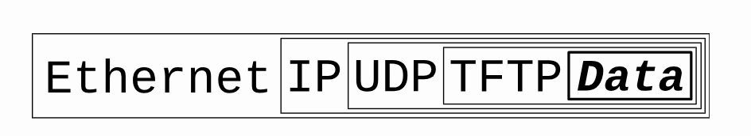

# Chapter 2: What is a Socket? 

| Topic | Description |
|---|---|
| Core idea | A socket is a way for programs to **communicate over a network** using standard Unix file descriptors. |
| Underlying Unix model | In Unix, everything is a file.   When Unix programs do I/O, they do it by reading  or writing to a **file descriptor** (an **integer** associated with an open file).|
| How you **create a socket** | Call `socket()` to obtain a socket descriptor. |
| How you **communicate** | Use `send()` / `recv()` socket calls. |
| Why it matters | It gives a standard programming interface for network communication, independent of underlying hardware details. |
---

Figure: socket metaphor : post delivery

Figure: TCP

Figure: UDP

## Section 2.1: Two Types of Internet Sockets 

| Item | `SOCK_STREAM` (TCP) | `SOCK_DGRAM` (UDP) |
|---|---|---|
| Common name | Stream socket | Datagram socket |
| Connection model | Connection-oriented | Connectionless by default |
|Communication Channel|Yes, reliable **two-way connected communication streams**.| No, **don’t have to maintain an open connection**|
| Error handling | TCP makes sure data arrives **sequentially and error-free**. | No.   App may add its own ACK/retry logic if reliability is needed |
| Reliability | Reliable delivery | Best-effort delivery |
| Ordering | Preserves order | May arrive out of order |
| **Speed/overhead** | More overhead, generally **slower** | Lower overhead, generally **faster** |
| Typical use cases | `ssh`, `telnet`, HTTP/web traffic, chat | When a TCP stack  is unavailable or when a few dropped packets are acceptable, e.g.,   tftp (trivial file transfer protocol, a little brother to FTP), dhcpcd (a DHCP client), Real-time multiplayer games, audio/video streaming, DHCP/TFTP-style workflows |
| Key tradeoff | **Correctness** and delivery guarantees | **Low Latency** and throughput with possible packet loss |
---

## Section 2.2: Network Theory
How packets are built:

| Topic | Description |
|---|---|
| Encapsulation flow | App data is wrapped layer-by-layer (e.g., TFTP → UDP → IP → Ethernet) before sending;   receiver unwraps in reverse order and finally gets the data. |
| Why layering helps | Socket code stays mostly the same even if hardware/topology changes; lower layers abstract details away. |
| Layered Network Model (ISO/OSI 7-layer) | Application, Presentation, Session, Transport, Network, Data Link, Physical. |
| Layered model consistent with Unix (simplified) | Application (telnet, ftp, etc)   → Host-to-Host Transport (TCP/UDP)   → Internet (IP/routing)   → Network Access (Ethernet/Wi-Fi). |
| Programmer responsibility | Use `send()` for stream sockets or `sendto()` for datagrams; kernel/hardware handle most lower-layer header work. |
---

Figure: Data Encapsulation

a packet is born, the packet is wrapped (“encapsulated”) in a header (rarely a footer) by the first protocol (TFTP protocol), then the whole thing (TFTP header included) is encapsulated again by the next protocol (UDP), then again by the next (IP), then again by the final protocol on the hardware (physical) layer (Ethernet).

# Chapter 3: IP Addresses, structs, and Data  Munging  
## Section 3.1: IP Addresses, versions 4 and 6

| Topic | Description | Example|
|---|---|---|
| IPv4  | 32-bit address, decimal + dot notation| `192.0.2.33`   its IPv6-compatible form is `::ffff:192.0.2.33`.|
| IPv6  | 128-bit address, hexadecimal + colon notation, created to solve IPv4 exhaustion.     shorthand: Leading zeros can be omitted and long runs of zero groups can be compressed with `::` (once per address). | `2001:0db8:ab00:0000:0000:0000:0000:0000`   =`2001:db8:ab00::`|
| Loopback address | It always means “this machine I’m running on now”.   - IPv4 loopback is `127.0.0.1`  - IPv6 loopback is `::1`. |
| Subnet concept | Address = **network** part + **host** part, determined by a netmask (outdated).     New style (Written as `address/the number of network bits (can be arbitrary) in decimal`| for IPv4: `192.0.2.12/30`,   for IPv6: `2001:db8::/32`|
| Port numbers | 16-bit transport-layer endpoint identifier; same IP can host multiple services by different ports.     Metaphor: Think of the IP address as the street address of a hotel, and the port number as the room number.  | HTTP `80`, telnet `23`, SMTP `25`; ports `<1024` are often special, and usually require special OS privileges to use. |
---

## Section 3.2: Byte Order
if you want to represent the two-byte hex number.

| Item | Network Byte Order  (**Big-Endian**) | Host Byte Order (depends on architechture) |
|---|---|---|
| Where it is used | Standard byte order used on the wire for **network** protocols. | Native byte order used internally by the **local computer**. |
| Byte layout example (`0xb34f`) | Stored as `b3 4f` (big end byte first). | Could be `b3 4f` (big-endian hosts) or `4f b3` (little-endian hosts). |
| **Conversion** needed? | No  | **Convert** to Network Byte Order before sending out on the wire and **convert** back to Host Byte Order after receiving. |
---

Convension
Use every combination of these: 
  - “n” for "network"   - “h” for "host"   -  “s” for "short"(two bytes)    - “l" for "long" (four bytes)   - "to" for direction

|Function|	Description|
|--|--|
|htons() |	host to network short |
|htonl() |	host to network long |
|ntohs() |	network to host short |
|ntohl() |	network to host long |
---

## Section 3.3: Structs

### Struct Overview

| Type Name| What it is for | when/How to use| Common function/API usage | IPv4 / IPv6 |
|---|---|---|---|---|
| `int socket descriptor` | a regular `int` as the socket file descriptor | Returned by `socket()`,   used by `connect()`, `bind()`, `send()`, `recv()`, etc. | |Both |
| `struct addrinfo` | Helper struct to prep the socket address structures for subsequent use; also used in host name lookups, and service name lookups |it’s one  of the first things we’ll call when making a connection: Call `getaddrinfo()` to fill out this `struct addrinfo`. (often it is all we need) | Both   - IPv4:`AF_INET`,   - IPv6: `AF_INET6`,   - IP version-agnostic: `AF_UNSPEC` |
| `struct sockaddr` | Generic struct holds socket address information, used by many socket calls. | |Parameter type for `connect()`, `bind()`, `accept()`, etc. (often via **cast**). |Both |
| `struct sockaddr_in` | IPv4-specific Internet socket address struct. | Used for IPv4 `connect()/bind()` (cast to `struct sockaddr *`). | |IPv4 only |
| `struct in_addr` | Holds an IPv4 address value. | access IPv4 address | |IPv4 only |
| `struct sockaddr_in6` | IPv6-specific socket address struct. | Used for IPv6 `connect()/bind()` (cast to `struct sockaddr *`). | |IPv6 only |
| `struct in6_addr` | Holds a 16-byte IPv6 address value. | access IPv6 address  | |IPv6 only |
| `struct sockaddr_storage` | Generic, large storage for either IPv4 or IPv6 socket address (Similar to `struct sockaddr` except larger)| Used when we don’t know in  advance if it’s going to fill out struct sockaddr with an IPv4 or IPv6 address.   pass in this parallel structure, check ss_family field to see  if it’s AF_INET or AF_INET6 (for IPv4 or IPv6), then we can cast it to a `struct sockaddr_in` or `struct sockaddr_in6 `| | Both |
-------

### `struct addrinfo` 

| Type | Field | Meaning / how to use |
|---|---|---|
| `int` | `ai_flags` | Behavior flags (e.g., `AI_PASSIVE`, `AI_CANONNAME` etc). |
| `int` | `ai_family` | Specify IP version:   - IPv4:`AF_INET`,   - IPv6: `AF_INET6`,   - IP version-agnostic: `AF_UNSPEC` |
| `int` | `ai_socktype` | Specify socket type  `SOCK_STREAM` or `SOCK_DGRAM`. |
| `int` | `ai_protocol` | Usually `0` for “any suitable protocol”. |
| `size_t` | `ai_addrlen` | Size of `ai_addr in bytes. |
| `struct sockaddr *` | `ai_addr` | Pointer to socket address   - IPv4: `struct sockaddr_in`   or - IPv6: `struct sockaddr_in6`. |
| `char *` | `ai_canonname` | Full canonical host name|
| `struct addrinfo *` | `ai_next` | pointer points to the next node in result linked list. |
---

### `struct sockaddr`

| Type | Field | Meaning / how to use |
|---|---|---|
| `unsigned short` | `sa_family` | Specify IP version:   - IPv4:`AF_INET`,   - IPv6: `AF_INET6`, |
| `char[14]` | `sa_data` | contains a destination address and port number for the socket (tedious) |
---
**Notes:**
generic and somewhat unwieldy to fill manually; usually use **family-specific structs** to reference elements of the socket address easily and **cast**. 
- `struct sockaddr_in` (IPv4) 
- `struct sockaddr_in6` (IPv6)

#### `struct sockaddr_in` (IPv4) 
Here "in” for  “Internet”

| Type | Field | Meaning | how to use |
|---|---|---|---|
| `short int` | `sin_family` | corresponds to `sa_family` in a `struct sockaddr` | must be **`AF_INET`(IPv4)**. |
| `unsigned short int` | `sin_port` | must be **Network Byte Order**. | using `htons()` for conversion|
| `struct in_addr` | `sin_addr` | IPv4 Ingernet address | see `struct in_addr` (IPv4)  |
| `unsigned char[8]` | `sin_zero` | to pad the structure to the length of a `struct sockaddr`| should be set to all zeros with the function `memset()` |
---
**Notes:**
- a pointer to a `struct sockaddr_in`(IP specific) can be cast to a pointer to a `struct sockaddr` (generic) and vice-versa.  So we can use a `struct sockaddr_in` and **cast** it to `struct sockaddr*` at last minute.
    - `struct sockaddr*` is needed by function connect().
- same idea for IPv6 below.

##### `struct in_addr` (IPv4) 

| Type | Field | Meaning |  how to use |
|---|---|---|--|
| `uint32_t` | `s_addr` | The 32-bit (4 byte) IPv4 address value (in network byte order). | If you  have declared ina to be of type `struct sockaddr_in`, then accessed by `ina.sin_addr.s_addr`|
---

#### `struct sockaddr_in6` (IPv6) 

| Type | Field | Meaning | how to use |
|---|---|---|---|
| `u_int16_t` | `sin6_family` | corresponds to `sa_family` in a `struct sockaddr` | Must be `AF_INET6` (IPv6). |
| `u_int16_t` | `sin6_port` | 16-bit port in **Network Byte Order**. | using `htons()` for conversion|
| `u_int32_t` | `sin6_flowinfo` | IPv6 flow information. |
| `struct in6_addr` | `sin6_addr` | IPv6 address | see `struct in6_addr` |
| `u_int32_t` | `sin6_scope_id` | Scope ID |
---

##### `struct in6_addr` (IPv6)

| Type | Field | Meaning | how to use |
|---|---|---|--|
| `unsigned char[16]` | `s6_addr` | Raw 16-byte IPv6 address. | If you  have declared ina to be of type `struct sockaddr_in`, then accessed by `ina.sin6_addr.s6_addr`|
---

### `struct sockaddr_storage` (Family-Agnostic, large)

| Type | Field | Meaning / how to use |
|---|---|---|
| `sa_family_t` | `ss_family` | Address family indicator (`AF_INET` or `AF_INET6`) used to decide final cast. |
| `char[_SS_PAD1SIZE]` | `__ss_pad1` | Implementation padding; ignore in normal use. |
| `int64_t` | `__ss_align` | Implementation alignment field; ignore in normal use. |
| `char[_SS_PAD2SIZE]` | `__ss_pad2` | Implementation padding; ignore in normal use. |
---
