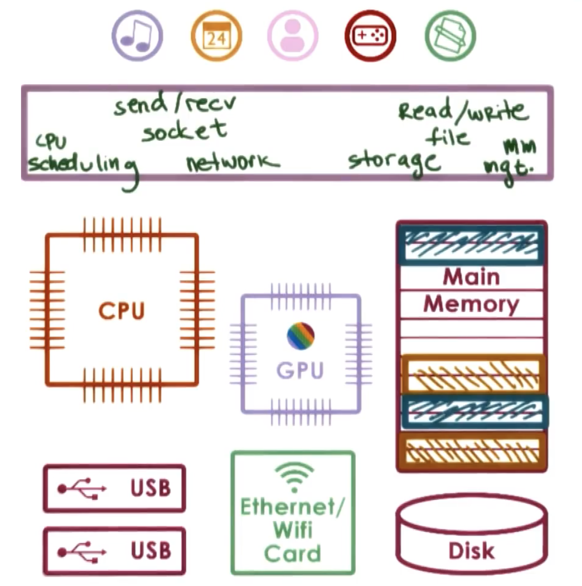
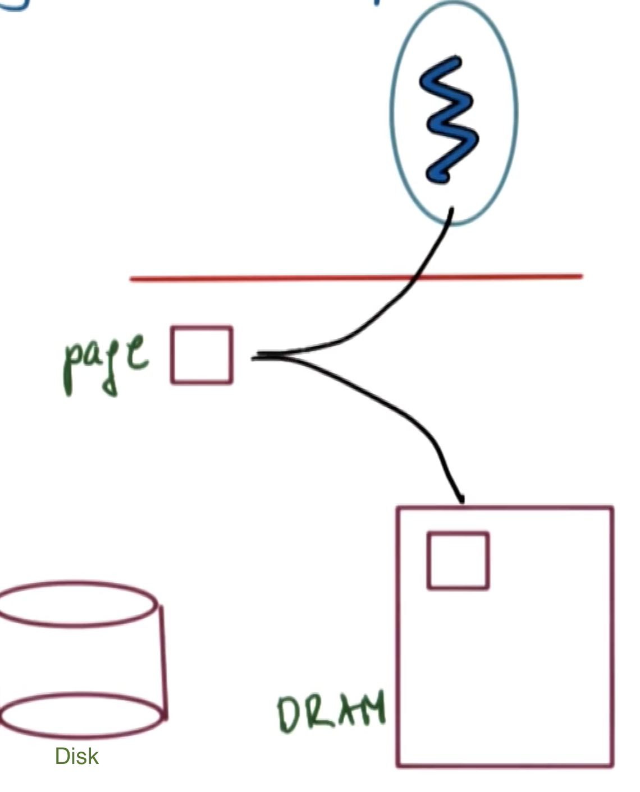
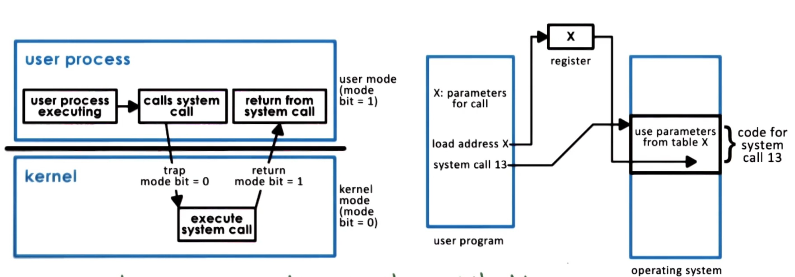
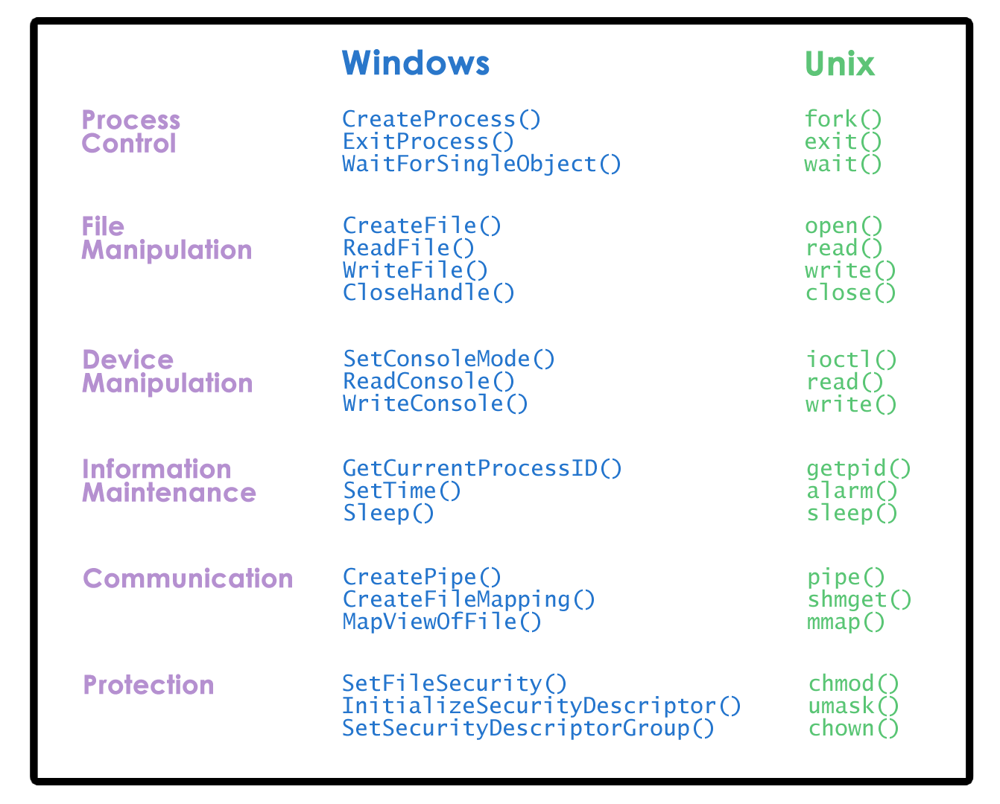
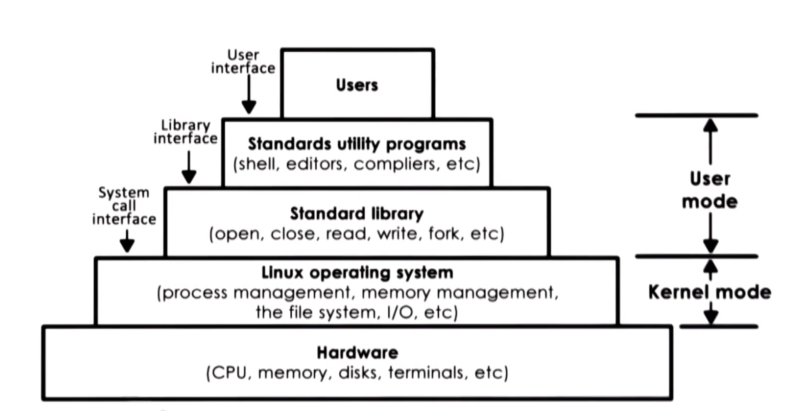
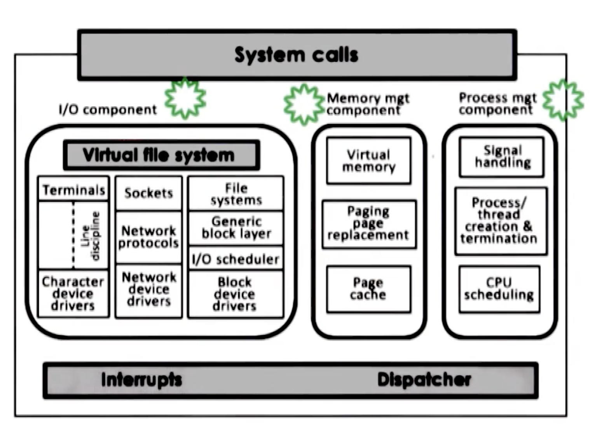
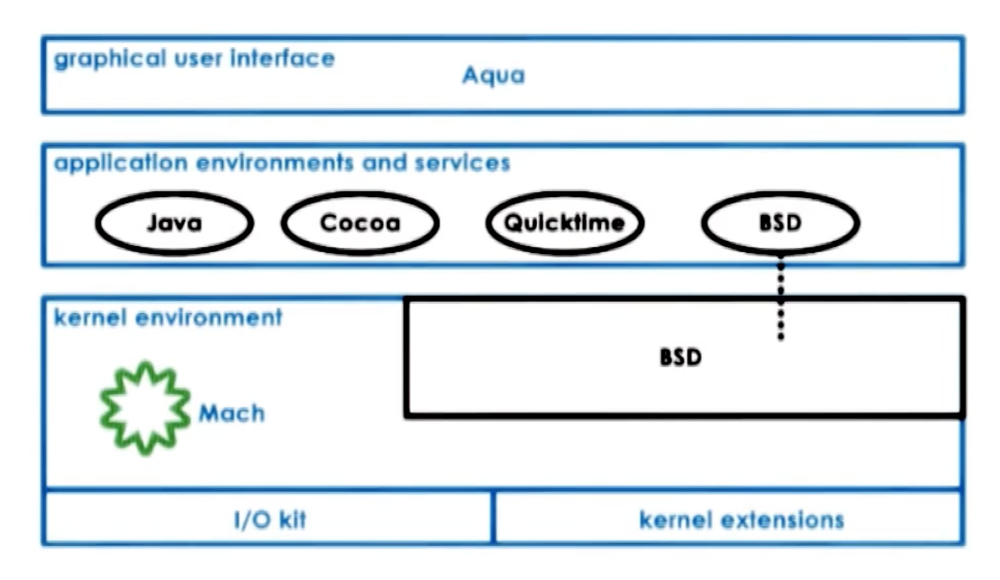

## What is an Operating System?

| Item | Definition |
|---|---|
| higher level Applications | - laptop/desktop/phone: browser, editor, messaging, music apps etc   - datacenter: web server, database, simulation|
| Operating System (OS) | Software layer **between apps and hardware** to **abstract** complex hardware and **manage** hardware resources (**arbitration**).   Elements:  file system, device driver, CPU scheduler etc   Visual **metaphor**: **shop manager** (allocates resources, schedules work, enforces rules). |
| Hardware | - Central Processing Units (CPUs)   - Physical Memory   - Network Interconnects (Ethernet port/Wifi Card)   - Graphic Processing Units (GPU)   - Storage Devices (hard Disk, SSDs, Flash drives [USB]) |
----
Figure: OS sits between apps and hardware

---

#### Main functions of OS

| Function | What it means | Quick example |
|---|---|---|
| **Hide hardware complexity** | **Directly** has privileged **access** to the underlying hardware and provide simpler abstractions than raw devices to apps | - Support different types of devices   - File abstraction instead of a block of disk storage: `read`/`write`   - Internet Socket abstraction instead of bits and packets: `send/receive` |
| **Allocate, Manage resources** | Manages hardware on behalf of applications according to some predefined **policies**. Decide how many and which resources will the app use, e.g., CPU, memory, IO | - allocates memory for applications   - schedules apps for execution on the CPU   -controls access to various devices and so on |
| **Isolation & protection** | Ensures that **applications** are isolated and prevent concurrent apps from harming each other | - Allocate each apps different parts of underlying phycial memory   - Make sure one application can’t read/write another’s memory |
---

**Examples** of OS
| Category| Examples |
|---|---|
| Desktop | - Microsoft Windows   - Unix-based : Mac OS X (extend BCD),   Linux|
| Embedded | Android, iOS, Symbian |
| Server||
---

### OS elements: abstraction vs mechanism vs policy

| Term | Meaning | Examples |
|---|---|---|
| **Abstraction** | “What” interface you program against | - For applications: Process/thread;   - For hardware: file (storage), socket (network card), memory page (phycial memory)|
| **Mechanism** | “How” the OS performs operations on abstractions | - Create/schedule process/thread to run on CPU;   - open/read/write/allocate hardware resources |
| **Policy** | "How"he mechanisms will be used to manage the underlying hardware | - The max number of sockets an application can access   - Which data can be removed from memory:   - Page replacement: Least-recently used (LRU) / earliest deadline first (EDF)  |
----

**Example** memory management:
| Component | In memory management |
|---|---|
| Abstraction | Memory page (fixed-size addressable region) of memory|
| Mechanisms | - Allocate page in DRAM   - map the memory page into a process addres to allow the process access the actual physical memory   - move pages from DRAM to disk accorrding to polices (**swapping**). |
| Policy | The **Least recently used** (LRU)  (unimportant, likely not useful in future) memory page will be copied in disk   The frequently/currently used are more important (we might contineu to use them) so we metain them in memory since it is faster to access memory than disk.|
----
Figure: Example - memory management

### Design principles

| Principle | Why it matters |
|---|---|
| **Separate mechanism from policy** | Keep mechanisms flexible to support different policies because in different settings, different policies make more sense.   e.g., for memory management: track the frequency and time for: Lest recently used (LRU) vs least frequantly used (LFU) vs random |
| **Optimize for the common case** | Pick a policy that match the device setup (type, CPUs, memory), users' application, workloads requrements.|
---

### Protection boundary: user vs kernel
| | User - level (unprivileged) | kernel - level (privileged)|
|---|---|---|
|Definition| Normal applications run here; cannot directly access hardware | OS runs here; can execute privileged instructions and directly access hardware|
|**user-kernel transation**| - attempt when forbidden in user mode will cause a trap, application will be interrupted, hardware enforced transfer to OS, then OS decides: allow/terminate process | - set a special bit in CPU = manipulating hardware is permitted; otherwise = forbidden.   - OS provide system call interface for applications to invoke: e.g., `open`(file), `send`(network socket),`mmap`(allocate memory).   - OS use signals to send notifications to the application  |
----

Figure: System Call Flow

**System call flow** explanation:  
- **Issues**: 
    - user → kernel → user; the context switching has **overhead**, **not** a **cheap** operation.
    - **application performace** (dependent on the ability to use **cache**) can benifit or suffer based on cache usage.
        - **benifit**: when **cache contains data**/address the applications needs
        - **suffer**: otherwise, forcing application to retrieve data from main memory.
        (OS bring data OS needed into cache, which replaces some application data in the cache )
- Arguments to system call must be written by applications, it can either be passed directly from process to OS, or by specifying their address.
Application must save relevant data at well-defined location.
- Applications make a system call using specific system call number, OS can determine how many arguments it should retrive from the well defined location,
- In synchronous mode, the process waits until the system call completes. Asynchronous modes will be talked in the future.

### OS services via System Calls

| Service | Typical responsibility | Related hardware |
|---|---|---|
| Process management | CPU scheduler: control the access to the CPU | CPU |
| Memory management | Allocate memory to applications and make sure no overwrite | Physical memory |
| Device management | Device drivers | Devices |
| File management  | Naming, permissions, persistence, buffering | Higher-level abstraction built on storage, not a single device |
| Storage management | | |
| Security | | |

Figure: System Calls: windows vs linux

### Different types of OS organization (kernel designs)

| Design | What it looks like | Pros | Cons |
|:------:|:------:|---|---|
| Monolithic (in the past)   &darr;| All the abstractions, services are inside OS, making it very large. | - Everything included   - Inlining, compile-time optimizations | - Too much code, hard to matain and debug, not customizable/portable / manageable   - Large memory requirement(impact appliataion performance)|
| **Modular** (common today) | basic serivces and APIs   +   loadable modules (Dynamically install new modules) | - Maintainable for upgrade   - smaller codebase, less resource intensive (more memory for apps -> better performace) | - Have to go through module interface before implementation reduces optimization opportunities (not signaficant)   - module maintenance issues (modules come from disparate code bases with bugs) |
| **Microkernel** (embedded systems, control systems) | Minimal kernel (IPC, address space, threads)   +   Everything else (file systems and disk drivers) will run outside OS kernel at user-level.   It requires lots of interprocess communication (IPC) | - Small, lower overhead, better performace   - easy to verify code| - Bad portability (often customized to underlying hardware)   - Harder to find common OS components leads to software complexity   - Expensive cost of frequent user/kernel crossing (due to IPC)|
---

### Example architectures 

| System | Layering (&uarr;) | Notes |
|---|---|---|
| Linux | Hardware   → Linux kernel   → standard libraries (system call interface)   →  utilities     → user apps | Kernel has components: I/O, memory management, process management.    → Modular design: Each seperate componnents can be independently modified or replaced.  |
| macOS (OS X) | - I/O kit for device drivers   - kernel extension kit for dynamic loading of kernel components   → - Mach microkernel (memory management, thread scheduling, IPC (including RPC)   + BSD (Unix interoperability + POSIX API + network I/O)   → user | |

#### Figure: Linux Architecture

#### Figure: Linux Kernel

#### Figure: Mac OS Architecture
