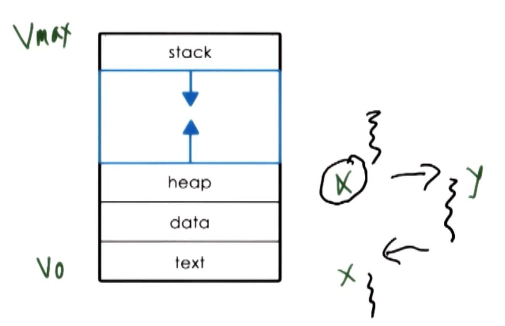
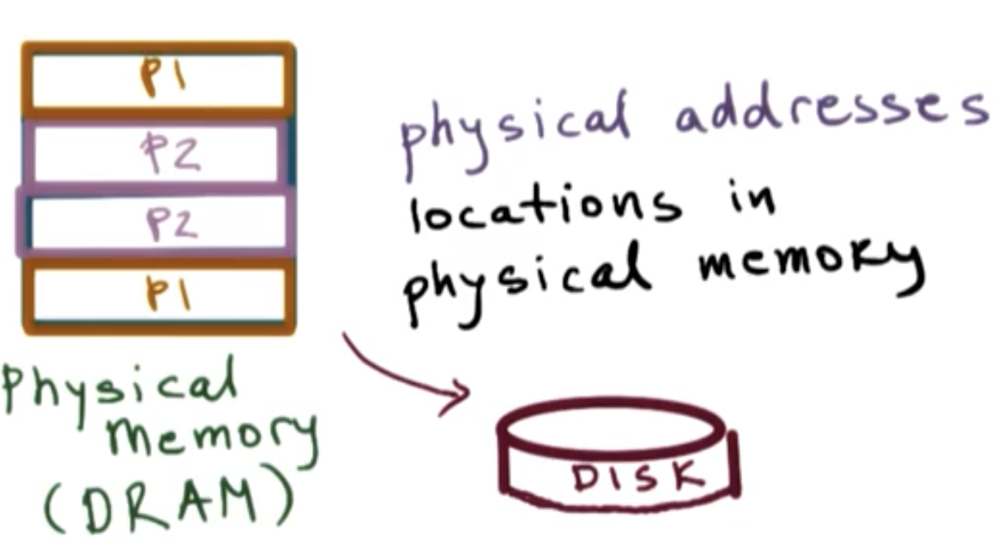

## What is a process

a process is an instance of an executing program, sometimes use terms "task" or "job" interchangeably with a "process"

|application program| &rarr; | process |
|---|:---:|--|
|stored on disk/flash memory/cloud, not executing   (static) |Once an application is launched| loaded into memory and starts executing   (active)|
||If the same program   (e.g., text editor) is launched more than once |multiple processes will be created, they will have different state (e.g. read document_A; type in a empty new document_B ).|
---

## What does a process look like?
### Process Address Space and Memory Management
process encapsulates all of the data (code, the data, variables that application need to allocate) of a running application. Every element of the process state has to be uniquely identified by its address. 

An operating system abstraction used to encapsulate all of the **process state** called **address space** (memory represeatation of a process), defined by a range of addresses from $V_0$ to $V_{max}$. Different types of **process state** will appear in different regions of the address space. 

| range | Address Space   (**Virtual** address, store process state) | property|
|---|---|---|
| $V_{max}$ |**stack**   (e.g., save the state x before jumping to another partion of the code y, after execution of y, restore the state x)| **Dynamically** created state that grows and shrinks as the program executes in a last-in, first-out (LIFO) order.|
| | **heap**  (temporary results, read data from files) | **Dynamically** created state; Seems contiguous but might not, portions of the addresses might not allocated|
| $V_0$ |text (code), data   (the data that is available when process is first initialized)| **static** state |
----

Figure: Process  address space, process execution example of using stack

The above **address space** is called **virtual address**, because they don't have to correspond to actual locations in the physical memory. 

OS creates **Page table** which maintains a **mapping** between **virtual memory addresses** and **physical memory addresses**. By using this mapping, we decouple the complex layout of the data in the virtual address space from the layout of the data in physical memory, to maintain physical memoery management simple.

Note:
It is possible for **different processes** to have the exact **same** address space range (**virtual** memory address **range**), OS will make sure that they point to distinct physical memory locations.

**Example** of a **page table entry**
|veritual memory| &rarr; |physcial memory|
|---|:---:|--|
|0x03c5||0x0f0f|

whenever the process tries to access x this page table mapping is referenced and the exact physical location where x is will be accessed.

When we do not have enough physical memory to store all the process state, the operating system must maintain information regarding processs address space to dynamically **decide** which portion of which process's address space will be present in **physical memory** and which portion will be **swapped temporarily to disk**, which will be brought in whenever needed.

Figure: Process 1 and Process2 in Physical memory and swap to disk

## How does OS know what a process is doing?
### Process Execution State
For an operating system to manage processes, it must have some idea about what a process is "doing". If the operating system stops a process, it must know exactly what it was doing when it was stopped, so the process can resume its execution with the exact same state.

### Process Control Block
the operating system maintains a **process control block (PCB)** data structure to maintain all useful information about **Process Execution State** for **every** single process.

The PCB is created and initialized when the process is **initially created**. Certain fields are updated when process state changes; other fields change frequenctly.

**Operating system**to collect all of the data about a process - stored within CPU registers - and save it to the **PCB** when the process is **no longer running**.

----
| How to maintain the process state | what information | change frequency|
|--|--|--|
|process state|
|process number|
|**program counter**| At any given time, the CPU use it to know where in the a instruction sequence the process currently is| every instruction, fast (maintained on CPUs' register) |
|**CPU registers**|other information (e.g., addresses for data, status info)|
|memory limit|mapping (virtual-> physical) | not too often |
|a list of open file|
|process priority|
|signal mask|
|CPU scheduling info| e.g., how much time this particular process had executed in a CPU, how much time it should allocate in the future (depends on process priority) |
|**stack pointer**| The top of the stack (helpful to pop out the top elements of the stack) |
|...| |
---

### How is  Process Control Block (PCB) Used?
PCBs are stored in memory on behalf of a process by the operating system until it comes time for the process to start/resume execution. At that point, the process's PCB is loaded from memory into CPU registers, at which point instruction execution can begin.

If a process is interrupted by the operating system - perhaps to give another process some CPU time - the operating system must pull the PCB out of CPU registers and save it back into memory.

Each time the operating system switches between processes, we call this a context switch.