## Threads
|Threads||
|--|--|
|visual **metaphor**|**worker** at a shop <br> - active entity: executing unit of a process <br> - works simultaneously with others threads  <br> - requires coordination - sharing of I/O devices, CPUs, memory
----


## Process vs. Thread
|Aspects |Process | Threads|
|--|---|--|
Defination|A single-thread process is represented by <br> - its [**address space**](process%20management.md#process-address-space-and-memory-management) (virtual - physical memory mapping) and <br> - its **execation context** (stack pointer, register, program counter etc). |Threads represent multiple **independent** execution contexts. <br> - **shared info**: They are within the **same virtual address space**, which means they share the virtual to physical address mapping, and the code/data/files.<br> - **Per-thread info** (in a seperate data structure): Threads will potentially execute **different** **instructions** and accessing different portions of the **address space**, operate on different portions of the **input** etc. This means that each thread will have to have its own different **program counter, stack stack, pointer, thread-specific registers**.|
|PCB|<br> OS represents  all the information in a [process control block (PCB)](process%20management.md#process-control-block). | More complex PCB: <br> - shared virtual address mapping, code,data <br> - per-thread executaion context.|
|virtual addresss| seperate| shared|
|execution context|✅| ✅ |
|context switch| longer | shorter|
|communication mechanisms| inter process communication (IPC) (expensive)| shared variable (cheap)|
|cache| cold| hot|
----

Figure: Multi-Threads
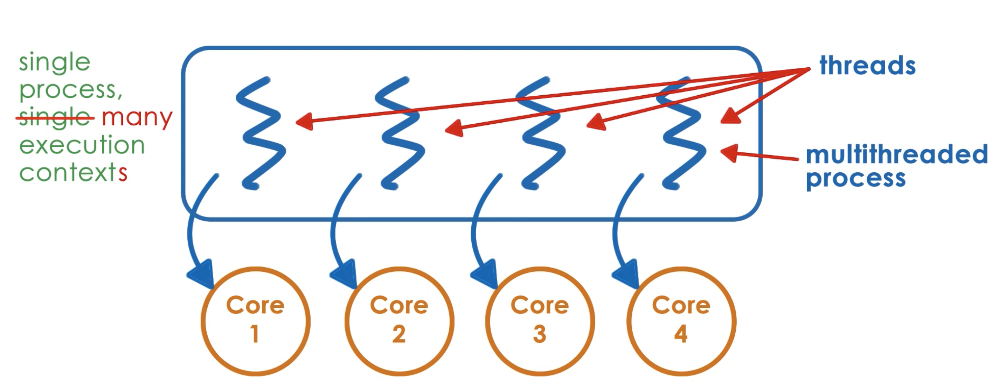

Figure: Single thread Process vs. **Multi Thread** Process
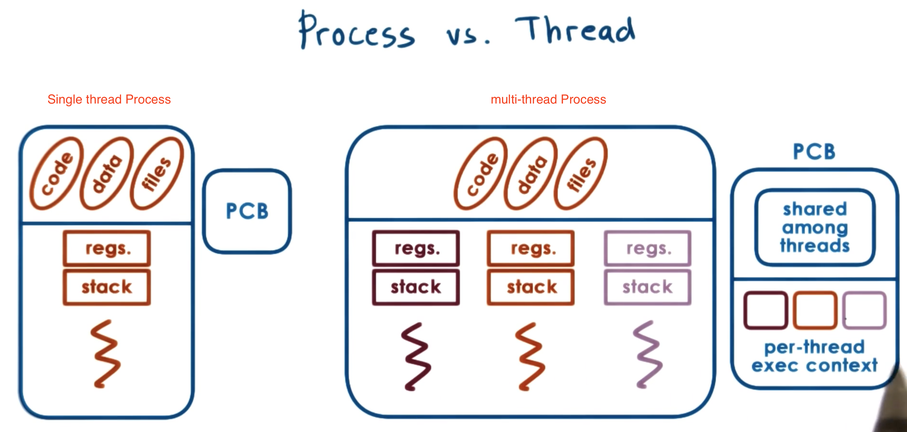


### Benefits of Multithreading
|cases| reasons|
|--|---|
|in multi-core/multi processor system| - Each thread executes same code but for different subset of **input** (e.g., a matrix)in **parallel** **concurrently** on a different processor to **speed up** <br> - Each thread executes different portions of program for special **tasks** to set **prioirty** differently and get **performance gain** by **hot cache** |
|why **multithreading** instead of **multiprocess**?| - **lower memory requirement**: A **multiprocess** application requires **more memory** => more swaps from disk (we have to allocate each process a address space, and a executation context) while <br>  a **multi-threaded** application requires **less memory** (sharing address space). <br> - **lower communication overhead**: communicating, passing, synchronizing data among processes (requires **inter process communication IPC**) is more **costly** than **inter thread communication**(**shared variables** in the same process address space)|
|even on **Single CPU** or generally when **number of threads > the number of CPUs**| - **Hide latency** associated with I/O operations: If thread has to wait on some event for some time **(t_idle)> two context switche (2*t_ctx_switch)**, then it makes sense to switch to another **thread** to perform other operation and switch back. <br> - **No memory overhead**: Threads **shared address space**|
|User applications and **OS kernel**| support **multiple execution contexts** to operate concurrently <br> - OS threads could work on behalf of apps <br> - run OS level services like aemons and device drivers. |
---

Figure: Multi-process requires more **memory (address space)** while multi-threads does not!
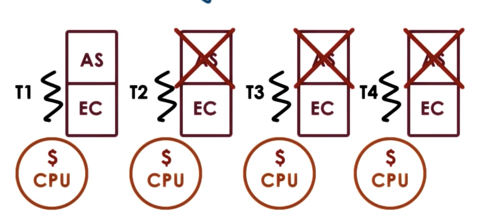

Figure: Multi-threading is benificial even on **Single CPU**
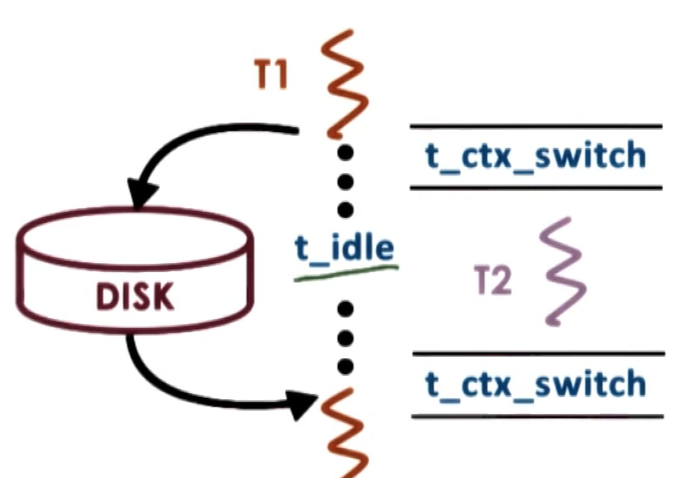

## Basic Thread Mechanisms
### overview
|What we need to support threads|Function| Meaning|
|---|---|--|
|thread data structure| identify threads, keep track resource usage| represent each thread
|Synchronization Mechanisms| - create and manage threads <br> - allow threads safely coordinate among each other running concurrently in the same address space| - don't overwrite each other's inputs or results <br> - allow one thread to wait on results that should be produced by other threads| 
---


### Thread Creation
#### 
|data structure and mechanisms| name | details|
|--|--|--|
|thread data structure|thread type|all the info to **represent** a thread, including:  <br> Thread ID, Program counter, Stack pointer, Register values, Stack, Other thread specific attributes (e.g., for thread management)|
|**create** a thread|parent thread call **Fork(proc, args)**| two arguments: <br> - proc: the procedure that created thread will start executing <br> - args: arguments for the procedure proc. Note that: It is not the UNIX fork. <br> <br> When one thread (parent thread $T_0$) calls fork, a new thread (child thread $T_1$) is created with a new thread data structure (its fields are initialized such that its program counter pointing to the first instructure of the procedure proc and the arguments will be avilable on the stack of the thread). When the thread finishes, store the results of computation in the shared address space and use mechanisms to notify the parent or other threads. |
|**terminate** a thread|parent thread call **Join (child thread ID)**| The parent thread will be **blocked** until the child completes. Join will return to the parent the result of the child's computation. At that point,child thread exits the system and all the resources allocated for child will be freed.
---


Figure: Thread creation and termination
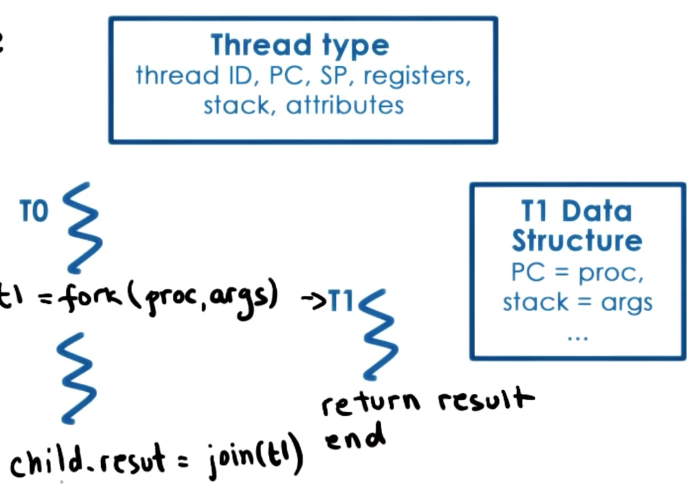


Figure: Thread creation example: insert element to a shared link list
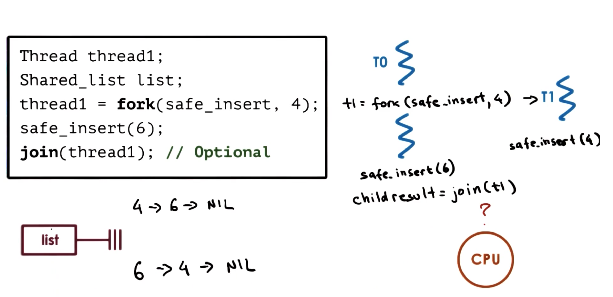
Note: data race: because we do not know which thread will run at which time, we cannot be certain of the ordering of the elements in the shared list. Perhaps the child thread inserts its element before the parent thread, or perhaps the parent thread inserts first. 

Figure: data race example: overwriting - insert element to a shared link list 
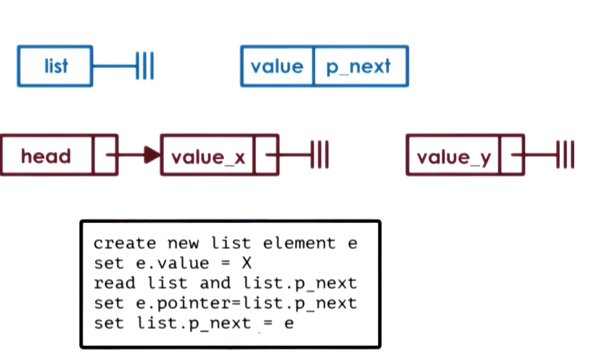
If multiple threads running concurrently, the operations are randomly interleaved. Only one element will be ultimately successfully linked to the list; the other one will be lost.


### Synchronization Mechanisms
#### Why we need synchronization mechanisms? issues of concurrent execution 

Figure: Data Race problem on threads because threads share memory address space
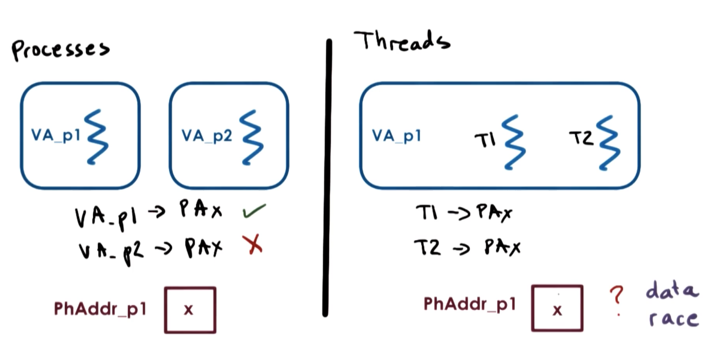

|process| threads|
|---|---|
|Each process operate within their own address space. The operating system ensures that no valid mapping and access for any address in address space of a process (e.g., P2) to physcial memory (X) which is already mapped to another process (P1)| Threads share the same virtual address space and virtual to physical address mappings, which introduces data race problems: one thread can try to read the data while another modifies it, leading to inconsistencies|
---
#### Synchronization Mechanisms
To avoid the issues of concurrent execution
|Mechanisms| Basic Idea| Details |
|---|---|--|
|**Mutual  Exclusion** <br> - **mutex** <br> (like a lock)| **Whenever** accessing **shared** data/state among threads: **only one** thread at a time is allowed to access shared data **exclusively** by acquiring a mutex. The other threads (**blocked** threads) will be suspended on the lock operation until the mutex owner **releases** the mutex. <br> Note that there is **no guarantee** the mutex aquire requests from **blocked threads** will be granted **in order**, all of them have chances to get access to mutex. | - the mutex should have at least the following information: <br> lock status (lock?), <br> owner, <br> blocked threads (list). <br> - The portion of the code protected by the mutex is called the **critical section**. <br> - Common thread API: <br> **lock(m)** <br> // critical section <br> **unlock(m)** |
|**Condition Variable** <br> (used with mutex)| a thread is waiting on other threads's operation with specific condition before processding. | The condition variable data structure should contain: <br> - mutex reference <br> - list of waiting threads<br>Common API: <br> - **Wait(mutex, condition_variable)** <br> Mutex will be automatically released and re-acquired on wait operation <br> (still mutual exclusion waking up one thread at a time, even when we use Broadcast). Note: **Always wait** in a **while loop** instead of if because a thread waking up from a condition variable wait cannot assume the condition still holds, we must use while loop to check the condition again, since other threads may have acquired the mutex and changed the shared state before it runs again. ```while (!condition) wait(); ``` <br> - **Singal(condition_variable)** <br> notify **only one thread** waiting on the condition variable <br> - **Broadcast(condition_variable)** <br> notify **all waiting threads**|
----


Figure: mutex example: safe insert - insert element to a shared link list 
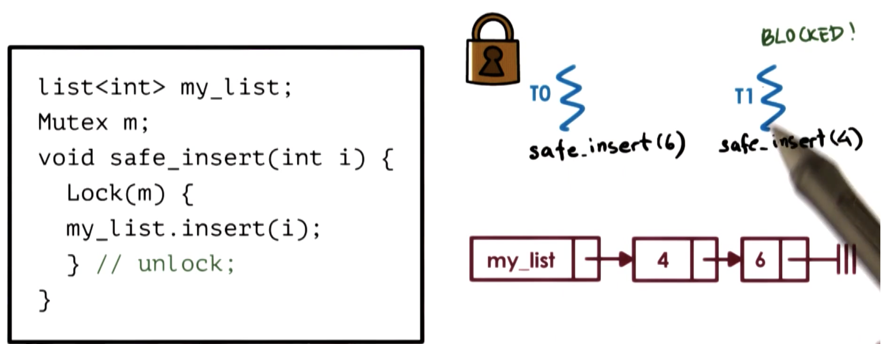

Figure: Condition Variable example: consumer and producer
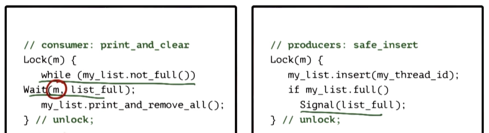

- The consumer aquire the mutex, check list is not full, then suspends itself (automatically release the mutex) and waits until the list become full (automatically aquire the mutex).
- The producer sends signal when the list is full.

Figure: Condition Variable API Wait implementation: 
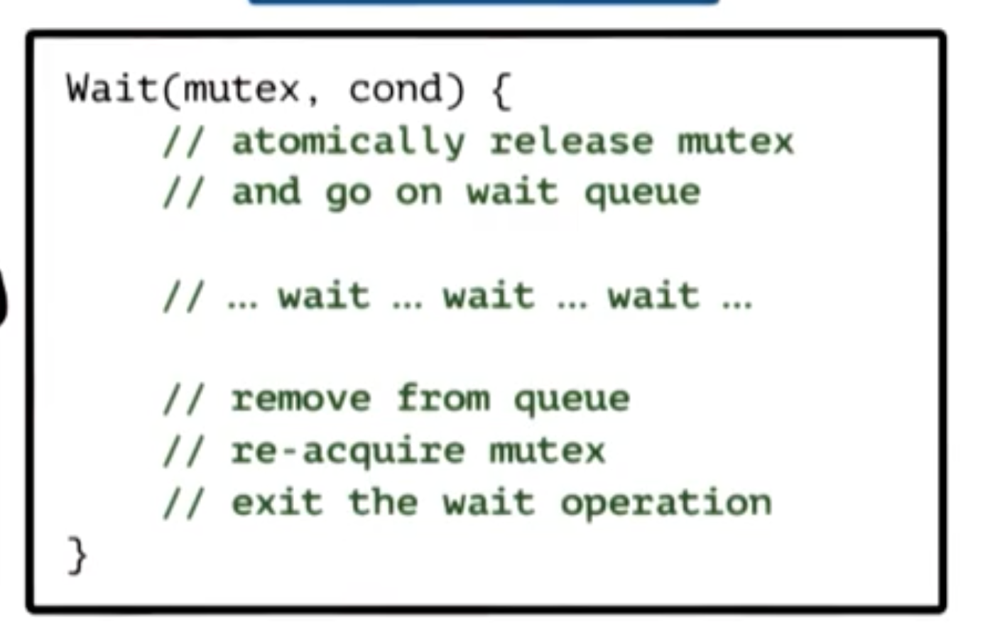


#### Readers/Writer Problem using condition variable
At any time, 0 or more readers can access the shared resource; while 0 or 1 writers can access the shared state. The readers and writer cannot access the shared state at the same time. 

We can enumerate the cases, condense our two counters into one proxy variable - **resource_counter**. 
|cases|state of shared resource encoded by proxy variable <br> **resource_counter** |
|--|---|
|if read.counter == 0 and write.counter == 0: can read, can write| **free**: resource.counter = 0 |
|if read.counter > 0 : can read| **reading**: resource.counter > 0 |
|if write.counter == 1 : cannot read, cannot write | **writing**: resource.counter = -1 (encoding as a negative number) |
---


Figure: **Readers/Writer example implementation**: 
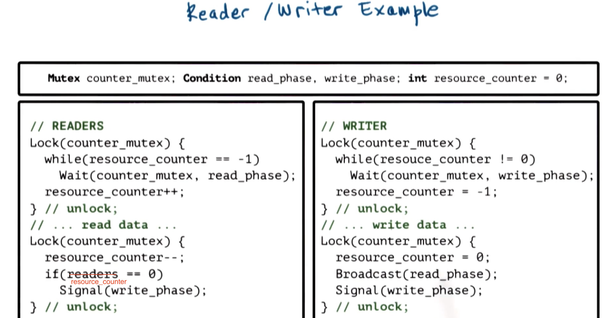

|variables|meaning|
|--|--|
|resource_counter| a proxy variable representing the state of the shared resourc. Only one thread (both reader/writer) at a time can update/access the resource counter |
|counter_mutex| a mutex which always need to be aquired whenever we access to resource_counter|
|read_phase| a condition variable signifying that the resource is ready for reading|
|write_phase| a condition variable signifying that the resource is ready for writing|
---


Readers/Writer with proxy variable implementation   - **Structure**

Benefit: allow more **complex sharing senarios**:
more than one read tBenefithread or only one write thread to be in the critical section at any time.
|Steps| Procedures | Details |
|--|--|--|
| 1| enter critical section block $\approx$ lock | set resource_counter - the shared resource is accessed (using mutex)|
| 2| critical section |read/ write shared data (no mutex)|
| 3|  exit critical section block $\approx$ unlock| reverse resource_counter - free the shared resource and Singal/Broadcast condition variables (using mutex)|
---


Figure: **critical section structure** with proxy variable
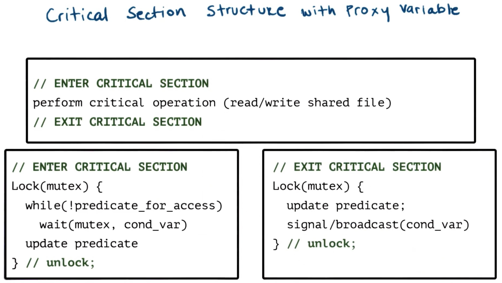


#### Note: When writing multi-threading
|What to do| Example|
|--|--|
|Write **comments** about which shared resource/state immediately when **defining the mutex/condition variables**| `mutex_type m_f1 // mutex for file 1`| 
|**always** protect access to **same** shared variable/operation by acquiring the **same mutex**.| use mutex m1 for read and write file 1|
|Do not forget to **use lock and unlock**. ||
|Make sure that you are signaling or broadcasting on the **correct condition**. |
| Do not use signal when **broadcast** are needed. <br> The opposite is actually okay.| 
| Remember that the threads **execution order is not related** to the **order** of **calling signals or broadcasts**. If priority are needed, other strategies must be used.|
|**Spurious Wake-ups** <br> (does not affect correctness but impact **performace**)|
|**Deadlocks**|

##### Spurious (Unnecessary) Wake-ups
when we wake up threads, but the waken up threads may not be able to proceed.

Figure: Spruious Wake-up
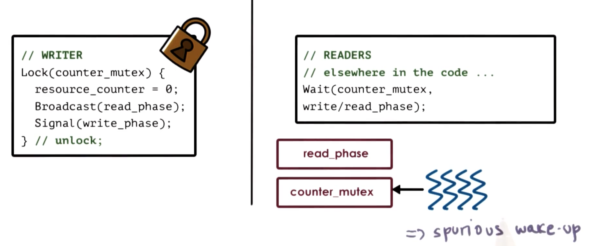

|writer| readers|
|--|--|
|The writer hold the counter_mutex: sending broadcast and signal| readers are waiting on conditiona variable read_phase's queue|
|The writer still holds the counter_mutex: complete the rest of operations before unlock| readers are waken up and try to reacquire the mutex, but failed, so they are waiting on the counter_mutex's queue (wait again) -> **waste cycles by context switching** |
---

**Solution**:
|senarios| solutions|
|--|--|
|when the broadcast/signal are **not depended on proxy variable**| **unlock the mutex before broadcast/signal**|
|when the broadcast/signal are **not depended** on proxy variable| **no solution** since proxy variable should be accessed within mutex lock construct |
----

Figure: Spruious Wake-up with **solution**: unlock the mutex before broadcast/signal
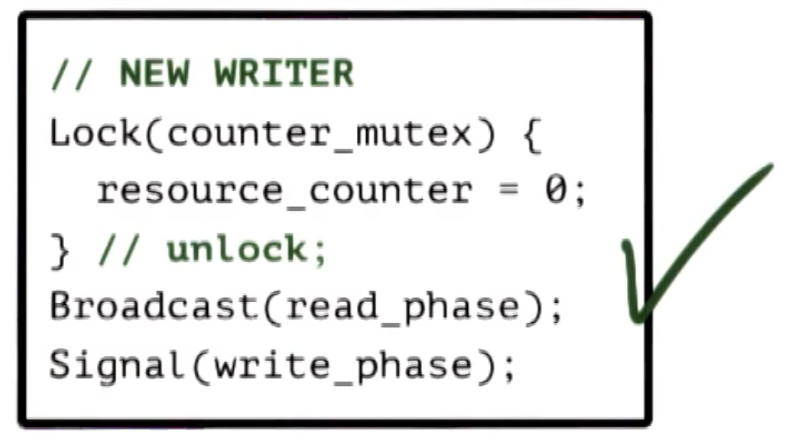

Figure: Spruious Wake-up: no solution
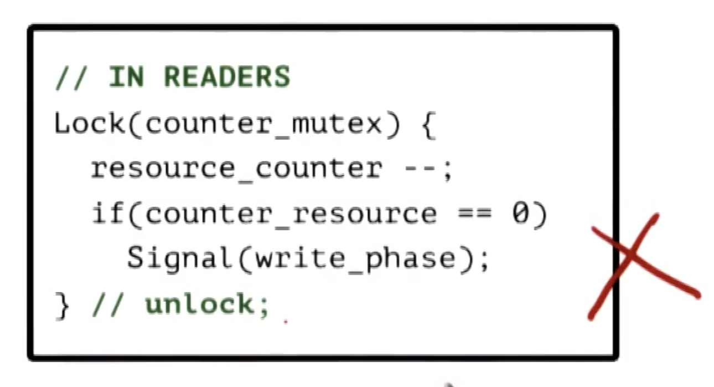


##### Deadlocks 
occurs when two or more competing threads are waiting on each other to complete, but none of them ever do. 

Metaphor: two stubborn workers: each grab a tool and want another tool but do not want to give up the one they have.

Figure: deadlock
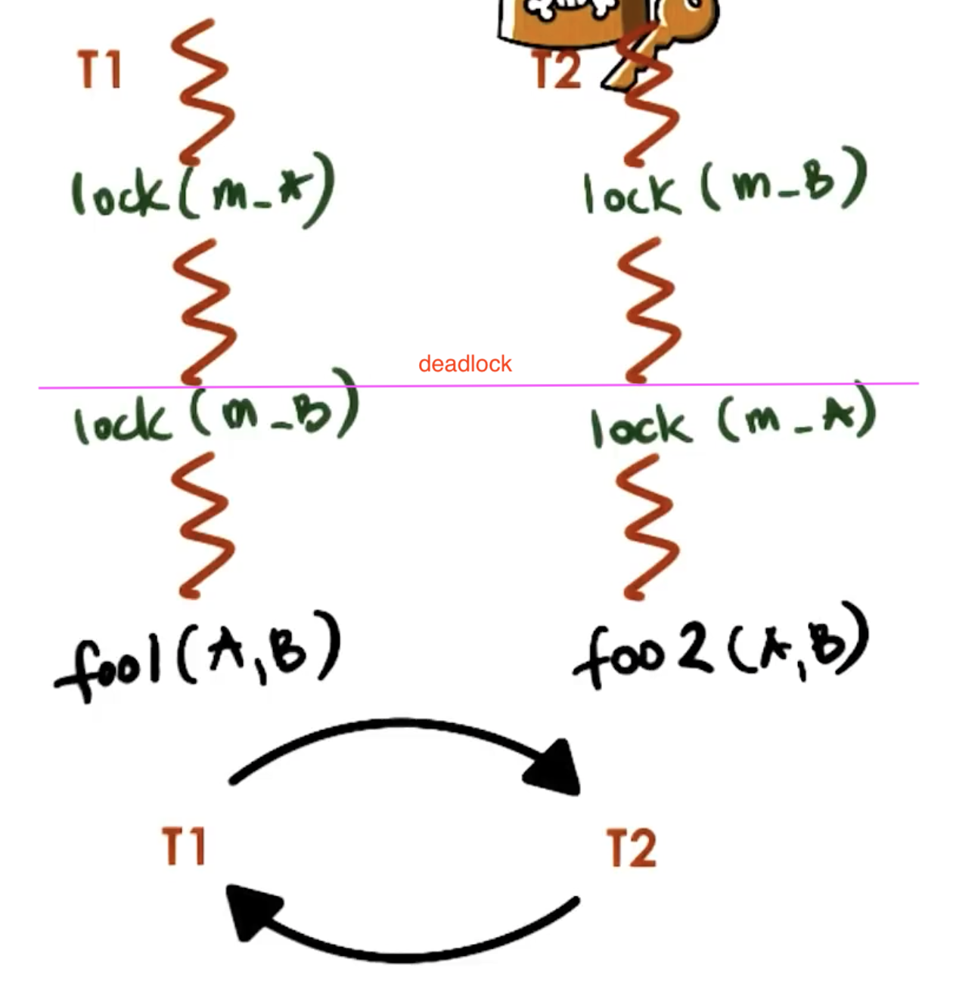
A cycle in the wait graph is necessary and sufficient for a deadlock to occur. The edges are from the thread waiting on a resource to the thread owning a resource.

|Thread T1| Thread T2|
|---|--|
|aquired mutex for shared resource A|aquired mutex for shared resource B|
|aquired mutex for shared resource B, but failed (since it is held by T2) |aquired mutex for shared resource A, but failed (since it is held by T1)|
|waiting| waiting|
---


**Solution of deadlock**:
maintain **same order** of mutexes for each thread (hard to guarantee though)

Example:
|T1| T2|
|--|--|
|aquired mutex for shared resource A|blocked, waiting|
|aquired mutex for shared resource B|waiting|
|release all mutexes | start to acquire mutexes A and then B|
----

**Deal with deadlock** in real performace critical systems:
|solution| meaning |cons|
|--|--|--|
|prevent deadlocks| Each time to acquire a mutex: check if that operation will cause a cycle in the graph: delay the operation or change code to first release some resource and afterward perform lock request | very expensive|
| detect deadlocks and recover| analysis of the wait graph and determine whether any cycles have occurred.| still expensive and sometimes impossible (if input and output are external) due to rollback executation|
| doing nothing| hope that the system never have deadlocks, and if we are wrong, just reboot. |
---


