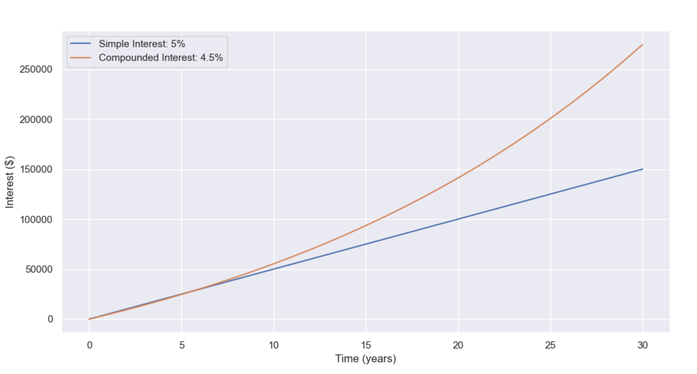

# Table of Contents
* [Table: Basic Concept of Interest](#basic-concept-of-interest)
* [Table: Simple Interest vs. Compound Interest](#simple-interest-vs-compound-interest)
    * [Figure: Difference between simple and compounded interest over time](#figure-1-difference-between-simple-and-compounded-interest-over-time)
* [Table: Compound Interest](#compound-interest)
* [Table: Spot Rate vs. Forward Rate](#spot-rate-vs-forward-rate)
* [Table: Types of Yield Curves](#types-of-yield-curves)
* [Table: Fixed vs. Variable Interest Rates](#fixed-vs-variable-interest-rates)
* [Table: Nominal Rates vs. Real Rates](#nominal-rates-vs-real-rates)
* [Table: Rate of Saving vs. Rate of Borrowing](#rate-of-saving-vs-rate-of-borrowing)


# Interest
## Basic Concept of Interest
| basic concept | Meaning | Notes|
|-------|---------|-----------------------|
| Time Value of Money | $100 today is worth more than $100 in the future. | Reason: <br> •  Immediate consumption <br> •  Have the opportunity to invest and gain more. |
|  Interest Rates | When we take out a loan, we must repay the principal value of that loan and make periodic interest payments to the lender. It is the cost of borrowing money (from the point of view of the borrower), <br> or the return on investment (from the point of view of the lender).  <br> The lenders determine interest in terms of an annual rate. | 1. To compensat for the risks: the longer the duration, the larger the amount of the loan, the worse economic conditions (which makes the borrower less likely to repay), the higher interest will be.  <br> 2. Banks may compete with each other by offering lower interest rates to attract new business.
| Present Value (PV)|  It discounts the future amount of money back to today’s value. | Essentially asking: <br> If I will get $105 in the future, how much is that worth today?
| Future Value (FV)| It grows today’s money into the future's value. | Essentially asking: <br>  If I have $100 today, how much will I have in the future after earning interest?
| Default   | Failure to repay a loan |                                                             
-------


## Interest Types
### Notation 
| Symbol | Meaning |
|-------|---------|
| $P$ | the **principal** amount |
| $PV$| **present value** |
| $FV$|  **future (or forward) value** |
| $n$| the **number** of years (integer count), used in simple interest|
| $t$| **continuous time** of loan or investment in years (decimal/fractional allowed), used in compound interest|
| $r$| the (nominal) annual **interest rate** ｜
| $q$| compound frequency: number of compounding period $q$ times per year|
| $qt$| Total number of compounding periods over the investment|
| $r_q$| nominal annual rate $r$ with $q$ compound frequency| 
-------


### Simple Interest VS Compound Interest
| Type | Concept | Formula | note |
|-------|---------|------------|-----------|
| Simple <br> Interest | Interest earned only on principal. | $$ \text{Simple Interest} = P \times r \times n $$ <br> $$FV = PV \times(1+nr)$$| Usually for Certificates of Deposits. Better when we are borrower.
| Compound Interest | Interest earned on principal + accumulated previous interest. | $ \text{Compound Interest} = P \times (1 + r)^t - P$ <br> $$FV = PV \times(1+r)^t$$ <br> $$ \Rightarrow PV = \frac{FV}{(1 + r)^t}$$  <br> $$ \Rightarrow r = \left(\frac{FV}{PV}\right)^{1/t} - 1$$| Most common type. Better when we are depositor/investor. <br> [Growth of investments over time:](https://worldquantuniversity.shinyapps.io/wqu_compound_interest_m1_ck/) <br> • the nearly linear growth with low interest rates and fewer compounding periods <br> • an exponential growth pattern when higher interest rates, more frequent compounding periods, and extended time frames are applied. 
-------

#### Figure : Difference between simple and compounded interest over time

Note: the compound interest grows much faster than simple interest over time


### Compound Interest
| Concept |	Explanation |	Note / Example |
|-------|---------|------------|
| Compound Frequency |	How often interest is added to your account. | monthly = 12 times/year, quarterly = 4 times/year, daily = 365 times/year |
| Nominal Annual Rate |	The stated (advertised) yearly interest rate, not accounting for compounding frequency. 	| 12% annual rate compounded monthly ≠ 12% actual return. |
| Discrete Compounding| with compounding frequency: <br> $$FV = PV \times(1+r)^t = PV \times\left(1+\frac{r}{q} \right)^{qt}$$| |
| Continuous Compounding | the extrame case, when compound frequency $q$ is infinite large - interest is added at every instant $$ \lim_{q \to \infty} FV = PVe^{rt}$$ |  |
| Effective Annual Rate (EAR)	| The true annual rate, including the effect of compounding. Formula: $$\text{EAR} = \left(1 + \frac{r}{q} \right)^q - 1$$| 12% nominal annual rate compounded monthly ≈ 12.68% EAR. <br> It allows: <br> •  fair comparison for two investment offers with different compounding frequencies <br> •  Understanding how much you’re really earning or paying. |
| Keep EAR the Same <br> Convert the Nominal Rate | Keep Effective Annual Rate the same, convert from one nominal rate with its compounding frequency to another. Formula: $$\frac{FV}{PV} = \left(1 + \frac{r_{q_1}}{q_1}\right)^{q_1} = \left(1 + \frac{r_{q_2}}{q_2}\right)^{q_2}$$ $$\Rightarrow r_{q_2} = q_2 \times \left[\left(1 + \frac{r_{q_1}}{q_1}\right)^{q_1/q_2}-1\right]$$ |  |  
-------


## Yield Curve
### Key Financial Terms of Yield Curve

| Term	| Meaning |
|-------|---------|
| Yield <br> (y-axis) | The spot interest rate (profits) earned from investing in a bond.|
| Term to Maturity <br> (x-axis)| The length of time your investment (e.g., Certificates of Deposit (CDs), bonds) is "locked in" and you have to wait before you get pay back| 
| Yield Curve | A graph showing the relationship between the short-term and long-term interest rates of fixed income securities (typically **goverment bonds**, considered very safe).| 
-------

### Types of Yield Curves
Yield curve movements reflect investor behavior and expectations about the economy.
| Type |	Shape |	Economic Interpretation| Reason |
|-------|---------|---------|---------|
| Normal Yield Curve |	Upward-sloping <br>  short-term < Long-term risk | Economy expected to grow.  | Usually, long-term investment are riskier, investors usually demand higher interest to compensate <br> (this rule also applies to other investments that have maturity): <br> • More uncertainty and risk over the long term (e.g. inflation, interest rate changes) <br> • More opportunity cost (personal need but your money is locked up longer)|
| Flat Yield Curve | Flat line <br> short-term $\approx$ Long-term risk | Uncertainty. |
| Inverted Yield Curve	| Downward-sloping <br> short-term > Long-term risk| 🚩 Leading indicator of the approaching of an economic recession. | Investors think recession is coming in the near future, and are fleeing to long-term safety. <br> • They buy lots of long-term bonds, driving long-term yields down.  <br> • Meanwhile, short-term rates stay high (e.g., due to inflation or Fed policy).|
-------

### Yield Curve Essentials

1. What the Yield Curve Represents
    - The yield curve is a *term structure* of interest rates: it shows the annualized return an investor can expect for lending to a given borrower (e.g., a national treasury) over different maturities.
    - Each maturity point—3 months, 2 years, 10 years, etc.—reflects a rate that’s inferred from all outstanding government securities around that horizon.
    - Because individual bonds pay coupons at different times and in different amounts, analysts “strip” those cash flows or use fitted models to derive a **zero-coupon** (spot) rate for each maturity. The yield curve is built from those spot rates, giving a clean snapshot.

 2. Why There Are Many Bonds per Country
    - Governments fund themselves continuously, issuing debt with diverse maturities to match financing needs and investor preferences.
    - Each issuance has its own coupon rate, maturity date, and trading history; the market therefore juggles many bonds simultaneously.
    - The yield curve consolidates this information into a single, smoothed profile of funding costs across time.

 3. Zero-Coupon vs. Coupon-Bearing Bonds
    - **Coupon bonds** distribute interest periodically. Their quoted yield blends multiple future cash flows and depends on bond-specific features.
    - **Zero-coupon yields** assume a single payoff at maturity. They strip away coupon effects, making it easier to compare maturities and to feed into models like Nelson–Siegel or spline fits.
    - In practice, institutions (e.g., central banks) estimate zero-coupon curves from traded bonds. These “desmoothed” series are widely published because they simplify valuation, risk management, and policy analysis.

4. Uses of the Yield Curve
    - **Pricing & valuation:** Discount future cash flows at the appropriate spot rate.
    - **Monetary policy signals:** The slope (short vs. long rates) often reflects growth and inflation expectations.
    - **Risk management:** Duration, convexity, and scenario analysis rely on accurate term structure data.
    - **Modeling:** Term-structure models (Nelson–Siegel, spline, HJM, etc.) start from zero-coupon inputs to ensure internal consistency.

5. Key Takeaways
    - A yield curve is the distilled view of a country’s borrowing cost through time.
    - Zero-coupon rates normalize the messy real world of coupon-bearing bonds, making the curve a consistent analytical tool.
    - Multiple bonds exist because governments issue debt continuously; the curve reconciles them into one coherent story about market expectations.


## Spot and Forward Rate
#### Notation
| Symbol | Meaning  | 
|--------|-------| 
| $0$ | today (at time 0) |       
| $s$ | when the investment starts. $0 \leq s < t$ |
| $t$ | when the investment mature (ends) |                                               
| $B(0, t)$ | Present Price (at time 0) of a **zero-coupon bond** that will <br>mature at time $t$ (pays $1, normalization just for  simplicity) |
| $r(0, t)$, $r(0, s)$  | **Spot rate** today (at time 0) for a bond maturing at time $t$ or $s$    |
| $f(0,s,t - s)$ | **Forward rate** agreed today (at time 0), for investment starting at $s$ and ending at $t$. <br> $t−s$ = how long the investment lasts  |
-------
A zero-coupon bond:
 - Doesn’t pay any interest along the way (no coupons)
- Pays a fixed amount — usually face value, like $1000 or $1 — at maturity
- Is sold at a discount, so your return = the price difference

### Spot Rate VS Forward Rate
| Aspect | Spot Rate |	Forward Rate |
|-------|---------|------------|
| Definition |	Annual interest rate is agreed today <br> and we start investment now | Annual interest rate is agreed today <br> but we wait and start investment in the future |
| Formula | Derive spot rate from a sequence of forward rates. $$r(0, t) = \left[ \prod_{i=1}^{t} (1 + f(0, i - 1, 1)) \right]^{\frac{1}{t}} - 1 \\= \left[ (1 + r(0, 1)) \cdot (1 + f(0, 1, 1)) \cdots (1 + f(0, t - 1, 1)) \right]^{\frac{1}{t}} - 1$$ | derive forward rate from spot rate $$f(0, s, t - s) = \left[ \frac{(1 + r(0, t))^t}{(1 + r(0, s))^s} \right]^{\frac{1}{t - s}} - 1$$|
| Idea behind both formulas| Investing with a spot rate from time $0$ to $t$ should give the same result as investing one year at a time with the relevant forward rates. <br> Therefore: chain and average across years (root), and minus 1 to get interest rate from growth factor  |Total accumulated growth factor from $0$ to $t$ = Accumulated growth factor from $0$ to $s$ $\times$ Accumulated growth factor from $s$ to $t$|
-------------------

#### Vistualization
```
 0  1 2 3 4 ...   i         t   Time
 |-|-|-|-|-|-|-|-|-|-|-|-|-|
                             → Total
```

```
 0           s             t   Time
 |-----------|-------------|
                            → Total
```


## Fixed vs. Variable Interest Rates
for deposits, loans, mortgages, bonds
| Feature |	Fixed Interest Rate	| Variable Interest Rate |
|-------|---------|------------|
| Definition |	Rate stays the same for the entire term | Rate changes over time based on a benchmark rate|
| certainty <br> and risk|	✅ High <br> stable and known	| ❌ Low <br> subject to market movements, more complex
-------

#### Decision Factors You Must Consider 
| Consideration	| Why It Matters |
|-------|---------|
| How much money is involved | Big sums → bigger impact of rate changes|
| Time horizon	| Longer terms = greater exposure to rate shifts| 
| Need for liquidity| Can you access funds or refinance if needed?|
| Market rate expectations |	Rising or falling?
| Risk tolerance | 	Are you comfortable with uncertain returns/costs?| 
-------

## Nominal Rates vs. Real Rates 
Inflation is a rise in prices of good and services, resulting in a drop in the purchasing power of money.
Inflation rate is the rate at which prices rise. 
| Aspect | Nominal Rates | Real Rates |
|-------|---------|------------|
| Definition	| Stated interest rate without removing inflation effect| Interest rate after removing inflation effect <br> — actual purchasing power gain|
| When useful	| Comparing products at a point in time	| Comparing across time or countries, inflation-adjusted analysis|
| Formula <br> Fisher Equation: <br> $$1 + r_n = (1 + r_r)(1 + \pi^e)$$ <br> Use approximation when $r_n$ and $\pi^e$ are small : $$r_r \approx r_n - \pi^e$$  | $$\Rightarrow r_n = (1 + r_r)\times (1 + \pi^e)-1$$| $$\Rightarrow r_r = \frac{1 + r_n}{1 + \pi^e} - 1$$|
-------

### The idea behind the Fisher Equation: 
$$
\text{Purchasing Power} = \frac{(1 + r_n)}{(1 + \pi^e)} = 1 + r_r
$$

### Notation
| Symbol | Meaning |
|----------|--------|
| $$r_n$$        | **Nominal** interest rate         |
| $$r_r$$        | **Real** interest rate (inflation-adjusted, reflects purchasing power) |
| $$\pi^e$$     | Expected inflation rate (price increase rate over time)      |
------------


## Rate of Saving vs. Rate of Borrowing
| **Aspect** | **Rate of Saving (Deposit)**   | **Rate of Borrowing (Loan)**   |
|-----------|--------------|--------|
| **Who earns/pays interest** | You earn interest on your deposit                | You pay interest on borrowed funds                  |
| **Typical rate example**    | 3% per year                                       | 7.5%–18% or more (depends on credit, loan type)     |
| **Why rates differ?**       | Banks take your money and pay low to you acquire funds (input, raw material)                  | Banks Lends it out as product (service) and charge high to cover risk, costs, and profit  |
| **Risk to bank**            | Low (your deposit is safe, insured)              | High (borrowers may default, need to manage risk)   |


