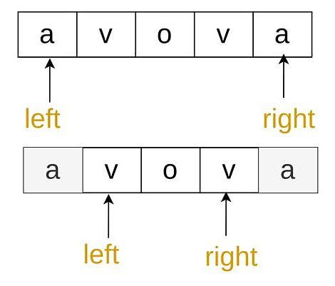
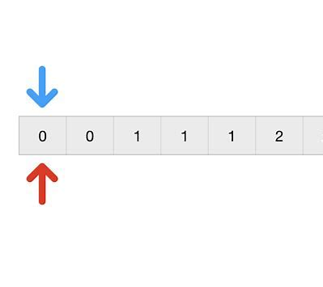
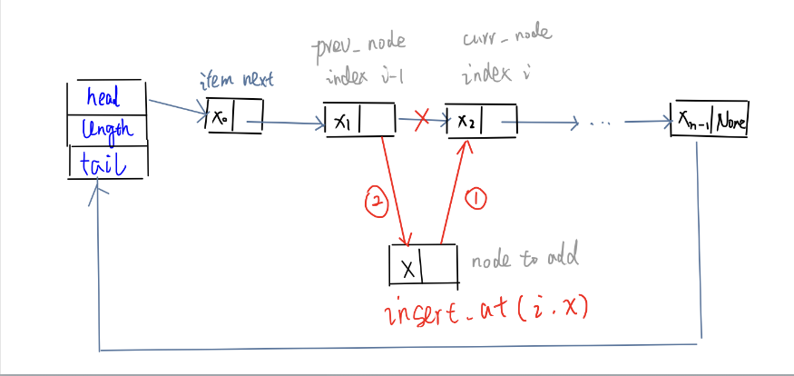
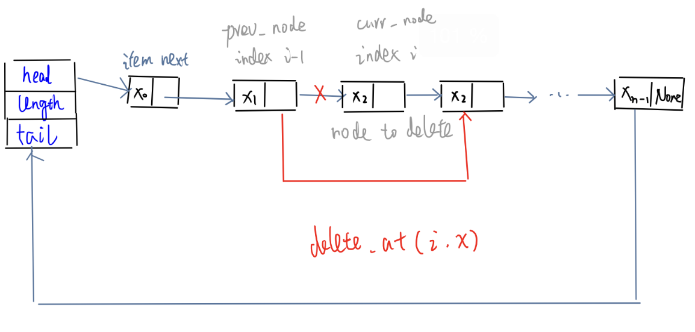
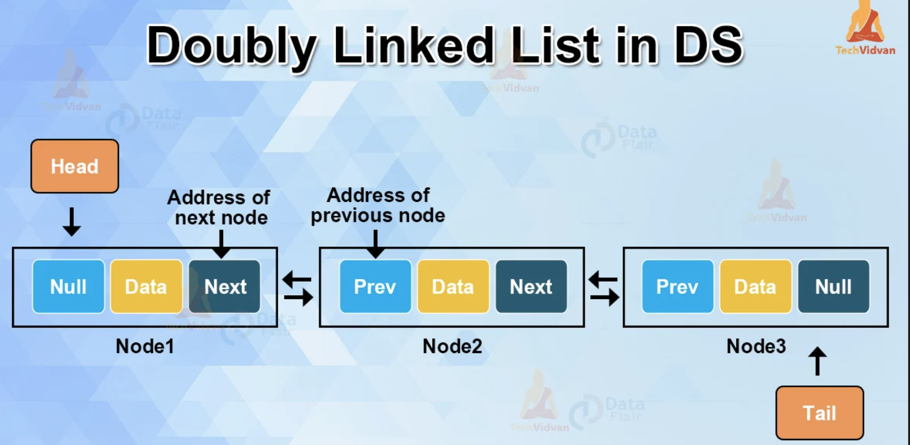
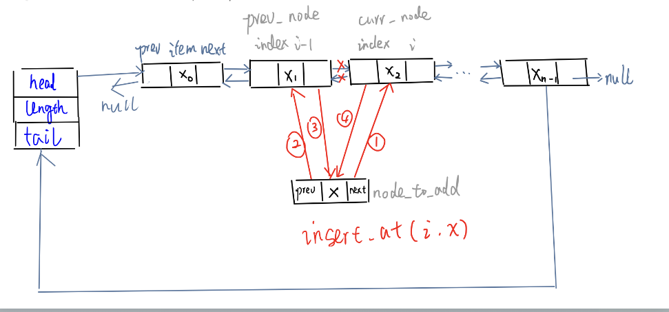
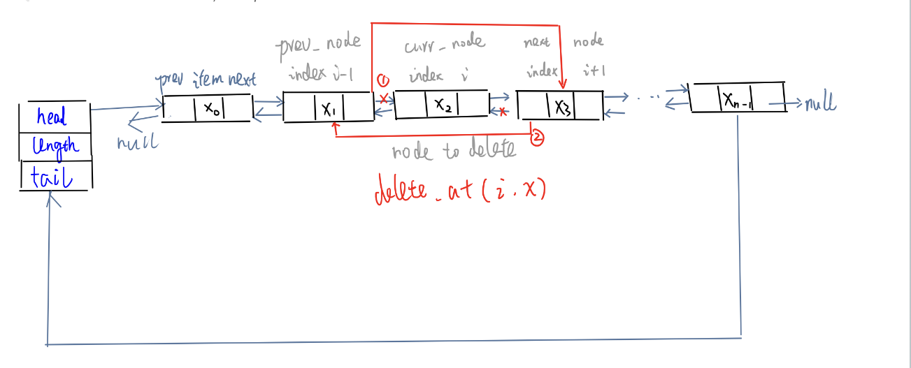
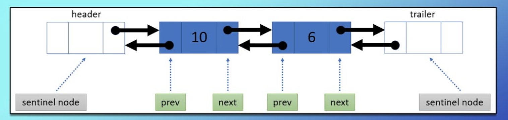
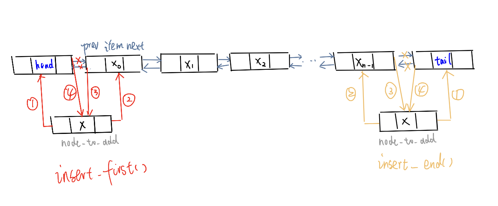
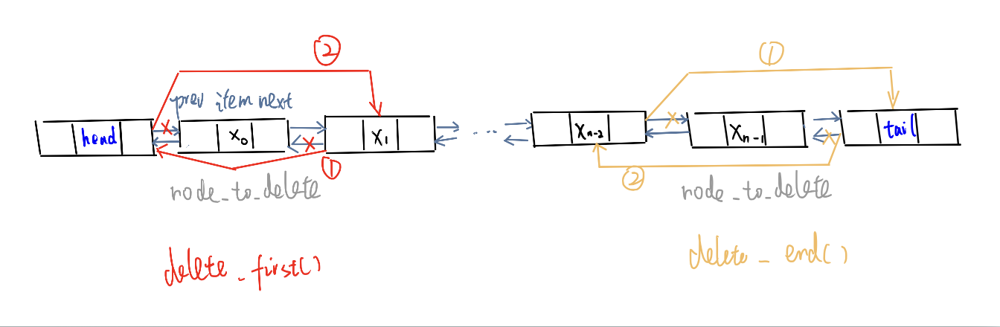

# Code Template - Data Structure

## Array & String

### Two Pointers

Having two **integer variables** that both move along an **iterable**, each representing an **index** of the array or string, usually named something like `i` and `j`, or `left` and `right`.

#### Two pointers - case 1: one input, opposite ends -> squeeze

Figure: **Two Pointers** - Case 1




| Aspect | Details |
|:---|:---|
| **Idea**| Start the pointers at the **first and last indices** and **move** them **towards each other** until they **meet**.|
| **When to use** | **reverse** array/string **in place** (e.g., check palindrome - after reversing, stay the same)|
| **Complexity** | - Time:  $\color{blue}O(n)$ (where n = arr.length) if we can keep the work **inside each iteration** at  $O(1)$<br> because the pointers start  $n$ away from each other and move at least one step closer in every iteration -> we will never have more than  $O(n)$ **iterations** <br> - Space:  $\color{blue}O(1)$ because we only use two integer variables. |


<details>
<summary>Python</summary>

For array input:

```python
def fn(arr):
    ans = INIT
    
    # Step 1. init two pointers: point to first and last element 
    left = 0     
    right = len(arr) - 1   

    # Step 2. loop: at each iteration, move two pointers towards each other, until they meet or cross (== or >)
    while left < right:  # Time: O(n)
        # do some logic here， depending on the problem
        
        # move two pointers closer: choose one or more from three options
        if CONDITION:  
            left += 1    # Option 1. increment the left pointer
        if CONDITION:
            right -= 1   # Option 2. decrement the right pointer
        if CONDITION:
            # do some logic here
            left += 1   # Option 3. move both pointers at the same time
            right -= 1
    
    return ans
```

For string input, extra steps: <strong>convert</strong> the string to a <strong>list</strong> before processing and <strong>join</strong> the list back to <strong>string</strong> before returning:

```python
def fn(s):
    arr = list(s)   # convert the string to a list
    ans = INIT

    # Step 1. init two pointers: point to first and last element
    left = 0
    right = len(arr) - 1

    # Step 2. loop: at each iteration, move two pointers towards each other
    while left < right:
        # do some logic here depending on the problem

        # move two pointers closer: choose one or more from three options
        if CONDITION:
            left += 1
        if CONDITION:
            right -= 1
        if CONDITION:
            left += 1
            right -= 1

    return ''.join(arr) # join the list back to string
```
</details>

<details>
<summary>C++</summary>

```cpp
int fn(vector<int>& arr) {
    int left = 0;
    int right = static_cast<int>(arr.size()) - 1; // convert to int because std::vector::size() returns an unsigned integer type std::size_t, if arr is empty, std::size_t cannot represent -1 and will leads to a super big number

    int ans = 0;

    while (left < right) {
        // do some logic here with left and right pointers, depending on the problem
        if (CONDITION) {
            left++;
        } 
        if (CONDITION) {
            right--;
        }
    }

    return ans;
}
```
</details>


#### Two pointers - case 2: two inputs, exhaust both

Figure: **Two Pointers** - Case 2




| Aspect | Details |
|:---|:---|
| **Idea**| start at the same first index 0, then **move along both inputs simultaneously** until all elements have been checked. |
| **When to use** | - Check subsequence <br> - Combine two arrays |
| **Complexity** | - Time:  $\color{blue}O(m+n)$ (where $m = \text{arr1.length}$, $n = \text{arr2.length}$) if we can keep the work **inside each iteration** at  $O(1)$<br> because at every iteration, we move at least one pointer forward, and the pointers cannot be moved forward more than $n + m$ times <br> - Space:  $\color{blue}O(1)$ because we only use two integer variables. |


<details>
<summary>Python</summary>

```python
def fn(arr1, arr2):
    i = j = 0   # Step 1. create two pointers: each pointer for each iterable, each start at the first index 0.
    ans = INIT

    # Step 2. loop: at each iteration, move one or two pointers forward, until one of the pointers reaches the end of its iterable (==).
    while i < len(arr1) and j < len(arr2): 
        # do some logic here depending on the problem
        
        # Step 3. incrementing either one of the pointers, or both. 
        if CONDITION:
            # do some logic here
            i += 1   
        if CONDITION:
            j += 1
    
    # Step 4. Optional: loop: iterate through the rest of the elements to make sure both iterables are exhausted, because when the above while loop finishes, one point is at the end, the other pointer might not be at the end. 
    # Note that only one of the following loops would run in reality.
    while i < len(arr1):
        # Do some logic here
        i += 1
    
    while j < len(arr2):
        # Do some logic here
        j += 1
    
    return ans
```
</details>

<details>
<summary>C++</summary>

```cpp
int fn(vector<int>& arr1, vector<int>& arr2) {
    int i = 0, j = 0
    Type ans = INIT;

    while (i < arr1.size() && j < arr2.size()) {
        // do some logic here
        if (CONDITION) {
            i++;
        } else {
            j++;
        }
    }

    while (i < arr1.size()) {
        // do logic
        i++;
    }

    while (j < arr2.size()) {
        // do logic
        j++;
    }

    return ans;
}
```
</details>

####  Two pointers - other cases

| Cases| When to use|
|:---|:---|
| starting the pointers at **different indices**, instead of first and last index|	
| only be **one input** array/string, but we still initialize both pointers at the first index and move both forward, e.g., fast slow pointer |
| three pointers|

## Linked List

Tips:
It's important to build an intuition behind how to correctly **re-assign pointers**. The best way is to see the process visually through **examples**. 

### Singly-Linked List


#### Definition - Singly-Linked List - Use Raw Pointer


<details>
<summary>Python</summary>

```python
class ListNode:
    def __init__(self, val):        # O(1)
        self.val = val
        self.next = None
    
    # get the node with specific offset away
    def later_node_recursion(self, offset):
        if offset == 0:     # base case
            return self
        
        if offset < 0:
            raise ValueError("offset must be non-negative")   
        if self.next is None:
            raise IndexError("offset exceeds list length")

        return self.next.later_node_recursion(offset - 1)   # time complexity: O(offset), space: O(offset)
    
    def later_node_iterative(self, offset):
        if offset < 0:
            raise ValueError("offset must be non-negative")
        
        curr_node = self
        for _ in range(offset): # time complexity: O(offset), space: O(1)
            if curr_node.next is None:
                raise IndexError("offset exceeds list length")
            curr_node = curr_node.next

        return curr_node

# example linked list
one = ListNode(1)
two = ListNode(2)
three = ListNode(3)
head = one
one.next = two
two.next = three
```
</details>


<details>
<summary>C++</summary>

```cpp
struct ListNode {
      int val;
      ListNode *next;
      // constructor overloading
      ListNode() : val(0), next(nullptr) {}
      ListNode(int val) : val(val), next(nullptr) {}
      ListNode(int val, ListNode *next) : val(val), next(next) {}
  };


int main() {
    // Dynamically allocate nodes on heap memory
    ListNode* one = new ListNode(1);  
    ListNode* two = new ListNode(2); 
    ListNode* three = new ListNode(3);

    ListNode* head = one; // head points to the first node (one)
    // Connecting the nodes to form: one -> two -> three
    one->next = two; // memory address assignment    
    two->next = three;      

    // In practice, we need to delete these nodes using `delete` to avoid memory leaks.
}
```
</details>

#### Definition - Singly-Linked List - Use Modern C++ Smart Pointer

<details>
<summary>C++</summary>

```cpp
#include <memory>

struct ListNode {
    int val;
    std::unique_ptr<ListNode> next; // unique ownership
    // constructor overloading
    ListNode() : val(0), next(nullptr) {}
    ListNode(int val) : val(val), next(nullptr) {}
    ListNode(int val, ListNode *next) : val(val), next(next) {}
};

int main() {
    // no raw pointers or manual deletion
    auto one = std::make_unique<ListNode>(1); // create ListNode object, smart unique pointer own this node 1.
    auto two = std::make_unique<ListNode>(2);
    one->next = std::move(two); // ownership transferred (then previous pointer two becomes nullptr)

    // No need for manual delete, smart pointers handle it automatically
}
```
</details>

#### Add/Delete Node - Singly-Linked List

At first, obtain the **reference** to the **previous node** `prev` (the node at position  $i - 1$) by iterating from the head.
Typically we do these operations **on the fly**, when iterating through the list (these functions are just demonstration). 

Figure: **Singly Linked List** - **insert** at **random** position: `node_to_add.next`  points to `preNode.next`, then change `preNode.next` points to `node_to_add`



Figure: **Singly Linked List** - **Delete** at **random** position: change `preNode.next` pointer to `preNode.next.next`




<details>
<summary>Python</summary>

```python
# Obtain the reference by iterating from the head - time: O(n)
def add_node(prev_node, node_to_add):   # Time: O(1)
    node_to_add.next = prev_node.next
    prev_node.next = node_to_add

def delete_node(prev_node):
    prev_node.next = prev_node.next.next
```
</details>


<details>
<summary>C++</summary>

```cpp
// Obtain the reference by iterating from the head - time: O(n)
void addNode(ListNode* prevNode, ListNode* nodeToAdd) {
    nodeToAdd->next = prevNode->next;   // Time: O(1)
    prevNode->next = nodeToAdd;
}

void deleteNode(ListNode* prevNode) {
    prevNode->next = prevNode->next->next;
}
```
</details>


### Traverse the Linked List

Example: 
get the sum of all values from an integer linked list.

#### Traverse - Iterative

Using **dummy pointers** `curr` **without losing** a reference to the **head**.


<details>
<summary>Python</summary>

```python 
def get_sum(head):
    ans = 0
    curr = head
    
    while curr: # The final node's next pointer is null. Therefore, after the final node, the while loop ends.
        # ans += curr.val
        curr = curr.next   

    return ans
```
</details>


<details>
<summary>C++</summary>

```cpp
int getSum(ListNode* head) {
    int ans = 0;
    ListNode* curr = head;
    while (curr != nullptr) {
        // ans += curr->val;
        curr = curr->next;
    }

    return ans;
}
```
</details>

#### Traverse - Recursive


<details>
<summary>Python</summary>

```python 
def get_sum(curr):
    if not curr:
        return 0
    
    return curr.val + get_sum(curr.next)
```
</details>


<details>
<summary>C++</summary>

```cpp
int getSum(ListNode* curr) {
    if (curr == nullptr) {
        return 0;
    }

    return curr->val + getSum(curr->next);
}
```
</details>


### Doubly linked list

Figure: **Doubly linked list** - similar to singly linked list, but each node also contains a pointer to the **previous** node `prev`, and it allows iteration in **both directions**.



#### Definition - Doubly linked list


<details>
<summary>Python</summary>

```python
class ListNode:
    def __init__(self, val):
        self.val = val
        self.next = None
        self.prev = None
```
</details>


<details>
<summary>C++</summary>

```cpp
struct ListNode {
    int val;
    ListNode *next;
    ListNode *prev;

    ListNode() : val(0), next(nullptr), prev(nullptr) {}
    ListNode(int val) : val(val), next(nullptr), prev(nullptr) {}
    ListNode(int val, ListNode* next, ListNode* prev) : val(val), next(next), prev(prev) {}
};
```
</details>


#### Add/Delete Node - Doubly-Linked List

With a doubly linked list, we only need a reference to the **current node** at  $i$, because we can simply reference the `prev` pointer of that node to get the node at  $i - 1$, and `next` pointer of that node to get the node at  $i + 1$,

Extra work: **update** the **`prev`** pointers


Figure: **Doubly Linked List** - **insert** at **random** position: `node_to_add.next` points to `curr_node`, `node_to_add.prev` points to `prev_node`, `prev_node.next` points to `curr_node`, `curr_node.prev` points to `curr_node`




<details>
<summary>Python</summary>

```python
def add_node(curr_node, node_to_add):
    # get prev node reference
    prev_node = curr_node.prev  
    # relink
    node_to_add.next = curr_node
    node_to_add.prev = prev_node
    prev_node.next = node_to_add
    curr_node.prev = node_to_add
```
</details>


<details>
<summary>C++</summary>

```cpp
void addNode(ListNode* currNode, ListNode* nodeToAdd) {
    ListNode* prevNode = currNode->prev;
    nodeToAdd->next = currNode;
    nodeToAdd->prev = prevNode;
    prevNode->next = nodeToAdd;
    currNode->prev = nodeToAdd;
}
```
</details>


Figure: **Doubly Linked List** - **delete** at **random** position: `prev_node_next`  points to `next_node`, then change `next_node.prev` points to `prev_node`




<details>
<summary>Python</summary>

```python
def delete_node(curr_node):
    # get prev, next node reference
    prev_node = curr_node.prev
    next_node = curr_node.next  
    # relink
    prev_node.next = next_node
    next_node.prev = prev_node
```
</details>


<details>
<summary>C++</summary>

```cpp
void deleteNode(ListNode* currNode) {
    ListNode* prevNode = currNode->prev;
    ListNode* nextNode = currNode->next;
    prevNode->next = nextNode;
    nextNode->prev = prevNode;
}
```
</details>

#### Add/Delete First/Last node using sentinel nodes(`head`, `tail`) - Doubly-Linked lists

To easily add and remove at the end or tail of the linked list. No need to judge the edge cases if `head` or `tail` `== nullptr`


Figure: **Doubly Linked List** - with **sentinel nodes**(`head`, `tail`). Even when there are no nodes in a linked list, you still keep a head and tail. The real head node of the linked list is **`head.next`** and the real tail node is **`tail.prev`**. The sentinel nodes themselves are not part of linked list.



Figure: **Doubly Linked List** - with **sentinel nodes**(`head`, `tail`). **insert** at start/end



Figure: **Doubly Linked List** - with **sentinel nodes**(`head`, `tail`). **delete** at start/end




<details>
<summary>Python</summary>

```python
def add_to_start(node_to_add):
    node_to_add.prev = head
    node_to_add.next = head.next
    head.next.prev = node_to_add
    head.next = node_to_add

def add_to_end(node_to_add):
    node_to_add.next = tail
    node_to_add.prev = tail.prev
    tail.prev.next = node_to_add
    tail.prev = node_to_add

def remove_from_start():
    if head.next == tail:   # special case: empty 
        return
    # get reference
    node_to_remove = head.next  
    # relink
    node_to_remove.next.prev = head
    head.next = node_to_remove.next

def remove_from_end():
    if head.next == tail:   # special case: empty
        return
    # get reference
    node_to_remove = tail.prev
    # relink
    node_to_remove.prev.next = tail
    tail.prev = node_to_remove.prev

# create empty linked list with sentinel nodes
head = ListNode(None)
tail = ListNode(None)
head.next = tail
tail.prev = head
```
</details>


<details>
<summary>C++</summary>

```cpp
void addToStart(ListNode* nodeToAdd) {
    nodeToAdd->prev = head;
    nodeToAdd->next = head->next;
    head->next->prev = nodeToAdd;
    head->next = nodeToAdd;
}

void addToEnd(ListNode* nodeToAdd) {
    nodeToAdd->next = tail;
    nodeToAdd->prev = tail->prev;
    tail->prev->next = nodeToAdd;
    tail->prev = nodeToAdd;
}

void removeFromStart() {
    if (head->next == tail) {
        return;
    }

    ListNode* nodeToRemove = head->next;
    nodeToRemove->next->prev = head;
    head->next = nodeToRemove->next;
}

void removeFromEnd() {
    if (head->next == tail) {
        return;
    }

    ListNode* nodeToRemove = tail->prev;
    nodeToRemove->prev->next = tail;
    tail->prev = nodeToRemove->prev;
}

ListNode* head = new ListNode(-1);
ListNode* tail = new ListNode(-1);
head->next = tail;
tail->prev = head;
```
</details>


### Reversing a singly-linked list

a typical **problem** or an **intermediate step**


<details>
<summary>Python</summary>

```python
def reverse_list(head):
    prev = None               # to track the previous node
    curr = head               # to track the current node 

    while curr:               # traverse until the tail 
        next_node = curr.next # 1. keep a reference to the original next node, make sure we don't lose it
        curr.next = prev      # 2. reverse the direction of the next pointer
        prev = curr           # 3. Update prev for the next iteration
        curr = next_node      # 4. Update curr for the next iteration
        
    return prev               # After the final iteration, prev points to the original tail, which is the new head
``` 
</details>
