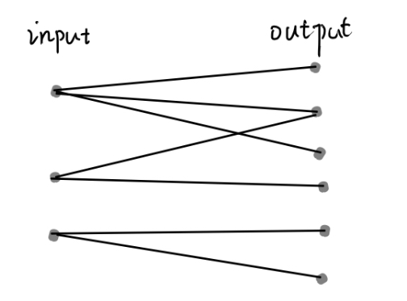
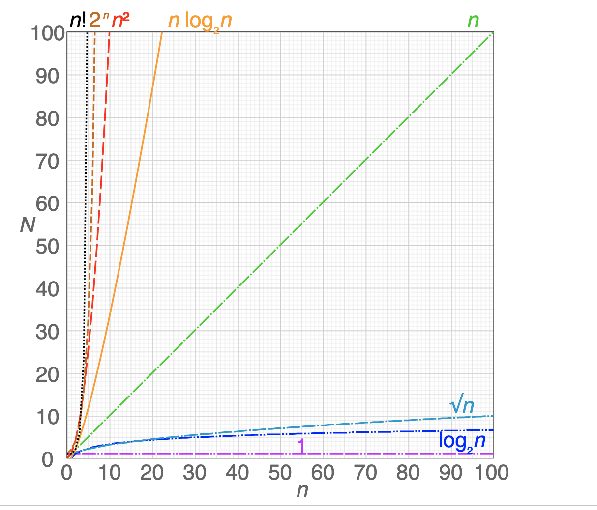
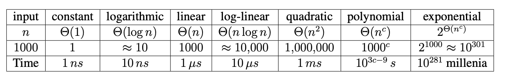
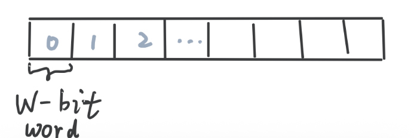

[TOC]

# 6.006 Lecture 1: Introduction
## Goal
**solve** computation problems, and **communicate** that our solutions are **correct** and **efficient**.   
 
| Term | Definition | Requirements | Example | 
|:---:|:---|:--|:--|
|Define a **Problem**| A mapping (binary relation) from problem **inputs** to **correct outputs**. |   - Usually **don’t** specify every correct output for all inputs (too many examples; one input could map to many output)    - Provide a verifiable **predicate** (a property) that correct outputs must satisfy (so we can check whether the output is correct or not given a input-output pair)    - **general** problem for **arbitrarily large input size** |  - Not general: small input instance: In this room, is there a pair of students with same birthday?     - General: arbitrarily large inputs: Given any set of n students, is there a pair of students with same birthday? (include year, date, hour, etc.)|
|Design **Algorithms** | a **sequence** of **procedure** that computers will follow to solve a problem, i.e., to **map** each input to a **single** **correct** output  |- should be **deterministic function**, i.e., no randomness   - should be correct for any **arbitrary valid input**. | to solve birthday matching:    – Maintain a record of names and birthdays (initially empty)     – Interview each student in some order   - If birthday exists in record, return found pair. Else add name and birthday to record    – Return None if last student interviewed without success |  
|Prove **Correctness**|| - For small inputs: can use case analysis     - For **arbitrarily large inputs**, algorithm must use **induction** (**recursion** is such a key concept) | Proof of correctness of birthday matching algorithm:   - **Induct** on $n$: the number of students in record    – **Hypothesis:** if first $n$ contain match, returns match before interviewing student $n + 1$   – **Base case:** $n = 0,$ first $0$ contains no match    – **Inductive steps:** Assume for induction hypothesis holds for $k$, and consider $k + 1$.  Two cases: 1. If first $k$ contains a match, already returned a match by induction. 2. Else first $k$ do not have match, so if first $k+1$ has match, match contains the $k+1$ student   – Then algorithm checks directly whether birthday of student $k+1$ exists in first $k$  |
|**Communicate Efficiency**| Measure **the number of operations** instead of time, so that the performance of algorithms depend on the **the size of input** instead of underlying machine.|**Asymptotic Notation:** **ignore constant factors and low order terms**     – **upper bounds** $O$ (worst case )  - lower bounds $\Omega$ (best case)   - **tight bounds** (both upper and lower, more presice) $\Theta$  (average case)     **Efficient** if returns in **polynomial time** with respect to input (**not exponential**)| 

Figure: **Problem definition:** mapping (binary relation, a bipartite graph) from problem **inputs** to **correct outputs**.

## Use Big O Notation to Describe the Computational Complexity
- [Bio O cheat sheet](https://www.bigocheatsheet.com/)
- [Python complexity](https://wiki.python.org/moin/TimeComplexity)

| Aspects | Details |
|:---:|:---|
| Question | Under the **worst case**, how does runtime or memory allocation scale (**upper bound**), as the input size grows? |
| **Complexity** | Complexity is described by a math **function**|
| Define **Variables**| Variables should represent values that change between **different inputs** and would **affect the algorithm**.  - If there is **one input** dimention, we coould define the **length** of an input as $n$    - If there are **multiple inputs**, we could define each input size seperately as $n, m$ or $n = \text{length1}+ \text{length2}$ 
| **Rules** | Only represent when the **input** variables tend to **infinity** (sufficiently large), **ignore constants** and **lower order terms**. | 
| Note | When n is not sufficiently large, an $O(n)$ algorithm can be slower than an $O(n\log n)$ algorithm. | 

Figure: **Complexity**:
$O(1)<O(\log n)<O(n^{1/2})<O(n)<O(n \log n)<O(n^2)<O(2^n)<O(n!)$

Table: Complexity

### Time Complexity vs Space Complexity 

| Aspects | time complexity | space complexity |
|:---:|:---|:---|
| **Difference** | the amount of **run time** (the number of basic **operations**) the algorithm needs to run  relative to the **input size** | the amount of **allocated memory** used by the algorithm relative to the **input size** | 
| **trade-off** | which is more important depends on the specific problem. Typically, people care about the **time complexity** more than the space complexity.|
| Note| | - ❌ never count the space used by the **input** (it is **bad practice** to **operate directly on input and/or modify the input**) ‼️Always ask interviewer if allowed   - ❌ usually don't count the space used by the **output** (the answer) unless an interviewer asks us to.  |

### Model of Computation : Word-RAM 
RAM (Random Access Memory)

| Aspects | Definition | Details |
|:---:|:---|:---|
| **Why do we need it** | Basis for computing efficiency: specification for **what operations** on the machine can be performed in constant $O(1)$ time. | CPU supports constant-time operations on an $O(1)$ number of words (**integers**): – **integer** arithmetic: `+`, `-`, `*`, `//`, `%` – **logical** operators: `&&`, `\|\|`, `!`, `==`, `<`, `>`, `<=`, `>=` – **bitwise** arithmetic: `&`, `\|`, `<<`, `>>` – Given word $a$, can **read / write** at address $a$. |
| **Computation model** | CPU addresses a **consecutive** chunk of memory ($w$-bit RAM cell) in constant time. The chunk size is called the **word size**, denoted by $w$. A $w$-bit word can address $n = 2^w$ addresses in memory. | To address the largest memory address, require at least $w \geq \log_2 n$ bits. To address more memory for arbitrarily large input, we need to increase the RAM size. |

Figure: **Word-RAM**: **Memory** is an **array** of $w$-bit words. Each **word** is a **$w$-bit long** cell/chunk in the memory and we can access them randomly.

## How to Solve an Algorithms Problem
| Methods | Details |
|:--:|:---|
| Reduce to a problem you **already know**   (use data structure or algorithm) | • Search Problem (Data Structures)   • Sort Algorithms  •  Shortest Path Algorithms 
| Design your **own (recursive) algorithm** | • Brute Force  • Decrease and Conquer  • Divide and Conquer  • Dynamic Programming (L15-L19)  • Greedy / Incremental
