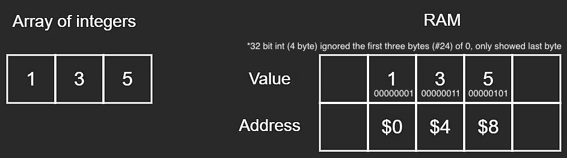
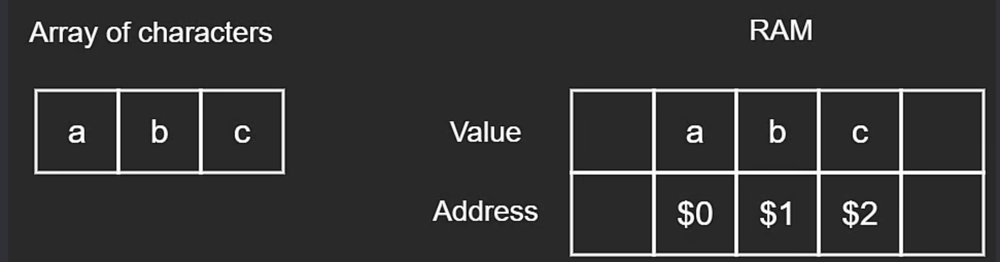
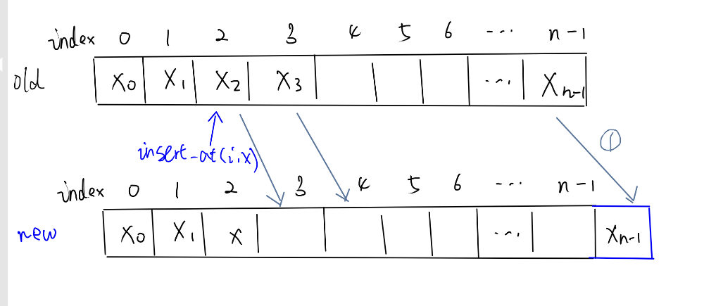
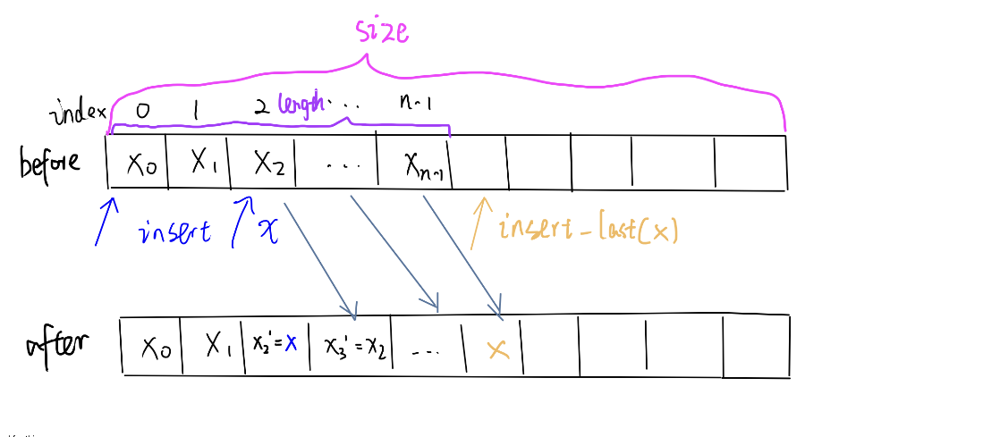
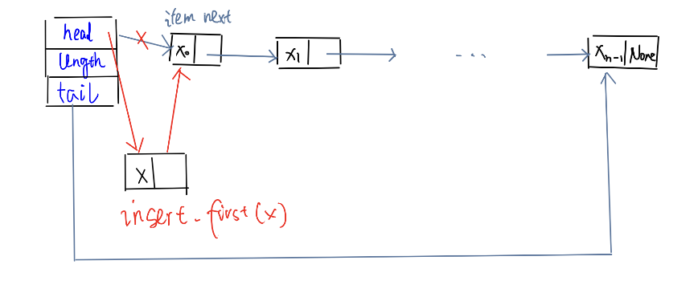
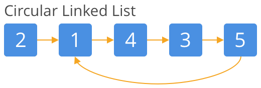
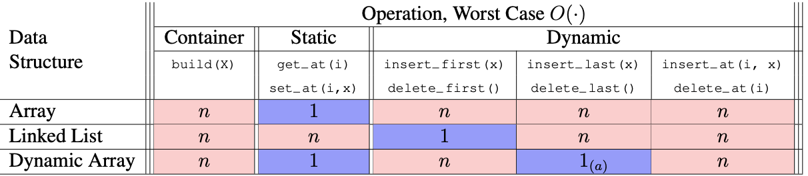

# 6.006 Lecture 2: Data Structure  
## Interfaces vs Data Structures 
| Aspects | Interface (API) | Data Structures |
|:--:|:--:|:--:|
| **Definition** | A collection of supported **operations** | a way to **store** non-constant **data** inside Random Access Memory(RAM), with **algorithms** that **support** a set of **operations** (called **interface**) on the data | 
| Exposure Level |for users|  under the hood| 
|**Key Difference**|a specification: **what data** we can store and **what operations** are supported and what they mean  (the problem) |a representation: **how** to store data and **how** operations are supported by algorithms   (the solution)  

## Interfaces

| Types | Definition| Order |
|:--:|:---|:--|         
| **Sequence**| Maintain a sequence of items,  $x_0, x_1, x_2, . . . , x_{n−1}$ (**zero indexing**) and use  $n$ to denote the number of items stored in the data structure |Extrinsic order to items (**first, last,  $i$-th**)
| **Set**| Maintain a set of items having unique keys (e.g., item `x` has key `x.key`)   | Intrinsic order to items (queries based on item **keys**)|

### Sequence Interface
|Operation Category | Operation Explanation |
|:--:|:--|
| **Container** | - `build(X)`: given an iterable `X`, build new sequence from items in `X`   - `len()`: return the number of stored items |
| **Static** not change length|- `iter_seq()` : return the stored items one-by-one in sequence order   - `get_at(i)`: return the  $i^{th}$ item  $x_i$  - `set_at(i, x)`: replace the    $i^{th}$ item  $x_i$ with `x`   - `get_first`,`get_last()`  - `set_first(x)`,`set_last(x)`  |
| **Dynamic** change length|  - `insert_at(i, x)`: add  $x$ as the  $i^{th}$ item. If there is a value there at index  $x$, make  $x$ the new  $x_i$.   - `delete_at(i)`: remove and return the  $i^{th}$.    - `insert_first(x)`: add  $x$ as the first item. Shift all elements.   - `delete_first()`: remove and return the first item   - `insert_last(x)`: add  $x$ as the last item. No shift.   - `delete_last()`: remove and return the last item   Note:  use different operation interfacees at different index  $i$, first, last, because we can find **more effient algorithms** for `insert_first(x)` than `insert_at(i, x)`|

#### Special case
|Data Structure | Supported Operation | Features |
|:--:|:--|:--|
| stack |- `insert_last(x)`   - `delete_last()` | LIFO (**Last In, First Out**)  elements added and removed from the **same end**|
| queue | - `insert_last(x)`   - `delete_first()`| FIFO (**First in, First out**).   elements are added and removed from **opposite ends**.|

## Sequence Data Structures: Static array vs Dynamic Array vs Linked List

| **Aspect** | **Static Array  (Fixed-Size)** | **Dynamic Array** | **Linked List   (Singly or Doubly)** |
|:---:|:---|:---|:---|
| **Memory Layout** | One **contiguous** block of memory. All elements stored **sequentially**. | **Contiguous** block of memory at any given time.  (**same** as static array) |  All elements are stored in nodes, **scattered** in **arbitrary order** in different locations of memory (**Non-contiguous**).  - **Singly** linked list: Each **node** (defined by a custom class) stores not only an item value `node.item`  but also **a pointer**  `node.next`  (reference to the **next** node, store its **memory address** rather than the entire node itself).   * We can chain ` .next`.  * The **final** node's next pointer is **null** (`None` in Python; `nullptr` in C++).  - **Doubly** linked list: store **extra pointer** `node.prev` to the **previous** node. |
|**Build** Memory Allocation|allocate memory for array with **exact** size  $n$  in  $\color{blue}\Theta(n)$ time,  $\text{space} = O(\text{time})$| Allocate **extra space**  $\text{size} = \Theta(n) > n$ so reallocation does not occur with every dynamic operation, only occur sometimes |allocate memory for array size  $n$ |
| **Size Management** | 👎 Must declare **fixed size** and type when initialized in advance.   - **Everytime** when the array is full, it can ***not*** store additional elements and have to **reallocate** a brand new array and **copy** values because the next word in memory might be already occupied by something else.  | 👍 **Resize as needed**   - allocate a **new** block of memory (the exact growth factor is **implementation-dependent**, simplication: double the size, i.e., full ratio  $r=1/2$), then **copy data and deallocate** the previous memory block automatically.   - When deleting from the tail, reduce size by allocating smaller memory (still maintain the full ratio and have extra space) and copy items|  👍 Number of nodes can **grow or shrink arbitrarily**. - Each insertion simply **allocates a new node** (array of size  $2$ in memory)  - size is only limited by available **memory**. |
| **Space Usage** | Exact **Fixed** amount of contiguous memory allocated for the **declared size**. | - May **over-allocate** extra unused capacity to allow future growth.  - Fixed size under the hood - still need **resize**  - In Python, `list` stores **pointers** to objects rather than objects themselves (objects themselves are separate Python objects); In C++, `std::vector<T>` stores **objects themselves**. | - Each node requires **pointer overhead** for `next` (doubly linked list also needs `prev` plus possible allocator/object overhead. - **No** need for contiguous space. |
|**Check Length**|$\color{blue}O(1)$|
| **Read/Set an element** | 👍 **Fast random access** `arr[i]` in **$\color{blue}O(1)$**   because elements (or pointers to elements) are contiguous so the location can be calculated:  `array[i] = memory[address(array) + i]` | 👍 **Fast random access** `arr[i]` in  $\color{blue}O(1)$    (same as static array). | - 👎 **No random access** via direct indexing: to get the  $i$-th element, **must traverse** from the head or tail in  $\color{blue}O(n)$.    - 👍 **Fast access at head:** in  $\color{blue}O(1)$ because we already have a pointer to the first node (head node).    - 👍 **Fast access at tail:** in  $\color{blue}O(1)$ if we have a pointer to the tail node. |
| **Traverse Sequence** (iterate all values) |  $\color{blue}O(n)$ | |  $\color{blue}O(n)$ by reassiging `curr_node.next`|
| **Insert / delete** | - 👎 **Slow insert** at **random**  $i$-th index in  $\color{blue}O(n)$ if the length < allocated capacity because it requires **shifting** each element afterwards 1 position to the right, then insert.    - 👎 **Insert** at **end**   *case 1. in  $\color{blue}O(1)$ if the length < allocated capacity   *case 2. in  $\color{blue}O(n)$ if length = allocated capacity because it **cannot expand** in place and must **reallocate** a new array and **copy**s all values.  - **Delete** from **end** in **$\color{blue}O(1)$**: set `arr[n-1] = default`.   - 👎 Delete at front or at random **i-th** index in  $\color{blue}O(n)$: shift each element afterwards 1 position to the left. | - 👍 **Insert** at **end** is **amortized  $\color{blue}O(1)$** (the average time taken per operation over a sequence of operations).   - 👎 **Insert**/**Delete** at **random**  $i-th$ index in  $\color{blue}O(n)$ requires **shifting** each element.    - 👍 **Delete** at the **end** in  $\color{blue}O(1)$ |    - 👍 **Fast insert/delete at head:** in  $\color{blue}O(1)$ because we have `head` pointer and can simply **manipulate nodes** by **relinking pointers**.    - 👍 **Fast insert at tail** in  $\color{blue}O(1)$ if we have `tail` pointer (without traversing).    - 👍 **Fast delete at tail** in  $\color{blue}O(1)$ if we have `tail` pointer and `node.prev` pointer (Doubly linked list).    - 👎 **Slow insert/delete** at random  $i$-th **middle** node in  $\color{blue}O(n)$ because we need to loop over items to find the reference to that node; if we already have reference to that specific node, then it becomes  $\color{blue}O(1)$  |
| **Implementation Examples** | - C++ `std::array<int, N>` | - C++ `std::vector<T>` (Must specify data type) - Python built-in `list` `[]` (no need to specify data type and can contain multiple types at once) | - C++ `std::list`, `std::forward_list` - Custom linked-list classes in Python or other languages. |
| **When to use** | - When size is **known** in advance and **won’t change**. - Need fast **random access**.   - Do **not** need any **dynamic** operations | - Need **fast random access**   - Need **frequent appends at the end**, but still need growth beyond the initial size. | - Frequent insertions and deletions at the **head or tail node**. - Do **not** need fast **random** access. |

### Static Array
Memory addresses are apart with element size. 

Example:
Figure: **Array** of Integers (a 32-bit int = 4 bytes, where 1 byte = 8 bits)

Figure: **Array** of Characters (a character = 1 byte, where 1 byte = 8 bits)

If there are elements after index  $i$, have to **shift** all the elements after index  $i$:

- `insert_at(i, x)`:  $x_i \rightarrow x_{i+1} \rightarrow x_{i+2} ...\rightarrow x_{n-1}\rightarrow x_{n}$
- `delete_at(i)`:  $x_i \leftarrow x_{i+1} \leftarrow x_{i+2}... x_{n-2}\leftarrow x_{n-1}$

Figure: **Static** Array - insert: **shift** all items after the modified item

### Dynamic Array
Figure: **Dynamic** Array - insert: **shift** all items after the modified item

### Linked List
Figure: **Linked List** - insert :manipulating nodes by **relinking**

Figure: **Circular Linked List** - ‼️ **Avoid cycle** (there is some node in the list that can be reached again by continuously following the next pointer)

## Amortized Analysis  

| Aspects | Meaning |Details| 
|:--:|---|---|
| **Definition** | Data structure analysis technique : cost of the operation is amortized   **(averaged/ distributed)** over the operation sequence  |Operation has amortized cost  $T(n)$ if  $k$ operations cost at most  $≤ kT(n)$
|**Example** |Inserting into a dynamic array takes  $\Theta(1)$ amortized time | Insert at last position, resize at  $n=1,2,4,8,16,…,2^i$|
| **Proof**|  $\begin{aligned}  \text{resized cost} &= \Theta(2^0 + 2^1 + 2^2 + ...+ 2^i) \\  &= \Theta(\sum_{i=0}^{\log n}2^i)\\ &= 2^{\log n} \\ &=\Theta(n) \space \text{in total} \\&= \Theta(1) \space\text{amortized}\end{aligned}$ | when  $\begin{aligned}n &= 2^i\\\log n &=i\end{aligned}$ Geometric series (grow at least **exponentially**) are **dominated by the last item**:  $\sum_{i=0}^{k}2^i = 2^{k+1}-1$  |

## Summary
Table: **Big O** summary

$_{(a)}$ means amortized.

## String

### String - Python vs C++
| Feature / Operation | Python `str` | C++ `std::string` |
|---|---|---|
| **Mutability** | **Immutable**  (can read by indexing, but **cannot modify in place**) | **Mutable** (can **modify in place**, e.g., `s[i] = 'd'`) |
| Memory layout | Implementation-dependent | Contiguous character storage |
| **Read** |  $\color{blue}O(1)$ |
| **Traversal** |  $\color{blue}O(n)$   |
| **Get length** |    $\color{blue}O(1)$ |
| Slicing / Substring | O(k) to create a substring of length k | O(k) to create a substring of length k |
| Concatenation (`s1 + s2`) | O(n + m) | O(n + m) in the general case |
| Append one character | O(n) to create a new string | Amortized O(1); worst-case O(n) |
| **Set** at **random position**  $i$ |$\color{blue}O(n)$ to create a new string |  $\color{blue}O(1)$ in place|
| **Insert / delete**| at **random** position/at **end**  $\color{blue}O(n)$ because have to **create a new string** |
| Search for a **character** |  $\color{blue}O(n)$ |
| Search for a substring | O(n) typical for single-character search; substring search depends on algorithm | O(n) typical; substring search depends on algorithm |
| Compare two strings | O(min(n, m)) worst-case when a difference is found late or strings share a long prefix; O(n) if equal length n | O(min(n, m)) worst-case when a difference is found late or strings share a long prefix; O(n) if equal length n |
| Bounds checking | `s[i]` raises `IndexError` if out of range | `s[i]` does not guarantee bounds checking; `s.at(i)` checks and throws `std::out_of_range` |
| When to use | Text processing; safe sharing because strings cannot be modified in place | Text processing when in-place modification and mutable character sequences are useful |
