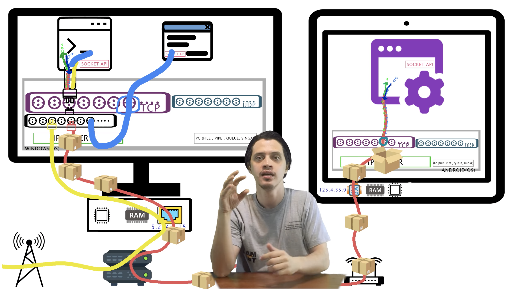
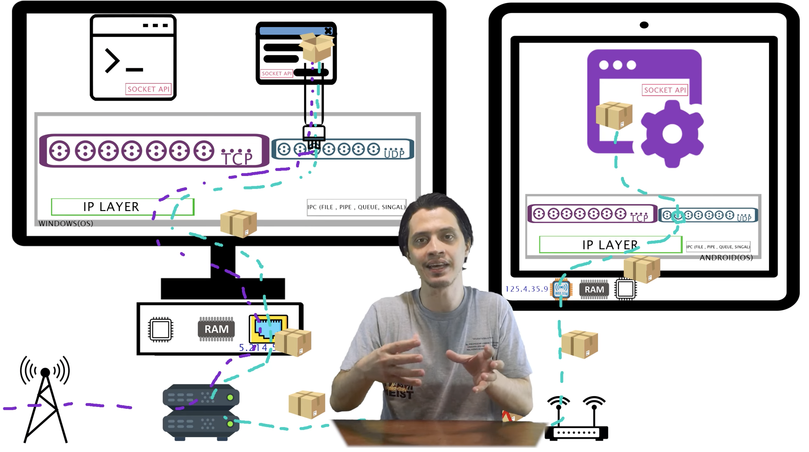
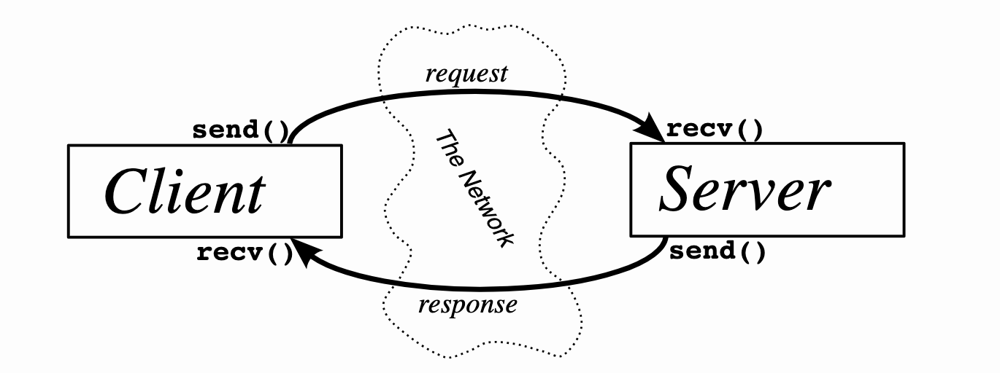

# Chapter 2: What is a Socket? 

| Topic | Description |
|---|---|
| Core idea | A socket is a way for programs to **communicate over a network** using standard Unix file descriptors. |
| Underlying Unix model | In Unix, everything is a file. <br> When Unix programs do I/O, they do it by reading  or writing to a **file descriptor** (an **integer** associated with an open file).|
| How you **create a socket** | Call `socket()` to obtain a socket descriptor. |
| How you **communicate** | Use `send()` / `recv()` socket calls. |
| Why it matters | It gives a standard programming interface for network communication, independent of underlying hardware details. |


Figure: socket metaphor : post delivery


Figure: TCP



Figure: UDP



## Section 2.1: Two Types of Internet Sockets 

| Item | `SOCK_STREAM` (TCP) | `SOCK_DGRAM` (UDP) |
|---|---|---|
| Common name | Stream socket | Datagram socket |
| Connection model | Connection-oriented | Connectionless by default |
|Communication Channel|Yes, reliable **two-way connected communication streams**.| No, **don’t have to maintain an open connection**|
| Error handling | TCP makes sure data arrives **sequentially and error-free**. | No. <br> App may add its own ACK/retry logic if reliability is needed |
| Reliability | Reliable delivery | Best-effort delivery |
| Ordering | Preserves order | May arrive out of order |
| **Speed/overhead** | More overhead, generally **slower** | Lower overhead, generally **faster** |
| Typical use cases | `ssh`, `telnet`, HTTP/web traffic, chat | When a TCP stack  is unavailable or when a few dropped packets are acceptable, e.g., <br> tftp (trivial file transfer protocol, a little brother to FTP), dhcpcd (a DHCP client), Real-time multiplayer games, audio/video streaming, DHCP/TFTP-style workflows |
| Key tradeoff | **Correctness** and delivery guarantees | **Low Latency** and throughput with possible packet loss |

## Section 2.2: Network Theory
How packets are built:

| Topic | Description |
|---|---|
| Encapsulation flow | App data is wrapped layer-by-layer (e.g., TFTP → UDP → IP → Ethernet) before sending; <br> receiver unwraps in reverse order and finally gets the data. |
| Why layering helps | Socket code stays mostly the same even if hardware/topology changes; lower layers abstract details away. |
| Layered Network Model (ISO/OSI 7-layer) | Application, Presentation, Session, Transport, Network, Data Link, Physical. |
| Layered model consistent with Unix (simplified) | Application (telnet, ftp, etc) <br> → Host-to-Host Transport (TCP/UDP)<br>  → Internet (IP/routing) <br> → Network Access (Ethernet/Wi-Fi). |
| Programmer responsibility | Use `send()` for stream sockets or `sendto()` for datagrams; kernel/hardware handle most lower-layer header work. |

Figure: Data Encapsulation


a packet is born, the packet is wrapped (“encapsulated”) in a header (rarely a footer) by the first protocol (TFTP protocol), then the whole thing (TFTP header included) is encapsulated again by the next protocol (UDP), then again by the next (IP), then again by the final protocol on the hardware (physical) layer (Ethernet).


# Chapter 3: IP Addresses, structs, and Data  Munging  
## Section 3.1: IP Addresses, versions 4 and 6

| Topic | Description | Example|
|---|---|---|
| IPv4  | 32-bit address, decimal + dot notation| `192.0.2.33` <br> its IPv6-compatible form is `::ffff:192.0.2.33`.|
| IPv6  | 128-bit address, hexadecimal + colon notation, created to solve IPv4 exhaustion. <br> <br> shorthand: Leading zeros can be omitted and long runs of zero groups can be compressed with `::` (once per address). | `2001:0db8:ab00:0000:0000:0000:0000:0000` <br> =`2001:db8:ab00::`|
| Loopback address | It always means “this machine I’m running on now”. <br> - IPv4 loopback is `127.0.0.1`<br> - IPv6 loopback is `::1`. |
| Subnet concept | Address = **network** part + **host** part, determined by a netmask (outdated). <br> <br> New style (Written as `address/the number of network bits (can be arbitrary) in decimal`| for IPv4: `192.0.2.12/30`, <br> for IPv6: `2001:db8::/32`|
| Port numbers | 16-bit transport-layer endpoint identifier; same IP can host multiple services by different ports. <br> <br> Metaphor: Think of the IP address as the street address of a hotel, and the port number as the room number.  | HTTP `80`, telnet `23`, SMTP `25`; ports `<1024` are often special, and usually require special OS privileges to use. |

## Section 3.2: Byte Order
if you want to represent the two-byte hex number.

| Item | Network Byte Order <br>(**Big-Endian**) | Host Byte Order (depends on architechture) |
|---|---|---|
| Where it is used | Standard byte order used on the wire for **network** protocols. | Native byte order used internally by the **local computer**. |
| Byte layout example (`0xb34f`) | Stored as `b3 4f` (big end byte first). | Could be `b3 4f` (big-endian hosts) or `4f b3` (little-endian hosts). |
| **Conversion** needed? | No  | **Convert** to Network Byte Order before sending out on the wire and **convert** back to Host Byte Order after receiving. |

Convension
Use every combination of these: 
<br> - “n” for "network" <br> - “h” for "host" <br> -  “s” for "short"(two bytes)  <br> - “l" for "long" (four bytes) <br> - "to" for direction

|Function|	Description|
|--|--|
|htons() |	host to network short |
|htonl() |	host to network long |
|ntohs() |	network to host short |
|ntohl() |	network to host long |

## Section 3.3: Structs

### Struct Overview

| Type Name| What it is for | when/How to use| Common function/API usage | IPv4 / IPv6 |
|---|---|---|---|---|
| `int socket descriptor` | a regular `int` as the socket file descriptor | Returned by `socket()`, <br> used by `connect()`, `bind()`, `send()`, `recv()`, etc. | |Both |
| `struct addrinfo` | Helper struct to prep the socket address structures for subsequent use; also used in host name lookups, and service name lookups |it’s one  of the first things we’ll call when making a connection: Call `getaddrinfo()` to fill out this `struct addrinfo`. (often it is all we need) | Both <br> - IPv4:`AF_INET`, <br> - IPv6: `AF_INET6`, <br> - IP version-agnostic: `AF_UNSPEC` |
| `struct sockaddr` | Generic struct holds socket address information, used by many socket calls. | |Parameter type for `connect()`, `bind()`, `accept()`, etc. (often via **cast**). |Both |
| `struct sockaddr_in` | IPv4-specific Internet socket address struct. | Used for IPv4 `connect()/bind()` (cast to `struct sockaddr *`). | |IPv4 only |
| `struct in_addr` | Holds an IPv4 address value. | access IPv4 address | |IPv4 only |
| `struct sockaddr_in6` | IPv6-specific socket address struct. | Used for IPv6 `connect()/bind()` (cast to `struct sockaddr *`). | |IPv6 only |
| `struct in6_addr` | Holds a 16-byte IPv6 address value. | access IPv6 address  | |IPv6 only |
| `struct sockaddr_storage` | Generic, large storage for either IPv4 or IPv6 socket address (Similar to `struct sockaddr` except larger)| Used when we don’t know in  advance if it’s going to fill out struct sockaddr with an IPv4 or IPv6 address. <br> pass in this parallel structure, check ss_family field to see  if it’s AF_INET or AF_INET6 (for IPv4 or IPv6), then we can cast it to a `struct sockaddr_in` or `struct sockaddr_in6 `| | Both |

### `struct addrinfo` 

| Type | Field | Meaning / how to use |
|---|---|---|
| `int` | `ai_flags` | Behavior flags: <br> - `AI_PASSIVE`: tells `getaddrinfo()` to assign the address of my local  host to the socket structures. <br> - `AI_CANONNAME`: |
| `int` | `ai_family` | Specify IP version for address family ("AF"): <br> - IPv4:`AF_INET`, <br> - IPv6: `AF_INET6`, <br> - IP version-agnostic: `AF_UNSPEC` |
| `int` | `ai_socktype` | Specify socket type  `SOCK_STREAM` or `SOCK_DGRAM`. |
| `int` | `ai_protocol` | Usually `0` for “any suitable protocol”. |
| `size_t` | `ai_addrlen` | Size of `ai_addr in bytes. |
| `struct sockaddr *` | `ai_addr` | Pointer to socket address <br> - IPv4: `struct sockaddr_in` <br> or - IPv6: `struct sockaddr_in6`. |
| `char *` | `ai_canonname` | Full canonical host name|
| `struct addrinfo *` | `ai_next` | pointer points to the next node in result linked list. |

### `struct sockaddr`

| Type | Field | Meaning / how to use |
|---|---|---|
| `unsigned short` | `sa_family` | Specify IP version: <br> - IPv4:`AF_INET`, <br> - IPv6: `AF_INET6`, |
| `char[14]` | `sa_data` | contains a destination address and port number for the socket (tedious) |
**Notes:**
generic and somewhat unwieldy to fill manually; usually use **family-specific structs** to reference elements of the socket address easily and **cast**. 

- `struct sockaddr_in` (IPv4) 
- `struct sockaddr_in6` (IPv6)

#### `struct sockaddr_in` (IPv4) 
Here "in” for  “Internet”

| Type | Field | Meaning | how to use |
|---|---|---|---|
| `short int` | `sin_family` | corresponds to `sa_family` in a `struct sockaddr` | must be **`AF_INET`(IPv4)**. |
| `unsigned short int` | `sin_port` | must be **Network Byte Order**. | using `htons()` for conversion|
| `struct in_addr` | `sin_addr` | IPv4 Ingernet address | see `struct in_addr` (IPv4)  |
| `unsigned char[8]` | `sin_zero` | to pad the structure to the length of a `struct sockaddr`| should be set to all zeros with the function `memset()` |
**Notes:**

- a pointer to a `struct sockaddr_in`(IP specific) can be cast to a pointer to a `struct sockaddr` (generic) and vice-versa.  So we can use a `struct sockaddr_in` and **cast** it to `struct sockaddr*` at last minute.
    - `struct sockaddr*` is needed by function connect().
- same idea for IPv6 below.

##### `struct in_addr` (IPv4) 

| Type | Field | Meaning |  how to use |
|---|---|---|--|
| `uint32_t` | `s_addr` | The 32-bit (4 byte) IPv4 address value (in network byte order). | If you  have declared ina to be of type `struct sockaddr_in`, then accessed by `ina.sin_addr.s_addr`|


#### `struct sockaddr_in6` (IPv6) 

| Type | Field | Meaning | how to use |
|---|---|---|---|
| `u_int16_t` | `sin6_family` | corresponds to `sa_family` in a `struct sockaddr` | Must be `AF_INET6` (IPv6). |
| `u_int16_t` | `sin6_port` | 16-bit port in **Network Byte Order**. | using `htons()` for conversion|
| `u_int32_t` | `sin6_flowinfo` | IPv6 flow information. |
| `struct in6_addr` | `sin6_addr` | IPv6 address | see `struct in6_addr` |
| `u_int32_t` | `sin6_scope_id` | Scope ID |

##### `struct in6_addr` (IPv6)

| Type | Field | Meaning | how to use |
|---|---|---|--|
| `unsigned char[16]` | `s6_addr` | Raw 16-byte IPv6 address. | If you  have declared ina to be of type `struct sockaddr_in`, then accessed by `ina.sin6_addr.s6_addr`|

### `struct sockaddr_storage` (Family-Agnostic, large)

| Type | Field | Meaning / how to use |
|---|---|---|
| `sa_family_t` | `ss_family` | Address family indicator (`AF_INET` or `AF_INET6`) used to decide final cast. |
| `char[_SS_PAD1SIZE]` | `__ss_pad1` | Implementation padding; ignore in normal use. |
| `int64_t` | `__ss_align` | Implementation alignment field; ignore in normal use. |
| `char[_SS_PAD2SIZE]` | `__ss_pad2` | Implementation padding; ignore in normal use. |

## Section 3.4: IP Addresses, Part Deux

### IP address manipulation functions
No need to figure them out by hand
| Function Name | Name Naming | Function | Note | Example |
|---|---|---|---|---|
| `inet_pton()` | **p**resentation **to** **n**etwork (`pton`) | Converts numeric string IP address into binary network address representation either `struct in_addr` (IPv4) or `struct in6_addr` (IPv6). | make sure to do **error checking (result is greater than 0)** before using. <br> Return <br> - `-1` on error, <br> - `0` if the address text is invalid, <br> - `>0` on success. | - IPv4: `struct sockaddr_in sa; inet_pton(AF_INET, "10.12.110.57", &(sa.sin_addr));` <br> -IPv6:`struct sockaddr_in6 sa6; inet_pton(AF_INET6, "2001:db8:63b3:1::3490", &(sa6.sin6_addr));` |
| `inet_ntop()` <br> (reverse direction)| **n**etwork **to** **p**resentation (`ntop`)  | Converts binary network address representation to string IP address | Two macros (`INET_ADDRSTRLEN`/`INET6_ADDRSTRLEN`) conveniently hold **the size of the string** that we’ll need to hold the **largest IPv4 or IPv6 address**. <br> Numeric addresses only; no DNS lookup on a hostname like `www.example.com`. | - IPv4: `char ip4[INET_ADDRSTRLEN]; // space to hold the IPv4 string  struct sockaddr_in sa; // pretend this is loaded with something inet_ntop(AF_INET, &(sa.sin_addr), ip4, INET_ADDRSTRLEN); ` <br> - IPv6:`char ip6[INET6_ADDRSTRLEN]; // space to hold the IPv6 string struct sockaddr_in6 sa6; // pretend this is loaded with something  inet_ntop(AF_INET6, &(sa6.sin6_addr), ip6, INET6_ADDRSTRLEN); ` |


### Section 3.4.1: Private (Or Disconnected) Networks

|Private Network <br>  | firewall &rarr; | Public Network| 
|---|---|--|
|**Internal** IP addresses|**firewall** translates using **Network Address Translation (NAT)** |**external** (everyone knows) IP addresses|
| **my devices** can use private 24M IP address allocated just for me||**static** IPv4 addresses **allocated** to me by the **DSL company**|

#### Reserved private ranges 

- IPv4:
    - `10.x.x.x` 
    - `192.168.x.x` 
    - `172.16.x.x` to `172.31.x.x`
- **NAT and IPv6 don’t generally mix**, in normal design (except gateway scenarios outside this guide’s scope).
    - in theory IPv6 has so many addresses that we won’t need to use NAT any longer.
    - But if you want to allocate addresses for yourself on a network that won’t route outside?   


## Section 4: Jumping from IPv4 to IPv6

| Rule / Change | summary | Quick example |
|---|---|---|
| **Rule 1 (IP-version agnostic)** | Use `getaddrinfo()` instead of manually packing socket address structs `struct sockaddr`; this removes many IPv4-only assumptions. | `getaddrinfo(host, service, &hints, &res)` |
| **Rule 2 (IP-version agnostic)** | Wrap **IP-version-specific logic** in **helper functions**. Do not  hard-coding anything related to the IP version.  | |
| Change 1 | `AF_INET` → <br>`AF_INET6` | `socket(AF_INET6, SOCK_STREAM, 0)` |
| Change 2 | `PF_INET` → <br> `PF_INET6` | `hints.ai_family = PF_INET6` |
| Change 3 | assignment `INADDR_ANY` → <br> `in6addr_any` | `struct sockaddr_in sa; sa.sin_addr.s_addr = INADDR_ANY;` <br> → <br>  `struct sockaddr_in6 sa6; sa6.sin6_addr = in6addr_any;` <br> <br> Also, the value `IN6ADDR_ANY_INIT` can be used as an initializer when the `struct in6_addr` is declared, e.g., <br>  `struct in6_addr ia6 = IN6ADDR_ANY_INIT;` |
| Change 4 | `struct sockaddr_in` → <br> `struct sockaddr_in6`; <br> <br> Note: no `sin6_zero` field | `struct sockaddr_in6 addr6;` |
| Change 5 | `struct in_addr` → <br>`struct in6_addr` | `struct in6_addr ip6;` |
| Change 6 | `inet_aton()` / `inet_addr()` → `inet_pton()` | `inet_pton(AF_INET6, txt, &addr6.sin6_addr)` |
| Change 7 | `inet_ntoa()` → <br>`inet_ntop()` | `inet_ntop(AF_INET6, &addr6.sin6_addr, buf, INET6_ADDRSTRLEN)` |
| Change 8 | `gethostbyname()` → <br>`getaddrinfo()` (preferred/superior) | `getaddrinfo("example.com", "80", &hints, &res)` |
| Change 9 | `gethostbyaddr()` → <br> `getnameinfo()` (preferred/superior) | `getnameinfo(sa, salen, host, hostlen, svc, svclen, 0)` |
| Change 10 | `INADDR_BROADCAST` does not apply in IPv6; use **IPv6 multicast** patterns instead. |  |


# Chapter 5: System Calls or Bust
call these functions, the kernel takes over and  does all the work for us automagically.  
## Section 5.1: `getaddrinfo()` — Prepare to launch
Functions: DNS and service name lookups, and **fills out the structs** we need. 

We can **use the results to pass to other socket functions** to get our network connection established.
```c
#include <sys/types.h>
#include <sys/socket.h>
#include <netdb.h>

int getaddrinfo(const char *node,   
                const char *service,  
                const struct addrinfo *hints,
                struct addrinfo **res);
```

| Parameters | Description | Notes |
|---|---|---|
| `*node` (input) |  - For **server**: the local bind **IP address** <br> - For **client**: the remote server target (**hostname** e.g. "www.example.com") or **IP address**) the client wants to connect to| - **Server** setup for listening:  <br> - often set it as `NULL` when setting `AI_PASSIVE` in `hints` to **`bind()`to the local host IP address**. <br> <br> - **Client**: If  you want to bind to a specific local IP address, drop the `AI_PASSIVE` in `hints` and put the IP address.  |
| `*service` (input) |**Port number** (e.g., `"80"`,`"3490"`) <br> or **service name** (e.g., `"http"`, `"ftp`, `"telnet"` or `"smtp"`  etc). | found in The IANA Port List1 or the  `/etc/services` file on our Unix machine) |
| `*hints` (input) | **pointer** `&hints` points to a defined struct addrinfo `hints` that we’ve already filled out with relevant  information.   | Example: <br> `struct addrinfo hints;` <br>`hints.ai_family = AF_UNSPEC; // IPv4 or IPv6 agnostic` <br> `hints.ai_socktype = SOCK_STREAM; // TCP stream sockets` <br> `hints.ai_flags = AI_PASSIVE;     // fill in my IP for me automatically` |
| `**res` (output) | address of a pointer which points to **a Linked list** `res`, where each node is `struct addrinfo` | Define pointer `struct addrinfo *res` and pass the address `&res` as output parameter  |
| `int status` Return value | - `0` : success <br> - **non-zero : error** | error handling: print error using `gai_strerror(status)`. |


### Server setup code example
```c
int status;
struct addrinfo hints;
struct addrinfo *res;  // a pointer will point to the results (linked list head)

memset(&hints, 0, sizeof hints); // make sure the struct is empty
// 1. Fill in struct addrinfo hints:
hints.ai_family = AF_UNSPEC;     // don't care IPv4 or IPv6
hints.ai_socktype = SOCK_STREAM; // TCP stream sockets
hints.ai_flags = AI_PASSIVE;     // fill in my IP for me

// 2. Error handling: If there’s an error (getaddrinfo() Return non-zero), we can print it out using the function gai_strerror()
if ((status = getaddrinfo(NULL, "3490", &hints, &res)) != 0) {
    fprintf(stderr, "gai error: %s\n", gai_strerror(status));
    exit(1);
}

// 3. If everything works properly: servinfo now poinst to  a linked list of struct addrinfos, each of which contains a struct sockaddr 

// ... do everything until you don't need servinfo anymore ....

freeaddrinfo(res); // 4. Free the linked-list that getaddrinfo() allocated 

```


### Client setup code example 

```c
`int status;
struct addrinfo hints;
struct addrinfo *res;  // will point to the results

memset(&hints, 0, sizeof hints); // make sure the struct is empty
// 1. Fill in struct addrinfo hints:
hints.ai_family = AF_UNSPEC;     
hints.ai_socktype = SOCK_STREAM; 

// 2. get ready to connect
status = getaddrinfo("www.example.net", "3490", &hints, &res);

// 3. If everything works properly: servinfo now poinst to  a linked list of struct addrinfos

// etc.
```

## Section 5.2: `socket()` — Get the File Descriptor

```c
#include <sys/types.h>
#include <sys/socket.h>

int socket(int domain, int type, int protocol); 
```

| Parameters / Return | Description | Values | notes
|---|---|---|---|
| `domain` (input) | Protocol Family (PF) used by the socket. | - `PF_INET` (IPv4) <br> - `PF_INET6` (IPv6).   | People used to hardcode these input values and we can still do that but **using results from `getaddrinfo()`** is better.  <br> <br>`PF_INET` thing is close related to `AF_INET` that they actually have the same value. <br> Use `AF_INET` in your `struct sockaddr_in` and `PF_INET` in your call to `socket()`. |
| `type` (input) | Communication type. | - `SOCK_STREAM` (TCP) <br> - `SOCK_DGRAM` (UDP). |
| `protocol` (input) | Specific protocol. | - Usually `0` to auto-select the proper protocol for the given `type`.  <br> - Or call `getprotobyname()` to look up the protocol you want, “tcp”  or “udp”.|
| Return value | Socket file descriptor  | - `int sockfd` on success <br> - `-1` on error  | The global variable `errno` is set to the error’s value |

### code example 

```c
int sockfd;
struct addrinfo hints, *res;

// do the lookup
// [pretend we already filled out the "hints" struct]
getaddrinfo("www.example.com", "http", &hints, &res);

// You should do error-checking on getaddrinfo(), and walk the "res" linked list looking for valid entries instead of just assuming the first one is good. See the section on client/server for real examples.

sockfd = socket(res->ai_family, res->ai_socktype, res->ai_protocol); // Feed the values from the results of getaddrinfo() into socket() directly
```

## Section 5.3: `bind()` — What port am I on?
associate that **socket** with a **port** on your local machine if you’re going to `listen()` for incoming connections on a specific port. The port number is  used by the kernel to match incoming packets to a certain process’s socket descriptor.

- **Server**: usually **must call** `bind()` to claim a known local port before `listen()`.
    - Typical server flow: `getaddrinfo()` → `socket()` → `bind()` → `listen()`
- **Client**: usually **skip** `bind()` but calls `connect()` to connect to a remote machine.
    - The kernel’ll check if the socket is unbound, and will bind it to an unused local port automatically if necessary.  


```c
#include <sys/types.h>
#include <sys/socket.h>

int bind(int sockfd, struct sockaddr *my_addr, int addrlen);
```

| Parameter | Description | Notes |
|---|---|---|
| `sockfd` (input) | Socket file descriptor (fd) returned by `socket()`. | This is the local socket you want to attach to a local address/port. |
| `my_addr` (input) | a pointer to a `struct sockaddr` that  contains information about your address, namely, port and IP address| Typically use `res->ai_addr` from `res`  output of `getaddrinfo()` |
| `addrlen` (input) | Length (bytes) of the address passed in `my_addr`. | Usually `res->ai_addrlen`|
| Return value | Result of bind operation. | - `0` on success <br> - `-1` on error and sets `errno` to the error's value. |

### Common pitfall and solutions

- Don’t go underboard with port numbers. 
    - All ports below 1024 are RESERVED (unless you’re the superuser)! 
    - You can have any port number **above 1024**, up to 65535 (provided they aren’t already being used by another program).  
- If `bind()` fails with “Address already in use”, add codes:
    ```c
    int yes=1;
    //char yes='1'; // Solaris people use this

    // lose the pesky "Address already in use" error message
    setsockopt(listener, SOL_SOCKET, SO_REUSEADDR, &yes, sizeof yes);
    ```

### code example for server listening:

```c
struct addrinfo hints, *res;
int sockfd;

// load up address structs with getaddrinfo():
memset(&hints, 0, sizeof hints);
hints.ai_family = AF_UNSPEC;  
hints.ai_socktype = SOCK_STREAM;
hints.ai_flags = AI_PASSIVE;     

getaddrinfo(NULL, "3490", &hints, &res); // use port ablove 1024 (up to 65535)

// make a socket:
sockfd = socket(res->ai_family, res->ai_socktype, res->ai_protocol);

// bind it to the port we passed in to getaddrinfo():
bind(sockfd, res->ai_addr, res->ai_addrlen);
```

## Section 5.4: `connect()` — **client** initiate a connection to a **remote host**.

- Typical **client** flow: `getaddrinfo()` → `socket()` → `connect()`
- Usually no `bind()` needed on the client side; kernel auto-picks a local port.

```c
#include <sys/types.h>
#include <sys/socket.h>

int connect(int sockfd, struct sockaddr *serv_addr, int addrlen); 
```

| Parameter | Description | Notes |
|---|---|---|
| `sockfd` (input) | Socket file descriptor |  returned by `socket()` |
| `serv_addr` (input) | Pointer to `struct sockaddr` (containing the destination port and IP address) | Usually pass info from `getaddrinfo()`, i.e., `res->ai_addr`|
| `addrlen` (input) | Length in bytes of `serv_addr`. | Usually pass info from `getaddrinfo()`, i.e., `res->ai_addrlen`. |
| Return value | Result of connection attempt. | -`0` on success - <br> `-1` on error and set `errno`. |


### code example for client connect to remote host:

```c
struct addrinfo hints, *res;
int sockfd;

// 1. Load up address structs with getaddrinfo():
memset(&hints, 0, sizeof hints);
hints.ai_family = AF_UNSPEC;
hints.ai_socktype = SOCK_STREAM;

getaddrinfo("www.example.com", "3490", &hints, &res);

// 2. make a socket:
sockfd = socket(res->ai_family, res->ai_socktype, res->ai_protocol);

// 3. connect!
connect(sockfd, res->ai_addr, res->ai_addrlen);
```

## Section 5.5: `listen()` — Will somebody please call me?
`listen()` wait for incoming connections and handle them.

```c
int listen(int sockfd, int backlog); 
```

| Parameter | Description | Notes |
|---|---|---|
| `sockfd` (input) | Socket file descriptor (fd)| returned by socket() system call.  |
| `backlog` (input) | the limit about **number of  connections** allowed **waiting** in the incoming queue until you `accept()`.|  Most systems silently limit this number to about `20`; you can probably get away with setting  it to `5` or `10`. |
| Return value | Result of listen setup. - `0` on success <br> - `-1` on error and sets `errno` on error. |  |


###  **server** setup flow:
```c
getaddrinfo();
socket();
bind();
listen();
// accept() goes there
```

- Call `bind()` before `listen()` so that the server  is running on a specific port and then clients know which port to connect to.

## Section 5.6: `accept()` — “Thank you for calling port 3490.”
`accept()` pulls one pending client connection from the listen queue and Return a **new socket descriptor** for that connection.

- The **original** `sockfd` (listening socket) keeps **listening** for new client connections.
- The **returned `new_fd`** is the socket ready to **`send()` / `recv()`** with this specific client.
-  If your server only needs one connection, you can `close()` the listening socket after `accept()` to prevent more  incoming connections on the same port.

```c
#include <sys/types.h>
#include <sys/socket.h>

int accept(int sockfd, struct sockaddr *addr, socklen_t *addrlen); 
```

| Parameter | Description | Notes |
|---|---|---|
| `sockfd` (input) | **Listening** socket descriptor. |  |
| `addr` (output) | a pointer to a local `struct sockaddr_storage` | - Define `struct sockaddr_storage their_addr;`  <br>  - **cast** it to `(struct sockaddr *)` by `(struct sockaddr *)&their_addr` <br> <br> `struct sockaddr_storage` is where the information about the incoming connection will go (and with it you can determine which host is calling you from which port). |
| `addrlen` (input) | a local integer variable that should be set to `sizeof(struct sockaddr_storage)` before its address is passed to `accept()`  | `addr_size = sizeof their_addr;`  |
| Return value | A **new** connected socket descriptor. | - `new_fd >= 0` on success <br> - `-1` on error and sets `errno`. |

### code example for server `accept()`:

```c
s#include <string.h>
#include <sys/types.h>
#include <sys/socket.h>
#include <netdb.h>

#define MYPORT "3490"  // the port users will be connecting to
#define BACKLOG 10     // how many pending connections queue holds

int main(void)
{
    struct sockaddr_storage their_addr; // for setting *addr
    socklen_t addr_size; // // for setting *addrlen

    struct addrinfo hints, *res;
    int sockfd, new_fd;

    // !! don't forget your error checking for these calls !!

    // load up address structs with getaddrinfo():
    memset(&hints, 0, sizeof hints);
    hints.ai_family = AF_UNSPEC;  
    hints.ai_socktype = SOCK_STREAM;
    hints.ai_flags = AI_PASSIVE;     

    getaddrinfo(NULL, MYPORT, &hints, &res);

    // make a socket, bind it, and listen on it:
    sockfd = socket(res->ai_family, res->ai_socktype,
                                                 res->ai_protocol);
    bind(sockfd, res->ai_addr, res->ai_addrlen);
    listen(sockfd, BACKLOG);

    // Accept an incoming connection:
    addr_size = sizeof their_addr;
    new_fd = accept(sockfd, (struct sockaddr *)&their_addr,
                                                       &addr_size);

    // ready to communicate on socket descriptor new_fd!
```

## Section 5.7: `send()` and `recv()` — Talk to me!
`send()` and `recv()` are for data transfer on **stream sockets (TCP)**  or connected datagram sockets. 

- For unconnected datagram sockets (UDP), use `sendto()` / `recvfrom()` instead.

They are blocking calls:

- `recv()` will **block (sleep)** until there is some data ready to receive.
- `send()` can also block if the stuff you’re sending is all jammed up somehow, but that’s rarer. 

```c
int send(int sockfd, const void *msg, int len, int flags); 
int recv(int sockfd, void *buf, int len, int flags);
```

| `send()` Parameter / Return | Description | Notes |
|---|---|---|
| `sockfd` (input) | Socket descriptor to send data to. | Can be a connected socket returned by `socket()` or the `new_fd` returned by `accept()`. |
| `msg` (input) | a **pointer** to the data you want to send | Example: `char *msg = "Your message";` |
| `len` (input) | the length  of that data in bytes. | Usually `strlen(msg)` for strings (without `\0`). |
| `flags` (input) | Send flags. | set to `0`. |
| Return value | Number of bytes **actually sent**. | `-1` on error and `errno` is set to the error number. <br> Note: <br> may send **fewer** bytes than requested. If the value returned by  `send()` (actually sent) **doesn’t match** the value in len (intend to send), it’s up to you to **send the rest of the string** by looping until all bytes are sent. <br> If the packet is small (less than 1K or so) it will probably manage to send the whole thing all in one go. |

| `recv()` Parameter / Return | Description | Notes |
|---|---|---|
| `sockfd` (input) | Socket descriptor to receive data from. | Usually connected stream socket. |
| `buf` (output) | buffer to read the information into | Must have enough allocated memory. |
| `len` (input) | maximum length of the buffer `buf`. | Protects against buffer overflow |
| `flags` (input) | Receive flags. | set to `0`. |
| Return value | Number of bytes actually received into buffer. | - `-1` on error (`errno` set) <br> - `0` means remote side **closed the connection**. |


### code example for `send()`:

```c
char *msg = "Beej was here!";
int len, bytes_sent;

//...

len = strlen(msg);
bytes_sent = send(sockfd, msg, len, 0);
```

## Section 5.8: `sendto()` / `recvfrom()` —  Talk to me, DGRAM-style  

> Skipped for now (not required for the warmup project scope).

## Section 5.9: `close()` and `shutdown()` 
After communication is done, use these calls to stop socket I/O.

- `close()` **closes the socket file descriptor** completely. 
    - Prevents further reads/writes 
    - frees descriptor resource.
- `shutdown()` disables communication in certain direction(s). More control than `close()`.
    - but does **not** **free** the socket descriptor (need to call `close()` to fully free it).

```c
close(sockfd);
```

```c
int shutdown(int sockfd, int how); 
```

| Parameters | Description | Meaning |
|---|---|---|
| sockfd (input) | the socket file descriptor you want to shutdown | `0` on success, `-1` on error (`errno` set). | 
| how (input)| disable direction control | - `0`: Further **receives** are disallowed. <br> - `1`: Further **sends** are disallowed. <br> - `2`: Further **sends and receives** are disallowed (similar communication effect to `close()`).|
| Return value | shundown result | - `0` on success <br> - `-1` on error (`errno` set) |


### code examples

```c
// fully close socket:
close(sockfd);

// or selectively disable communication first:
shutdown(sockfd, 1);  // no more sends
close(sockfd);        // finally release descriptor
```

## Section 5.10: `getpeername()` — Who are you?
`getpeername()` tells you the remote endpoint (IP/port) on the **other end of a connected stream socket**.

- Once you have peer address, you can use inet_ntop(), getnameinfo(), or gethostbyaddr() to print or get more information.

```c
#include <sys/socket.h>

int getpeername(int sockfd, struct sockaddr *addr, int *addrlen); 
```

| Parameter | Description | Notes |
|---|---|---|
| `sockfd` (input) | Connected stream socket descriptor. | Socket must already be connected. |
| `addr` (output) | a pointer to a`struct sockaddr` or `struct sockaddr_in` that will hold the **information about the other side** of the connection | |
| `addrlen` (input) | a pointer to an int | should be initialized to `sizeof *addr` or `sizeof(struct sockaddr`  |
| Return value | Result of query. | - `0` on success <br> - `-1` on error and sets `errno` accordingly |


### code example (to check)

```c
struct sockaddr_storage their_addr;
socklen_t len = sizeof their_addr;

if (getpeername(sockfd, (struct sockaddr *)&their_addr, &len) == -1) {
    perror("getpeername");
}
```

## Section 5.11: `gethostname()` — Who am I?
`gethostname()` Return the host name of the machine running your program.

- The name can then be passed to `getaddrinfo()` to determine  the IP address of your local machine

```c
#include <unistd.h>

int gethostname(char *hostname, size_t size);
```

| Parameter | Description | Notes |
|---|---|---|
| `hostname` (output) | a pointer to an array of chars that will contain the hostname upon the function’s return | |
| `size` (input) | Buffer length in bytes for hostname array | Ensure buffer is large enough to avoid truncation issues. |
| Return value | Result of call. |  - `0` on success <br> - `-1` on error and sets `errno` accordingly  |


### code example (to check)

```c
char hostname[256];

if (gethostname(hostname, sizeof hostname) == -1) {
    perror("gethostname");
}
```


# Chapter 6: Client-Server Background
Client processes and server processes communicate in request/response style over the network. Note that the client-server pair can speak `SOCK_STREAM`, `SOCK_DGRAM`, or anything else (as long as they’re speaking the **same** thing).

Figure: Client-Server Interaction




|aspects |Client <br> (multiple) <br> (metaphor: caller)| Server <br>(only one) <br> (metaphor: public phone line)|
|--|--|--|
| Role|Initiates connection to a server and requests data/service.| listens on a known port, waits for incoming connections and responds to clients.|
|Model|| Parent process keeps waiting for a connection, `accept()` it, then `fork()` a child process to handle each client. |
|Socket|| - `sockfd` listening socket (stays open) <br> - `new_fd`: connected socket for one client|
| Typical stream flow |resolve server address `getaddrinfo()`<br> -> create socket `socket()` <br> -> call server `connect()` <br> -> receive reply `recv()` <br> -> close socket|  `getaddrinfo()` <br> -> `socket()` <br> -> `bind()` <br> -> `listen()` <br> -> `accept()` |

## Section 6.1: A Simple Stream Server
This demo server accepts TCP connections and sends `"Hello, world!"` out over the stream connection.


### minimal server code example

```c
/*
** server.c -- a stream socket server demo
*/

#include <stdio.h>
#include <stdlib.h>
#include <unistd.h>
#include <errno.h>
#include <string.h>
#include <sys/types.h>
#include <sys/socket.h>
#include <netinet/in.h>
#include <netdb.h>
#include <arpa/inet.h>
#include <sys/wait.h>
#include <signal.h>

#define PORT "3490"  // server listens on this TCP port,clients will be connecting to this port

#define BACKLOG 10   // maximum pending connections queue will hold

void sigchld_handler(int s)
{
    (void)s; // quiet unused variable warning

    // waitpid() might overwrite errno, so we save and restore it:
    int saved_errno = errno;

    while(waitpid(-1, NULL, WNOHANG) > 0);

    errno = saved_errno;
}


// get sockaddr, IPv4 or IPv6:
void *get_in_addr(struct sockaddr *sa)
{
    if (sa->sa_family == AF_INET) {
        return &(((struct sockaddr_in*)sa)->sin_addr);
    }

    return &(((struct sockaddr_in6*)sa)->sin6_addr);
}

int main(void)
{
    // listen on sock_fd, new connection on new_fd
    int sockfd, new_fd;
    struct addrinfo hints, *servinfo, *p;
    struct sockaddr_storage their_addr; // connector's address info
    socklen_t sin_size;
    struct sigaction sa;
    int yes=1;
    char s[INET6_ADDRSTRLEN];
    int rv;

    memset(&hints, 0, sizeof hints);
    hints.ai_family = AF_INET;
    hints.ai_socktype = SOCK_STREAM;
    hints.ai_flags = AI_PASSIVE; // use my IP

    if ((rv = getaddrinfo(NULL, PORT, &hints, &servinfo)) != 0) {
        fprintf(stderr, "getaddrinfo: %s\n", gai_strerror(rv));
        return 1;
    }

    // loop through all the results and bind to the first we can
    for(p = servinfo; p != NULL; p = p->ai_next) {
        if ((sockfd = socket(p->ai_family, p->ai_socktype,
                p->ai_protocol)) == -1) {
            perror("server: socket");
            continue;
        }

        if (setsockopt(sockfd, SOL_SOCKET, SO_REUSEADDR, &yes,
                sizeof(int)) == -1) {
            perror("setsockopt");
            exit(1);
        }

        if (bind(sockfd, p->ai_addr, p->ai_addrlen) == -1) {
            close(sockfd);
            perror("server: bind");
            continue;
        }

        break;
    }

    freeaddrinfo(servinfo); // all done with this structure

    if (p == NULL)  {
        fprintf(stderr, "server: failed to bind\n");
        exit(1);
    }

    if (listen(sockfd, BACKLOG) == -1) {
        perror("listen");
        exit(1);
    }

    sa.sa_handler = sigchld_handler; // reap all dead processes
    sigemptyset(&sa.sa_mask);
    sa.sa_flags = SA_RESTART;
    if (sigaction(SIGCHLD, &sa, NULL) == -1) {
        perror("sigaction");
        exit(1);
    }

    printf("server: waiting for connections...\n");

    while(1) {  // main accept() loop
        sin_size = sizeof their_addr;
        new_fd = accept(sockfd, (struct sockaddr *)&their_addr,
            &sin_size);
        if (new_fd == -1) {
            perror("accept");
            continue;
        }

        inet_ntop(their_addr.ss_family,
            get_in_addr((struct sockaddr *)&their_addr),
            s, sizeof s);
        printf("server: got connection from %s\n", s);

        if (!fork()) { // this is the child process
            close(sockfd); // child doesn't need the listener
            if (send(new_fd, "Hello, world!", 13, 0) == -1)
                perror("send");
            close(new_fd);
            exit(0);
        }
        close(new_fd);  // parent doesn't need this
    }

    return 0;
}
```

## Section 6.2: A Simple Stream Client
This demo client connects to the host we specify on the command line, port `3490`, receives the string the server sends.


### minimal client code example

```c
/*
** client.c -- a stream socket client demo
*/

#include <stdio.h>
#include <stdlib.h>
#include <unistd.h>
#include <errno.h>
#include <string.h>
#include <netdb.h>
#include <sys/types.h>
#include <netinet/in.h>
#include <sys/socket.h>

#include <arpa/inet.h>

#define PORT "3490" // the port client will be connecting to 

#define MAXDATASIZE 100 // max number of bytes we can get at once 

// get sockaddr, IPv4 or IPv6:
void *get_in_addr(struct sockaddr *sa)
{
    if (sa->sa_family == AF_INET) {
        return &(((struct sockaddr_in*)sa)->sin_addr);
    }

    return &(((struct sockaddr_in6*)sa)->sin6_addr);
}

int main(int argc, char *argv[])
{
    int sockfd, numbytes;  
    char buf[MAXDATASIZE];
    struct addrinfo hints, *servinfo, *p;
    int rv;
    char s[INET6_ADDRSTRLEN];

    if (argc != 2) {
        fprintf(stderr,"usage: client hostname\n");
        exit(1);
    }

    memset(&hints, 0, sizeof hints);
    hints.ai_family = AF_UNSPEC;
    hints.ai_socktype = SOCK_STREAM;

    if ((rv = getaddrinfo(argv[1], PORT, &hints, &servinfo)) != 0) {
        fprintf(stderr, "getaddrinfo: %s\n", gai_strerror(rv));
        return 1;
    }

    // loop through all the results and connect to the first we can
    for(p = servinfo; p != NULL; p = p->ai_next) {
        if ((sockfd = socket(p->ai_family, p->ai_socktype,
                p->ai_protocol)) == -1) {
            perror("client: socket");
            continue;
        }

        inet_ntop(p->ai_family,
            get_in_addr((struct sockaddr *)p->ai_addr),
            s, sizeof s);
        printf("client: attempting connection to %s\n", s);

        if (connect(sockfd, p->ai_addr, p->ai_addrlen) == -1) {
            perror("client: connect");
            close(sockfd);
            continue;
        }

        break;
    }

    if (p == NULL) {
        fprintf(stderr, "client: failed to connect\n");
        return 2;
    }

    inet_ntop(p->ai_family,
            get_in_addr((struct sockaddr *)p->ai_addr),
            s, sizeof s);
    printf("client: connected to %s\n", s);

    freeaddrinfo(servinfo); // all done with this structure

    if ((numbytes = recv(sockfd, buf, MAXDATASIZE-1, 0)) == -1) {
        perror("recv");
        exit(1);
    }

    buf[numbytes] = '\0';

    printf("client: received '%s'\n",buf);

    close(sockfd);

    return 0;
}
```

## Section 6.3: Datagram Sockets
> Skipped for Project 1 scope (as requested).


