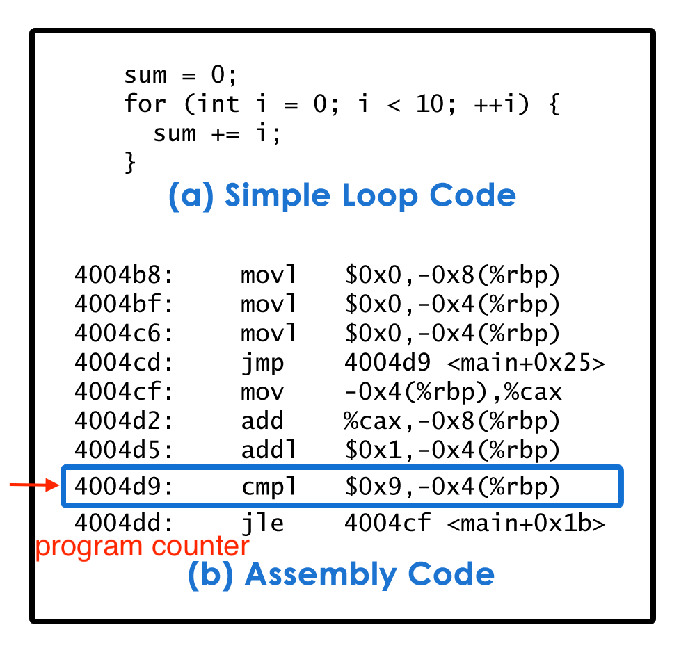
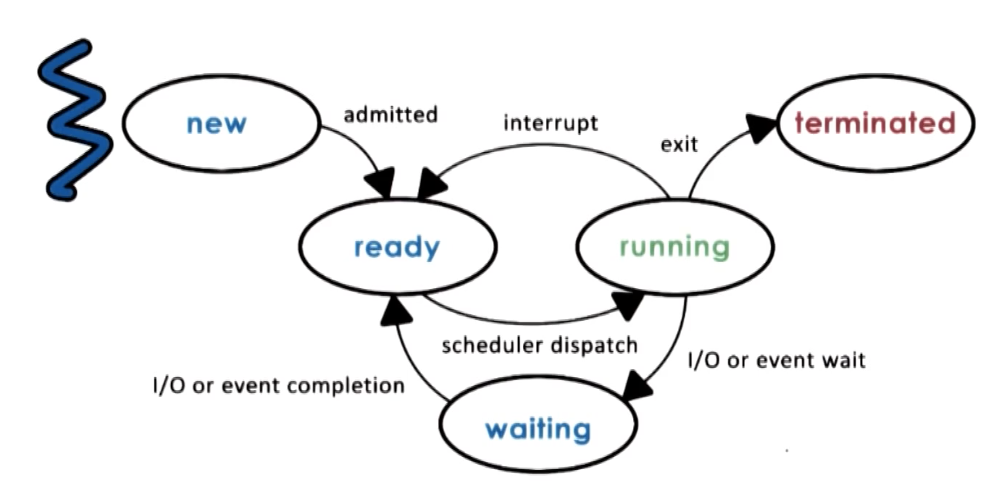
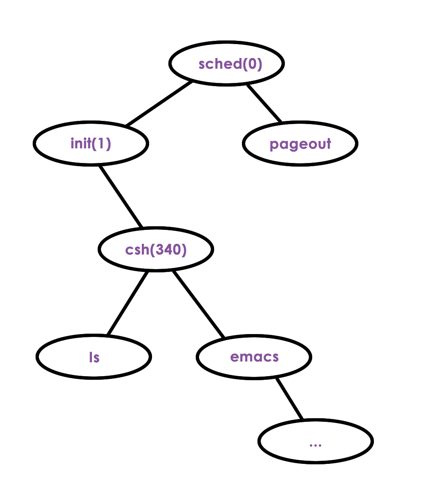
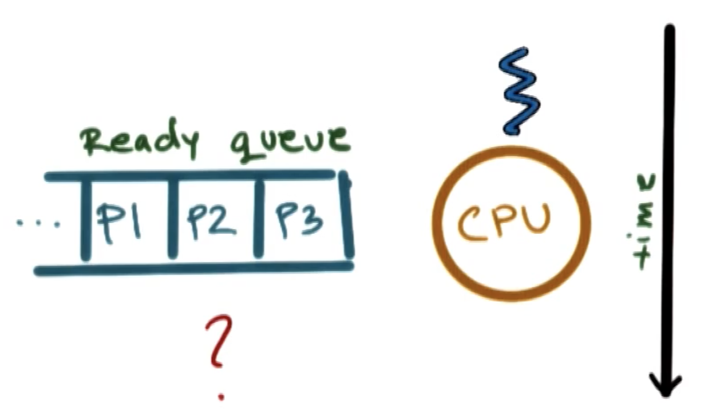
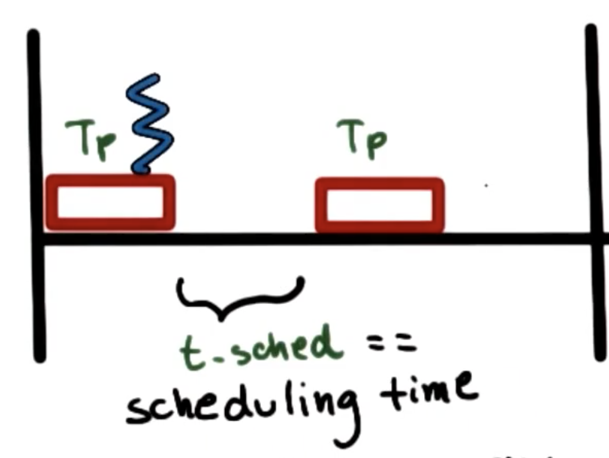
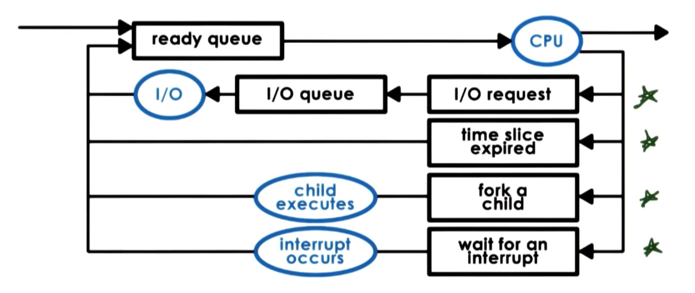
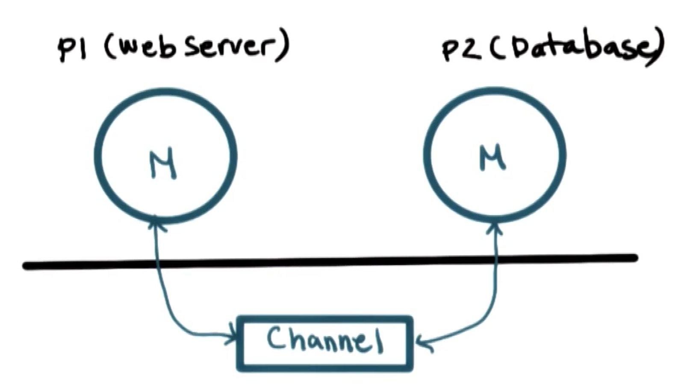
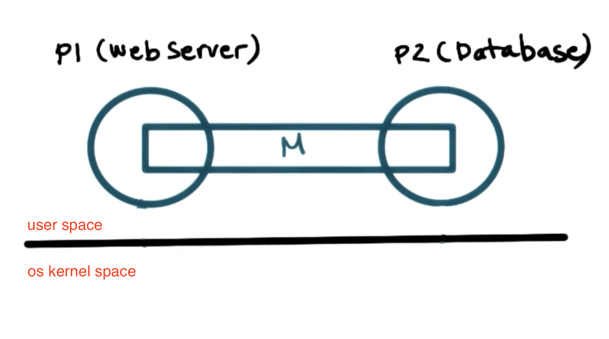

[TOC]

## What is a process

a process is an instance of an executing program, sometimes use terms "task" or "job" interchangeably with a "process"

|application program| &rarr; | process |
|---|:---:|--|
|stored on disk/flash memory/cloud, not executing   (static) |Once an application is launched| loaded into memory and starts executing   (active)|
||If the same program   (e.g., text editor) is launched more than once |multiple processes will be created, they will have different state (e.g. read document_A; type in a empty new document_B ).|

## What does a process look like?
### Process Address Space and Memory Management
process encapsulates all of the data (code, the data, variables that application need to allocate) of a running application. Every element of the process state has to be uniquely identified by its address. 

An operating system abstraction used to encapsulate all of the **process state** called **address space** (memory represeatation of a process), defined by a range of addresses from $V_0$ to $V_{max}$. Different types of **process state** will appear in different regions of the address space. 

| range | Address Space   (**Virtual** address, store process state) | property|
|---|---|---|
| $V_{max}$ |**stack**   (e.g., save the state x before jumping to another partion of the code y, after execution of y, restore the state x)| **Dynamically** created state that grows and shrinks as the program executes in a last-in, first-out (LIFO) order.|
| | **heap**  (temporary results, read data from files) | **Dynamically** created state; Seems contiguous but might not, portions of the addresses might not allocated|
| $V_0$ |text (**code**), **data**   (the data that is available when process is first initialized)| **static** state |
----

Figure: Process  address space, process execution example of using stack

The above **address space** is called **virtual address**, because they don't have to correspond to actual locations in the physical memory. 

OS creates **Page table** which maintains a **mapping** between **virtual memory addresses** and **physical memory addresses**. By using this mapping, we decouple the complex layout of the data in the virtual address space from the layout of the data in physical memory, to maintain physical memoery management simple.

Note:
It is possible for **different processes** to have the exact **same** address space range (**virtual** memory address **range**), OS will make sure that they point to distinct physical memory locations.

**Example** of a **page table entry**
|veritual memory| &rarr; |physcial memory|
|---|:---:|--|
|0x03c5||0x0f0f|

whenever the process tries to access x this page table mapping is referenced and the exact physical location where x is will be accessed.

When we do not have enough physical memory to store all the process state, the operating system must maintain information regarding processs address space to dynamically **decide** which portion of which process's address space will be present in **physical memory** and which portion will be **swapped temporarily to disk**, which will be brought in whenever needed.

Figure: Process 1 and Process2 in Physical memory and swap to disk

## How does OS know what a process is doing?
### Process Execution State
For an operating system to manage processes, it must have some idea about what a process is "doing". If the operating system stops a process, it must know exactly what it was doing when it was stopped, so the process can resume its execution with the exact same state.

### Process Control Block
the operating system maintains a **process control block (PCB)** data structure to maintain all useful information about **Process Execution State** for **every** single **process**.

The PCB is created and initialized when the process is **initially created**. Certain fields are updated when process state changes; other fields change frequenctly.

**Operating system** collect all of the data about a process - stored within CPU registers - and save it to the **PCB** when the process is **no longer running**.

----
| How to maintain the process state | what information | change frequency|
|--|--|--|
|process state|
|process number|
|**program counter**| At any given time, the CPU use it to know where in the a instruction sequence the process currently is| every instruction, fast (maintained on CPUs' register) |
|**CPU registers**|other information (e.g., addresses for data, status info)|
|memory limit|mapping (virtual-> physical) | not too often |
|a list of open file|
|process priority|
|signal mask|
|CPU scheduling info| e.g., how much time this particular process had executed in a CPU, how much time it should allocate in the future (depends on process priority) |
|**stack pointer**| The top of the stack (helpful to pop out the top elements of the stack) |
|...| |
Figure: Program Counter

### Context Switch - How is  Process Control Block (PCB) Used?
**context switch**: Each time the operating system **switches the context of processes**.

PCBs are stored in memory.
CPU registers holds PCB value of the currently running process (which will ultimately need to be stored in its PCB)
If a process is interrupted by the operating system, the operating system save its PCB (including the CPU register value).
If a process is resumed, the OS restore its PCB, and update the CPU register with its PCB.

Example: Context Switch of two Processes P1 and P2 
|Process P1| Operating system| Process P2|
|:---:|:---:|:---:|
|running   &darr;||idle|
|interrupted|save PCB of P1,   restore PCB of P2|resumed|
|idle||running &darr;|
|running   &darr;|save PCB of P2,   restore PCB of P1|interrupted|
|running   &darr;||idle|
----

**context switch** is **expensive** and we want to **limit the frequency** of context swtich.
- Direct costs: the number of **CPU cycles** required to load and store PCB to and from memory.
- Indirect costs: **cold cache** and **cache misses**.   Specifically: When a process (e.g., P1) is running on the CPU, its data is stored in the processor cache. **Accessing data from cache** is much **faster** than from memory. When the data we need is **present** in the cache, we called it **hot cache** (process performance is at its best). When os has to context swtich to another process (e.g., P2) due to higher priority of P2 or timeout of P1, some or all of the data of P1 in the cache will be replaced for new processes P2. The next time when P1 is scheduled, its data is **not in the cache** (we called it **cold** cache) and the CPU has to spend many more time to read data from memory (cache misses).

## Process Life Cycle: 
### Process State
Figure: Process Life Cycle

|State| Defination| When to enter the state|
|--|---|--|
|**new**| |When a process is created| 
|**ready** | ready to start executing but isn't currently executing on CPU| - When a new process is admitted (OS performs admission control, allocates and initializes the PCB and initial resources for this process.)   - When a running process is interrupted and a context switch is performed.   - When the I/O operation completes or the event occurs for a waiting process|
|**running**| | When the scheduler schedules the process on the CPU|
|**waiting**|| When a running process needs to perform some longer I/O operation (e.g., reading data from disk) or wait on an event (e.g., timer, input from a keyboard)|
|**terminated**| | When a running process exit:   - finish all the operations in the program   - encounters some error |

### Process Creation
In operating systems, a process can create one or more child processes. The creating process is the **parent** and the created process is the **child** of that parent, share a tree-like hierarchy.

|Mechanisms for process creation|defination|
|---|--|
|**fork**|the operating system will **copy** the parent **PCB** into the child PCB. Both parent and child processes will execute at the same point, the instruction immediately after the fork (have same PCB including program counter).|
|**exec**|the operating system will take a PCB (created via fork), but will not leave the values to match the parents' value. Instead OS will **replace child image and load a new program**. The child's PCB will now point to values that describe this new program. The program counter of the child will now point to the **first instruction** of the new program. 1. call fork to create the initial process 2. call exec to replace the child's image (created in the fork) with the image of the new program.  |
Example:
Figure: Process Creation Tree

Once the initial boot process is done and OS is loaded, it will create some initial processes. When a user log into a system, a user shell process is created. When user type commands, (e.g., ls, emacs), then new processes get spawned from the shell parent process. 
|OS |the parent of all processes| When to start |
|---|---|--|
|UNIX-based OS |init | starts after system boots.|
|Android|zygote| launch every new app processes|
 

## Process Scheduling
### Role of the CPU Scheduler
Figure: CPU Scheduler

For the CPU to start executing a process, the process must be ready first. There might be many processes that are in the ready state waiting in the ready queue. 

**CPU scheduler** is an operating system component that manages how processes use the CPU resources. It determines **which ready process** will be dispatched to the CPU to start running, and **how long** that process should run for.

|OS must do|defination|
|---|---|
|**preempt**|interrupt the executing process, save its current context|
|**run scheduling algorithem**| choose one of the ready processes that should be run next.|
|**dispatch**| dispatch process onto the CPU, and swiched into its context so the process can finally start executing. |
----

Since CPU resources are precious, the operating system needs to make sure that CPU time is spent on **running processes**, not executing OS operatiosn (e.g., scheduling algorithms). 
Therefore OS should **minimize the time for perform avobe OS tasks**, so OS must be efficient in the design and implementation in data structure (e.g., waiting processes,priority/history of processes) and algorithms.

### Length of Process
The **longer** we run a **process**, the less frequently we run CPU scheduler, the less CPU time is wasted on running **CPU schduler** (**overhead**) instead of running application processes. 

**Time slice**: $T_p$ denotes the time allocated to a **process** to run on the **CPU**;
  $t_{sched}$ denotes the time to run CPU scheduler.

**CPU usage efficiency** = total processing time / total duration time

Example:
If processing time is equal to the CPU schedueler time $T_p = t_{sched}$, then CPU efficiency = 50%, only 50% CPU time spent on useful work.

Figure: CPU effiency 50%

When designing a CPU scheduler, we have to make important design decisions:
- approporiate timeslice value
- good metrics to choose next process to run

### How I/O operation affection process CPU scheduling

|ways that processes enter the ready queue|How to enter the ready queue|
|--|---|
|wait for I/O devices   (keyboards, network cards, disks etc)|When a process makes an I/O request, the operating system will deliver that request, and place the process to the I/O queue for that particular I/O device. The process will remain in the queue until the device complete the I/O operation, then the process will move to a ready queue. |
|running on CPU but time slice expired||
|create a new process via fork| child process executes|
|wait for an interrupt| interrupt occcurs|
Figure: A few ways that processes enter the ready queue.

## Inter Process Communication (IPC)
Many application consist of multiple processes and interract with each other to contribute to a common goal.

Example: Web application.
- P1: Web server (front-end) accepts the customer requests.
- P2: Database (back-end) stores customer information.

Inter process communication mechanisms (IPCs)
- help to **transfer data/information** between address spaces 
- maintaining **protection and isolation**. 
- provide flexiblility and performance (because different types of interactions between processes exhibit different proerties).

|IPC type|How it works|Pro +| Cons -| When to use|
|---|---|---|---|--|
|**Message Passing IPC**|Operating system establishes a **communication channel**, e.g., like a **shared buffer**. Process interact with each other by   - **write (send)** messages to the channel.   - **read (recv)** messages from the channel.|the **operating system manages** this channel, providing **same system calls** for write/send and read/recv. |**overhead**: Every single piece of information to be transmitted needs to be **copied** from user space of the sending process **into the channel** in the os kernel memory, and back to the address space of the receiving process.| |
|**Shared Memory IPC**|The operating system establishes a **shared memory channel**, and then **maps it into the address space** of both processes. The processes are then allowed to **directly read/write** from/to this memory (the same way they can read/write from any memory as if their virtual address space).| **No overhead from OS**: The operating system is completely out of the picture.| No well-defined APIs, the usage of the shared memory is more **error-prone** or developers have to **reimplement** code. The **mapping** memory between processes operation is **expensive**| If the setup **cost can be amortized** across **a large number of messages**|
----

Figure: Message Passing IPC channel between processes.

Figure: Shared Memory IPC does not have the extra channel but provides direct communication.

