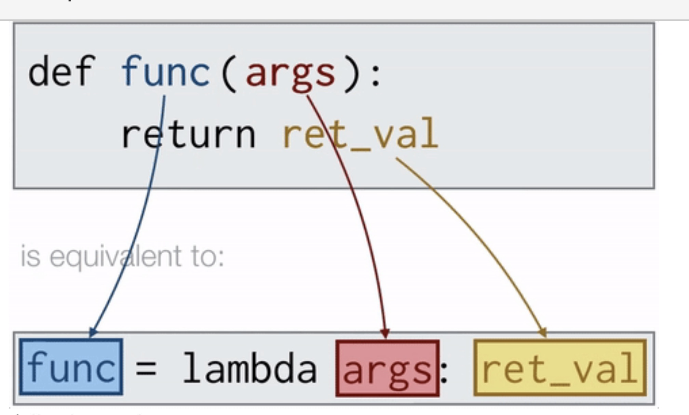

# Methods

### Unpacking

| Concept | Description | Example | Details |
| :--- | :--- | :--- | :--- |
| **Unpacking List(`*`)** | Unpacks elements of a **list or tuple** into **positional arguments** when calling a function. | `function(*my_list)` | Passes **each element of the sequence as an individual argument**. <br><br>Note that the list/tuple/dict element size should be the **same** as the number of arguments of the function, otherwise, it will raise Type**Error** |
| **Unpacking Dictionary(`**`)** | Unpacks **key-value pairs of a dictionary** into named keyword arguments. | `my_dict = {"key__1": value_1, "key__2": value_2}`<br>`function(**my_dict)` | Matches dictionary **keys** to **function parameter**, and pass the **values**, seperate conceptually with equal signs  `function(my_dict[key_1], my_dict[key_2])` |

### Placeholder `*args` and `**kwargs`

To tell our functions to expect a presently **unknown variadic** number of positional **arg**uments / **k**ey**w**ord **arg**uments. `*args` and `**kwargs` can be named differently, e.g., `*objects`

| Concept | Description | Syntax |
| :--- | :--- | :--- | 
| **`*args` Parameter** (can be called with different names) | Could take an **arbitrary number** of **positional arguments**(from left to right) into a tuple, i.e., `args = (value_1, value_2, value_3)` | `def f(*args):` <br><br> `f(value_1, value_2, value_3)`| 
| **`**kwargs` Parameter** | Could take an **arbitrary number** of **keyword arguments** (can be called optionally and individually by its own name) into a dictionary, i.e., `kwargs = {arg_1 : value_1, arg_2 : value_2, arg_3 : value_3}` | `def f(**kwargs):`<br><br> `f(arg_1 = value_1, arg_2 = value_2, arg_3 = value_3)`| 


## Scope
### `global` vs. Local Variables
Note: **OOP classes are preferred** over global variables. 

The rule of thumb: 
Use global variables **sparingly**.

| Feature | Local Variable | Global Variable |
| :--- | :--- | :--- |
| **Where defined** | Inside a function | Outside all functions (at the top) |
| **Scope (Access)** | Only inside that function | Anywhere in the module |
| **Lifetime** | Exists only while function runs | Exists for the entire program execution |
| **Modification** | Assign directly <br> `var = 10` | Requires **`global` keyword** to tell each function that `var` does not refer to a local variable: instead, it refers to the global variable we originally placed at the top of our code.  <br> `global var` <br> `var = 10` |

Note:
**Do not** have a local variable that has the **same name** as any global variable.

## variables
### Constant Variable
**Constant** variable are intended to remain **unchangeable** throughout program execution, typically denoted by **all capital** variable names and are placed at the **top** of our code.  
Note: 
Python does **not enforce** constant immutability like other languages, we can only name it in **`ALL_CAPS`** to indicate "Do not change it", i.e., Python actually has no mechanism to prevent us from changing that value.

**Class constants** are defined within class but outside of any particular class method and can be accessed via `ClassName.CONSTANT`

## Lambda Function

| Feature | Regular Function | **Lambda** Function (alternative way for creating a simple function) |
| :--- | :--- | :--- |
| **When to use** | General purpose, especially when for **complex** expressions and **reusable** functions | When an **anonymous simple, temporary** function is needed immediately, not intended to be reused multiple times, such as when using **inline operations**, as **arguments to higher-order functions** (map, filter, sorted) |
| **Syntax** | `def fn_name(arguments):` <br>&nbsp;&nbsp;&nbsp;&nbsp;`block of code`<br>&nbsp;&nbsp;&nbsp;&nbsp;`return expression_or_var` | `lambda arguments: expression` |
| **Syntax details** | Starts with `def` keyword followed by the function name, arguments, and a block of code for multiple expressions, optionally explicit return statement. | Starts with `lambda` keyword followed by parameters, a colon, and a **single expression**.<br><br>* **arguments**: A comma-separated list of parameters<br>* **expression**: A single expression that is evaluated and returned automatically. |
| **Example** | `def add(x, y):` <br>&nbsp;&nbsp;&nbsp;&nbsp; `return x + y` | `lambda x, y: x + y` |
| **Scope of Variables** | Can define local variables for use within the function. | Cannot define new variables; can only use function arguments and existing variables. |

Figure: Regular Function vs Lambda Function




## Code Quality & Documentation 

### Check [Type Hints](https://docs.python.org/3/library/typing.html) Using [`mypy`](https://mypy.readthedocs.io/)
In other programming languages, one expresses explicitly what variable type one wants to use, however, Python **does not require the explicit declaration of types**.
Nevertheless, it’s good practice to ensure all of your variables are of the right type.

`pip install mypy`<br>`mypy file_name.py`

| Concept | Purpose | Syntax | + |
| :--- | :--- | :--- | :--- |
| **Type Hints** | **Annotates the expected types** for arguments, variable and return values for static analysis. | `def function(argument: arg_type) -> return_type:`<br>&nbsp;&nbsp;&nbsp;&nbsp; `variable: var_type = value` <br>&nbsp;&nbsp;&nbsp;&nbsp; `return return_var` | Improves code readability and allows type checkers to catch errors before runtime. |


###  [Docstrings](https://peps.python.org/pep-0257/)
Standardized multiline comments placed inside functions to document function behavior / features  within triple quotes `"""`.

Document fields (`:param`, `:return`, etc.) can be parsed by tools such as [Sphinx](https://www.sphinx-doc.org/en/master/index.html), to parse docstrings and **automatically create documentation** in the form of **web pages and PDF** files such that you can publish and share with others.
```python
    def function_name(argument: arg_type) -> return_type:
        """
        One-sentence explanation of the function.

        :param argument: description
        type argument: arg_type
        :raise ErrorType: If statement 
        :return: description
        rtype: return_type
        """
```
We could also include **sample input and sample output** in the docstrings.    
    
 
