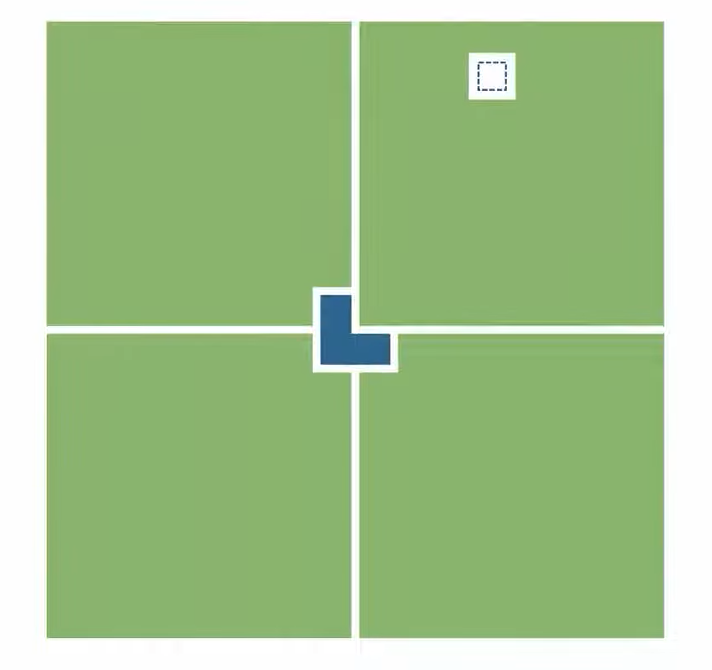
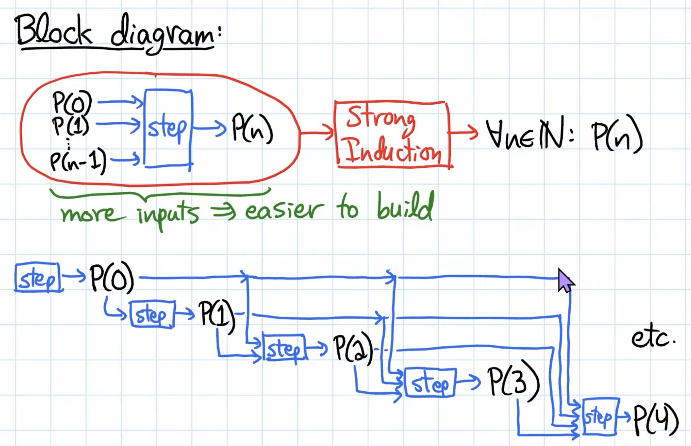

 
# Contradiction and Induction  
> Course source: 6.1200J Lecture 02-03  

## Logical Deduction  
An inference rule is a rule for **combining** true propositions to **form** other true  propositions.  
We can quickly **verify** an inference rule using **truth table**.

|Rule| Meaning| 
|:--:|:--:|
|$((P \implies Q) \space \text{AND} \space P) \implies Q$ | If  $P$ implies  $Q$, and  $P$ is true, then  $Q$ must be true.|
|$((P \implies Q) \space \text{AND} \space \text{NOT}\space Q)  \implies \text{NOT} \space P$| If  $P$ would imply  $Q$, but  $Q$ is false, then  $P$ must be false.|
|$((P  \implies Q) \space\text{AND}\space (Q  \implies R))  \implies (P  \implies R)$| If  $P$ would imply  $Q$, and  $Q$ would imply  $R$, then  $P$ must implie  $R$.|
|$((\text{NOT} \space P)  \implies \text{FALSE})  \implies P$|If assume Not  $P$ leads to a contradiction, then  $P$ must be true.|

Example:
$P \implies Q$: If it rains, the ground gets wet. 

When write a proof:

- Each step in a proof should be clear and logical.  
- You should state **which previously proved propositions are being used**.  
- Please do not make wild leaps of faith.  
- Please **do not** use “Proof by Intimidation” (**obvious, Clearly** etc)  
- But we are not picky about which inference rules you use, and there is certainly no  need to cite an inference rule at every step. 

## Proof Outlining  
This outlining step  can often be started nearly mechanically, based on the **form of the theorem** being proved  and the **chosen proof techniques**.

- **Choosing a proof method** can lead to immediate and noticeable progress  on constructing the proof. 
- **Break down** a proof into **smaller tasks** precisely,and tackle these  tasks one at a time. 
- Consider **multiple  possible approaches** to a problem before deciding which one(s) to pursue. 

A common proof-writing **mistake** is to dive into **how** to prove something, while  not realizing that you’re trying to prove the wrong thing! Spending a bit of time identifying
**what** needs to be proved, likely using our **common proof techniques**, will ensure that your  “how to prove”-energy is directed at the correct targets. 

## Fundamental Proof Techniques  
| Proof Techniques | Therom   (to be proved) | How to Prove | Write Proof|
|:---:|:---|:---|:---|
| Prove Something **Exists** by **example**|  $\exists x \in S. P(x)$ | **choose a specific example**  $x^*$, prove  $P(x^*)$ | We’ll show that the value x = [some specifc values] works.  $\exists x \in S$ because [reasons], for this choice of x, P(x) is true because [reasons].  |
| Prove sometthing is **Universal (for all)** |  $∀x ∈ S. P(x)$ | **choose a general variable** for arbitrary  $x$, prove  $P(x)$ |Assume  $x$ is an **arbitrary element** of  $S$. Then we **want to show**  $P(x)$ is true because [reasons]. |
| Prove **Implication** by **Direct Proof**  |$ P \implies  Q  $| **assume the condition**  $P$, prove  $Q$| **Assume**  $P$ is true, then **want to show**  $Q$ is also true, because [reasons (probably using that assumption)]|
| Prove **Implication** by **Contrapositive** |$ P \implies  Q  $ |**asssume  $\text{NOT} \space Q$**, prove  $\text{NOT} \space P$    **Reason**:  $ P \implies Q  $ is **equivalent to its contrapositive**  $\text{NOT} \space Q \implies \text{NOT} \space P$ |We’ll prove the **contrapositive**, so **assume**  $\text{NOT} \space Q$ is true. Then we **want to show**  $\text{NOT} \space P$ is true because  [reasons].|
| Prove anything by **Contradiction**|  $P$    (**not** assuming a **specific form of theorem**) |**Assume**  $\text{not}\space P$, prove  $\textbf{false}$.     **Reason**: By our inference rule  $((\text{NOT} \space P)  \implies \text{FALSE})  \implies P  $, this is a valid proof of  $P$.  |For the sake of **contradiction**, **assume**  $P$ is false, .... The **other**  statement  $R$ is **both true and false (inconsistant)**, which is **contradiction** (, so our assumption is wrong, so  $P$ is true.)
|**Universal** over natural number by regular **Induction** |  $\forall n \geq 0. P(n)$| Check **base case**  $P(0)$ then for  $\forall n \in \mathbb{N}, n\geq 0$ **show**  $P(n) \implies P(n+1)$| - Let  $P(n)$ be the **predicate** [make it concret  $P(n)$:= ...]  We prove  $\forall n \in \mathbb{N}. P(n)$, by induction on  $n$. (*see note below*)  - **Base case**, must show  $P(0)$ is true: Left hand side (LHS) is [value], right hand side (RHS) is [value], so ...    - **Inductive** step: Let  $\forall n \in \mathbb{N}$, and assume  $P(n)$ is true; we must show  $P(n + 1)$. |
|**Universal** over natural number by **Strong Induction** |  $\forall n \geq 0. P(n)$| 1. **Split** the problem into a few **parts** (size < n)   2. Check **base case**  $P(0)$   3. **Recursively** solve these **smaller** problems  $P(i)$ (where  $i < n$) by using strong induction.   4. **Combine** the solutions. | - Let  $P(n)$ be the **predicate** [make it concret  $P(n)$:= ...]  We prove  $\forall n \in \mathbb{N}. P(n)$, by strong induction on  $n$.   - **Base case**, must show  $P(0)$ is true.  - **Inductive** step: Let  $\forall i < n, i \in \mathbb{N}$, and assume  $P(i)$ is true; we must show  $P(n)$ is true. |
|Prove by **Exhaust All Possible Cases**|$P$ is true| Come up a **proposition**  $C$, which makes the following a tautology (**always true**)   $C1 \lor C2 \lor ... \lor Ck$. |  Proof by cases:    - Case 1: **Assume  $C_1$ is true**. Then P is true because [reasons].   - Case 2: **Assume    $C_2$ is true**. Then P is true because [reasons].   ...   - Case k: **Assume    $C_k$ is true**. Then P is true because [reasons].   ...   These k cases are **exhaustive** (i.e.,  $C1 \lor C2 \lor ... \lor Ck$ is a tautology) because [reasons]  |
 
## Proof by Induction  
Induction is probably the most common and most powerful proof technique in computer  science.
### Intuition: like Dominoes / chain
| Knows all these | Want to prove all these|
|:--:|:--:|
|$P(0)$|$P(0)$|
|$P(0) \implies P(1)$|$P(1)$|
|$P(1) \implies P(2)$|$P(2)$|
|$P(2) \implies P(3)$|$P(3)$|
|$P(3) \implies P(4)$|$P(4)$|
|$P(4) \implies P(5)$|$P(5)$|
|...|...|
|$P(n-1) \implies P(n)$|$P(n)$|
|$P(n) \implies P(n)$|$P(n+1)$|
|**Summary:**|
|$P(0) \space \text{AND}\space  \forall n \in \mathbb{N}, n\geq 0, [P(n) \implies P(n+1)]$ |$\forall n \geq 0. P(n)$|

### Use Induction Axiom to prove
 Let  $P(n)$ be a predicate (**Induction Hypothesis**), defned for  $n \in \mathbb{N}$. If  $P(0)$ and  $\forall n \geq 0.[P(n) \implies P(n+1)]$, then  $\forall n \geq 0. P(n)$

### Note: strengthen the inductive hypothesis
Often (but not always!) this  $P(n)$ will be the predicate we initially set out to prove, however sometimes we might need to strengthen the inductive hypothesis using a **stronger**  $Q(n)$ instead of original  $P(n)$.

**Example**:
$P(n)$ is the predicate "it is possible to use non-overlapping L-trominoes to cover  a  $2^n$ by  $2^n$ square grid, except for **one of the center-most** squares".
$Q(n)$ is the stronger hypothesis "it is possible to use non-overlapping L-trominoes to cover  a  $2^n$ by  $2^n$ square” except for **any** one square".

Figure: Example of strengthen the inductive hypothesis: Algorithm divide and conquer - Cut the grid into divide and conquerfour quadrants and put a L-trominoes in the middle.

### Strong Induction
Suppose  $P(n)$ is a predicate with n a natural-number variable. Suppose that

1.  $P(0)$ is true.
2.  $\forall n \in \mathbb{N}$, it holds that    $IH(n) = P(0) \land P(1) \land  . . . P(n) \implies P(n + 1)$.

Then it holds that    $\forall n \in \mathbb{N}, P(n)$

**Note**:
Strong induction is in fact completely  **equivalent to** regular induction, and the strong induction theorem can easily be **proven** from the Axiom of Induction by using the regular induction Axioms for the new induction hypothesis  $IH(n)$.

Figure: **Strong Induction Intuition** - not only assume  $P(0)$ but also **assume all the  $P(i)$ is true**, where  $i \in  \mathbb{N}, i < n$

