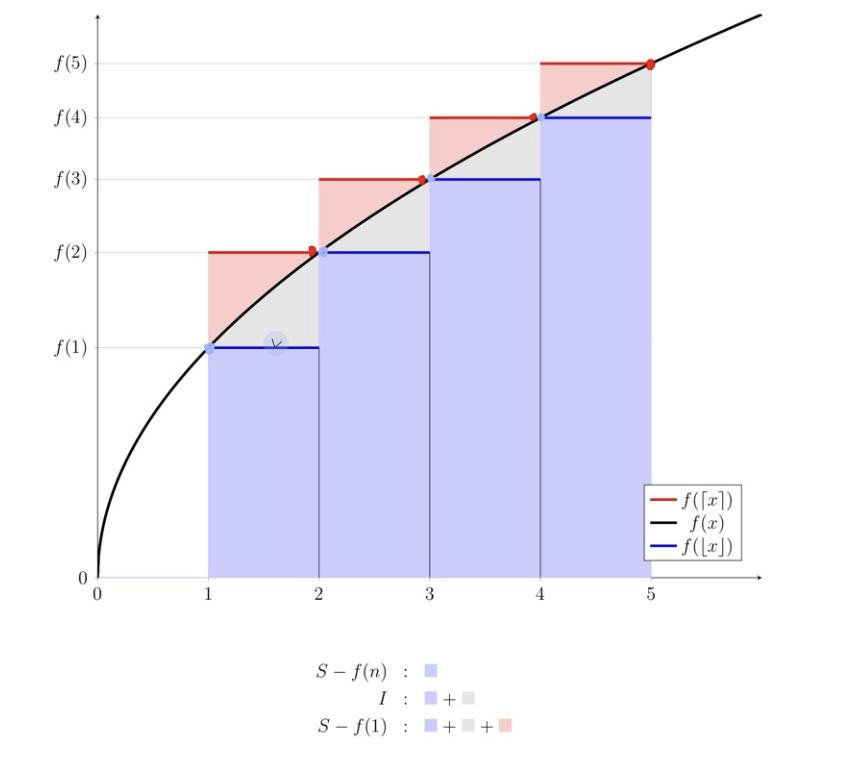
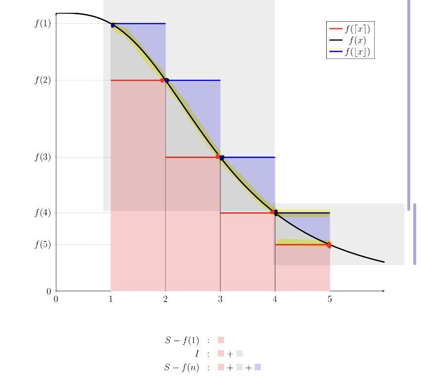

#  Sums 
> Course source: 6.1200J Lecture 05

| Methods | Idea | Example/ Theorem|
|:---:|:---|---|
| **Educated Guessing**|Make a partial guess about the form, using #**variables** for #**unknown** numbers, check **base cases** (e.g.,  $n=0, 1, 2 ,3 ...$) to get the system of equations and **solve the system of equations**. Then prove it with **induction**.|  $\begin{aligned}S:= \sum_{k=1}^{n}k^2=1^2+2^2+3^2+...+&(\frac{n}{2})^2+...+n^2\\\text{the last half part:}&\frac{n}{2} \space\text{items, each} \ge (\frac{n}{2})^2\\&\text{total} \ge (\frac{n}{2})^2(\frac{n}{2})=\frac{n^3}{8}\end{aligned}$ so we guess it is degree -3 polynomial   $S=\sum_{k=1}^{n}k^2=an^3+bn^2+cn+d$   then solve  $a,b,c,d$
| **Guess and Check**| If we **know** (or can **guess**) the **closed form answer**, then prove it with **induction**. The hard part is finding/guessing the answer, not proving it.|
| **Perturbation**| **compare** the sum to **itself or a modified version** of itself (e.g., multiply it with something), and hope things combine nicely (items get canceled or same sum) |$\begin{aligned}\text{Geometric series: }S &= 1 + &x + &x^2 + x^3 + · · · + x^{n−1} &\\\text{perturbated: }xS &= &x + &x^2 + x^3 + · · · + x^{n−1} &+ x^n \\ \text{cancels: } S -xS &= 1&&&-x^n\\\text{simplify: }(1 − x)S &= (1 − x^n)\\  S = \color{blue}\sum_{k=0}^{n-1}x^k&\color{blue}= \frac{1 −x^n}{1 − x} \end{aligned}$ |
|**Nested Double Sum**|first find a **closed form** for the **inner sum**, and then use it to find a closed form for the **outer sum**. One tool that is often useful for evaluating double sums is to **exchange the order of summation**. |  $\begin{aligned}\color{blue}\sum_{i=1}^{n}\sum_{j=1}^{i} j &= \sum_{i=1}^{n} \frac{i(i+1)}{2} && {\because \text{sum of consecutive integers:} \sum_{j=1}^{i} j = \frac{i(i+1)}{2}}\\&= \sum_{i=1}^{n} \left(\frac{1}{2}i^2 + \frac{1}{2}i\right) \\&= \frac{1}{2}\sum_{i=1}^{n} i^2 + \frac{1}{2}\sum_{i=1}^{n} i\\ &= \frac{1}{2}\left[{\frac{n(n+1)(2n+1)}{6}}\right] + \frac{1}{2}\left[{\frac{n(n+1)}{2}}\right] && {\color{blue}\because \text{Sum of squares: }\sum_{i=1}^{n} i^2 = \frac{n(n+1)(2n+1)}{6},\; \sum_{i=1}^{n} i = \frac{n(n+1)}{2}} \\ &= \frac{n(n+1)(2n+1) + 3n(n+1)}{12} \\ &= \frac{n(n+1)\big[(2n+1) + 3\big]}{12} \\ &= \color{blue}\frac{n(n+1)(n+2)}{6}\end{aligned}$     $\begin{aligned}\color{blue}\sum_{i=1}^{n}\sum_{j=i}^{n} j &= \sum_{j=1}^{n}\sum_{i=1}^{j} j && {\color{blue}\because 1\le i\le n \text{ and } i\le j\le n \iff 1 \le i \le j \le n \iff 1 \le j \le n \text{ and } 1 \le i \le j} \\ &= \sum_{j=1}^{n} \left( j \sum_{i=1}^{j} 1 \right) && {\because j \text{ is constant with respect to } i} \\ &= \sum_{j=1}^{n} j \cdot j && {\because \sum_{i=1}^{j} 1 = j} \\&= \sum_{j=1}^{n} j^2 \\&= \color{blue} \frac{n(n+1)(2n+1)}{6} && {\because \text{ Sum of squares}}\end{aligned}$|
|**Approximating** Sums by  **Integral**| No known closed form. Best we can do is to **approximate the discrete sum**  $\color{blue}S := \sum_{1}^{n} f(k)$ by **continious intergral**  $\color{blue}I := \int_{1}^{n} f(x) dx$.  1. **under-approximate** x using  $\lfloor x \rfloor$, therefore underapproximate  $f(x)$ using  $f(\lfloor x \rfloor)$, then we can get lower bound of  $I$  2. **over-approximate** x using  $\lceil x \rceil$, therefore over-approximate  $f(x)$ using  $f(\lceil x \rceil)$, then we can get upper bound of  $I$| Suppose  $f(x)$ is a weakly **increasing** function of  $x$  1. under-approximate:  $\begin{aligned} \lfloor x \rfloor &\le x \\ f(\lfloor x \rfloor) &\le f(x) \\ \int_1^n f(\lfloor x \rfloor)dx &\le \int_1^n f(x)dx =I \\ \sum_{k=1}^{n-1}f(k) \times 1 &\le I && \because \text{constant} \space f() \space \text{on each interval of width 1 = LHS of the interval}\\S- f(n) &\le I  && {\because S := \sum_{k=1}^n f(k) = \sum_{k=1}^{n-1}f(k)+f(n)}\\ S &\le I+f(n) \end{aligned}$   2. over-approximate:  $\begin{aligned}\lceil x \rceil &\ge x\\ f(\lceil x \rceil) &\ge f(x)\\ \int_1^nf(\lceil x \rceil) dx &\ge \int_1^nf(x) dx = I \\ \sum_{k=2}^n f(k) \times  1 &\ge I \\ S -f(1) &\ge I && {\because S := \sum_{k=1}^n f(k) = f(1) + \sum_{k=2}^n f(k)} \\ S &\ge I + f(1) \\ \end{aligned}$   3. Combine 1. and 2. we have the **Theorem 1.** **integral bound** for weakly **increasin** function  $f$:  $\color{blue}I+f(1) \le S\le I + f(n)$    To get the **Theorem 2.** **integral bound** for weakly **decreasing** function  $f$, apply above **Theorem 1.** in step 3 to **increasing** function  $g(x) := f(n + 1 − x)$  $\begin{aligned}S&=f(1)+f(2)+...&+f(n)\\&= g(n)+g(n-1)+...&+g(1) \\ &= \sum_{k=1}^n g(k)\\I + g(1) \le S \le I+g(n)\\  \color{green}I+f(n) \le S \le I + f(1)\end{aligned}$ which is the **similar to Theorem 1.** just the upper bound and lower bound are **flipped**   4. Take limits of Theorem 2 as  $n → \infty$, we get **Theorem** (Integral Bound - Improper). If  $f : [1, \infty) \to \mathbb{R}$ is weakly **decreasing**, then the sum  $\color{red}S = \sum_{k=1}^{\infty} f(k)$ **converges** iff the improper integral  $\color{red}I = \int_{1}^{\infty} f(x)\,\mathrm{d}x$ **converges**. If they converge, then  ${\color{red}I \le S \le I + f(1)} {\because \text{converges means running total approaches a fixed finite number, implies items} \color{green}\lim_{n \to \infty} f(n) = 0}$   **Note:** If we notice **lack of precision**, which is coming from the fact that the difference between the two step functions - the further part they are, the worse the approximation - so we can **compute the first few terms** exactly, and just **approximate the rest terms** to get more **precise** bound, e.g.,  $\begin{aligned} &S = f(1) + f(2) + f(3) &+ \sum_{k=1}^{\infty} f(k+3) \\ & &S' :=  \sum_{k=4}^{\infty} f(k) \\ & & I' := \int_{4}^{\infty} f(x)\,\mathrm{d}x\\  & & \color{purple}I' \le S' \le I'+f(4) \end{aligned}$

Figure: **Theorem 1 (Integral Bound - Increasing)** use step functions to approximate the lower bound and upper bound

Figure: **Theorem 2 & 3 (Integral Bound - Decreasing & Improper)** use step functions to approximate the lower bound and upper bound; To get more precise bound: compute exactly first few items  $f(1), f(2),f(3)$ and approxite the rest

