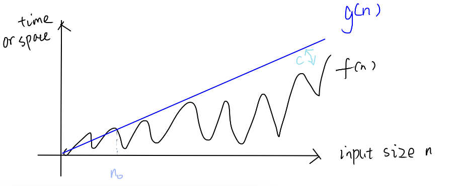
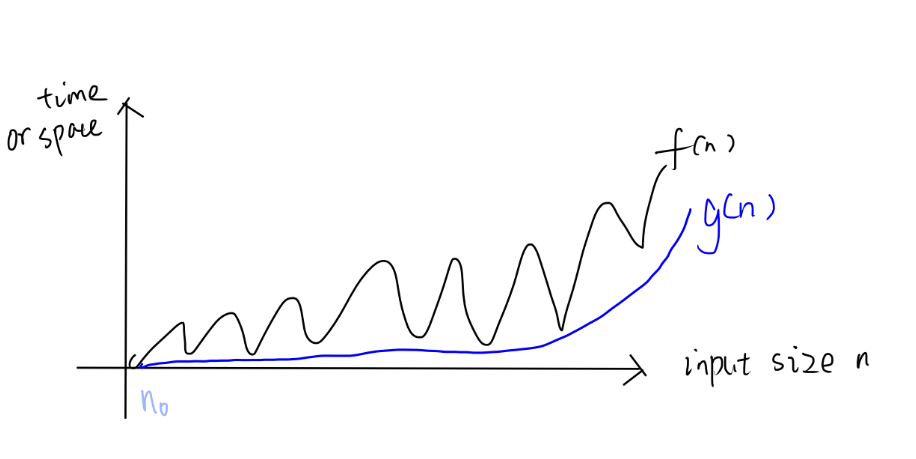
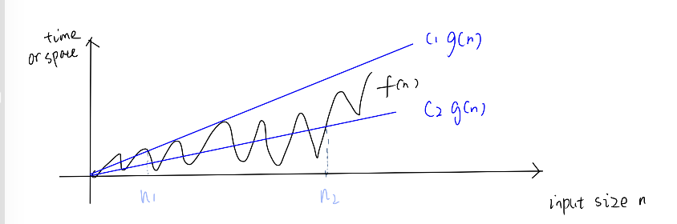

#  6.1200J Lecture 06: Asymptotics

**Approximating Products** by 

1. taking **logs** to transfer it into a sum
2. Then compute/approxiate the **sum** by methods in Lecture 5. 
3. Take **undo the log** by exponentiating  $e$

## Summary
\(f,g: \mathbb{N} \rightarrow \mathbb{R}^{+}\) map natural numbers to positive real numbers.

| Notation | Asymptotically (approximately) | Formal Definition| Intuition | Limit Test  (as  $n \to \infty$) | Important Example |
| :--- | :--- | :--- | :--- | :--- |:--- |
| **$f \sim g$**   *tilde* |  $f = g$ | same as the limit test| Equal  - **cannot ignore** constant factor |$\lim_{n \to \infty} \frac{f(n)}{g(n)} = \color{blue}1$ | - Apply integral method to approximate Harmonic Numbers  $H_n = \sum_{i=1}^n \frac{1}{i} \sim \ln n$    - Approximating Products (e.g., **n factorial**)   Stirling’s approximation:      $n! \sim \left(\frac{n}{e}\right)^n \sqrt{2\pi n}$ More **precise** bound:  $e^{\frac{1}{12n+1}} \le \frac{n!}{\left(\frac{n}{e}\right)^n \sqrt{2\pi n}} \le e^{\frac{1}{12n}}$|
| **$f \in O(g)$**  *Big-O*|  $f \le g$ |  $\exists \text{ constant }c > 0, \text{ starting point } n_0 \in \mathbb{N} \text{ s.t. } \forall n \ge  n_0, \; \|f(n)\| \le c \cdot g(n)$ |  $O(g)$ is a set of functions that are asymptotically **upper bounded** by  $g$ (showing **worst case**)  - **Ignore lower-order terms** and **constant factors** (they are absorbed into constant  $c$)|  $\lim_{n \to \infty}  \frac{f(n)}{g(n)} \color{blue} < \infty$   Note:  -if the limit  $=\infty$ then  $f \notin O(g)$   - if the limit does **not exist**, **inconclusive** then we must go back to the **definition** and find  $n_0$ and  $c$|  $n^2 + 3n + 7 \in O(n^2)$ $1000 \in O(n^2)$ |
| **$f \in \Omega(g)$**  *Big-Omega* |  $f \ge g$ |  $g \in O(f)$|  $\Omega(g)$ is the set of functions that are asymptotically **lower bounded** by g (showing **best case**)   - **Ignore lower-order terms** and **constant factors**|  $\lim_{n \to \infty}  \frac{f(n)}{g(n)} \color{blue}\in (0, \infty ]$ |  $x^3 \in \Omega(x^2)$ $5x^2 \in \Omega(x^2)$ |
| **$f \in \Theta(g)$**  *Big-Theta* |  $f = g$ |  $f \in O(g) \text{ and } f \in \Omega(g)$ |  $\Theta(g)$ is the set of functions that are asymptotically **equal** to  $g$ (showing **average** case; both **upper bound and lower bound**)|  $\lim_{n \to \infty}  \frac{f(n)}{g(n)} \color{blue}\in (0, \infty)$ |  $3 + sin(n) \in \Theta(1)$    $n! \sim \left(\frac{n}{e}\right)^n \sqrt{2\pi n}\\ \implies n! = \Theta\left(\sqrt n (\frac{n}{e})^n\right)\\ \implies \log(n!)= \Theta(n \log n)$|
| **$f \in o(g)$**  *Little-o* |  $f < g$  **much smaller** | same as limit test |  $o(g)$ is the set of functions that are asymptotically **much smaller** to  $g$  - Little o can explain the **lower order term**  $h$ which can be ignored  $f \sim f +h \iff h\in o(f) \iff \lim_{n\to \infty} \frac{h}{f}=0$|$\lim_{n \to \infty} \frac{f(n)}{g(n)} = \color{blue}0$ |  $(\log n)^a = o(n^b), \space \forall \text{constant } a, b > 0$ |
| **$f \in \omega(g)$**  *Little-omega* |  $f > g$  **much bigger**|  $g \in o(f)$|  $\omega(g)$ is the set of functions that are asymptotically **much bigger** to  $g$ |  $\lim_{n \to \infty} \frac{f(n)}{g(n)} = \color{blue}\infty$  |  $x^2 \in \omega(x)$ $2^x \in \omega(x^{100})$ |

Figure: **Big O** notation -  $O(g)$ is a set of functions that are asymptotically **upper bounded** by  $g$,  $f \in O(g)$ means  $f$ one of the functions in the set  $O(g)$

Figure: **Big Omega** notation -  $\Omega(g)$ is a set of functions that are asymptotically **lower bounded** by  $g$,  $f \in \Omega(g)$ means  $f$ is one of the functions in the set  $\Omega(g)$

Figure: **Big Theta** notation -  $\Theta(g)$ is a set of functions that are asymptotically **equal** to  $g$,  $f \in \Theta(g)$ means  $f$ is one of the functions in the set  $\Theta(g)$

### The relationships of asymptotics
according to **limit test**
e.g., Little  $o$ implies big  $O$

\[
\begin{array}{ccccccc}
\sim & \Longrightarrow & \Theta & \Longrightarrow & O & \text{and} & \Omega \\
    &                &       &                & \Uparrow &       & \Uparrow \\
    &                &       &                & o        &       & \omega
\end{array}
\]

## Warning: Do **not mix** asymptotic notation and induction.
Example:
False Theorem:  $2^n \in O(1)$

False proof. Proof by induction.

- Base case: when  $n=0$,  $2^0=1 \in O(1)$
- Inductive step: assume  $n \ge 0$,  $2^n \in O(1)$, want to show  $2^{n+1}\in O(1)$:  $2^{n+1}=2^n + 2^n \in O(1) + O(1) = O(1)$ Done.

The reason why induction fails:
We prove something completely different:
$2^0\in O(1), 2^1\in O(1), 2^2\in O(1), 2^3\in O(1), \ldots$
but we cannot treat a function  $2^n$ as  $n$ individual constant functions.