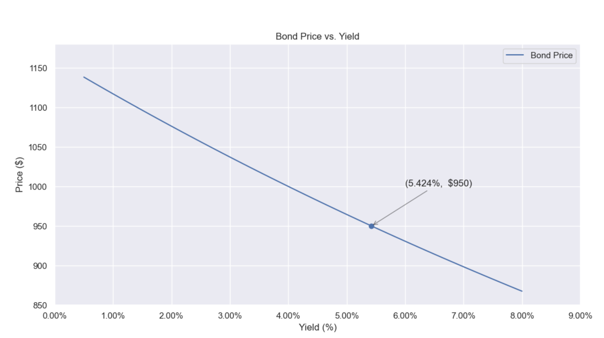

# Buying and Selling Short

## Fixed-income Investment: Bond vs CD
| **Aspect** | **Bond**    | **Certificate of Deposit (CD)**   |
|-----|----------|-----------------------------------|
| **Type**                    | Tradable debt security                                                                      | Non-tradable bank savings product                                             |
| **Issuer**              | Governments or corporations                                                                 | Banks                                                                         |                   |
| The amount of money borrowed/lended         | **Face/Par/Nominal Value**         |Principal |                                
| Interest Rate |   **coupon rate** |  interest rate    |
| **Liquidity**               | Can be sold in secondary markets                                      | Must hold until maturity (early withdrawal = penalty)                         |
| **Risk**                    | Credit risk (issuer may default);   market risk (price fluctuates in markets)                | Very low risk if FDIC insured                                                 |                                     |
| **How to Get Paid**         | 1. Coupon payments 2. Maturity repayment 3. Additional: Selling before maturity                   | 1. Interest  2. Principal repayment at maturity      |

## Bond Pricing 
| Term | Meaning | Use Case |
|---|---|---|
| Market Price | What you actually pay for the bond in the market today | |
| Market Rate (prevailing rate)| Current annual market interest rate for similar bonds | Bond pricing |
| Implied Yields to Maturity   (YTM) | The true annual rate of return you will earn if you buy the bond today at its market price and hold it until it matures,   assuming: You receive all coupon payments on time, and you get the full face value at maturity | helps investors compare bonds with different coupon rates, maturities, and prices on a common scale |
| Formula |$P = \sum_{j=1}^{qn} \frac{M \cdot \frac{c}{q}}{ \left(1 + \frac{x}{q} \right)^j } + \frac{M}{ \left(1 + \frac{x}{q} \right)^{qn} }$| 1. Bond Pricing   2. Compute YTM|
| General Formula |  $P = \sum_{i=1}^{T} \frac{CF_i}{(1 + r(0, i))^i}$ | when coupon rate and/or discounting rate change over time|
| Intuition of the formula| the present value of the bond (its price) is simply the present value of all future cash flows (both coupons and the final principal repayment), discounted using the market rate.|

### Notation
| Symbol                     | Meaning                                                                 |
|----------------------------|-------------------------------------------------------------------------|
|  $P$                      | Present value (Price) of the bond                                       |
|  $M$                      | Principal amount (Face /par/ notional value) of the bond                                      |
|  $c$                      | Annual coupon rate       |
|  $x$                      |  Interest rate that is used for discounting FV to PV   1. Current annual market interest rate for similar bonds (also called prevailing rate)    when  $x$ is known, calculate  $P$   2.  Yield to Maturity   when  $P$ is known and solve for  $x$ that makes the present value of all the future cash flows = current market price                            |
|  $q$                      | Interest payment frequency - Number of coupon payments per year (usually in US is semiannual, in this case q = 2)  |
|  $n$                      | Number of years until bond maturity                                     |
|  $j$                      | Sum up index for each coupon payment period (from 1 to  $qn$)                 |                |
|  $CF_i$         | Cash flow at time  $i$  (e.g. coupon for each period or face value + coupon at final period)                        |
|  $r(0, i)$       | Spot interest rate from time 0 to time  $i$   |
|  $T$            | Total number of periods until maturity (typically in years), indexing via  $i$                 |

### Figure: Inverse Relationship between Bond Price and Yields

higher interest rates mean lower bond prices.

### Zero-Coupon Bond
| **Concept**                           | **Explanation**                                                                                   |
|--------------------------------------|---------------------------------------------------------------------------------------------------| 
| **Defination**                 | A bond that pays no coupons (no periodic interest) and only get the face value at maturity. Its market price << face value.      |                                |                       |                                           |
| **Role in Bond Pricing**             | Easy to derive the spot rates  $r(0, i)$ for each year ($i$ = 1 to  $T$) since it has one cash flow|
| **Formula to Calculate Spot Rate**   |  $r(0, T) = \left( \frac{FV}{PV} \right)^{1/T} - 1$
| **Risk**                             | Higher credit risk for long-term zeroes due to no interest payments.                              |                           

### Trading below/at/above Par
| **Trading Term**     | **Condition**                                                                 | **Meaning**                                                                                 | **Reason (Coupon vs. Market Rate)**                         |
|----------------------|--------------------------------------------------------------------------------|---------------------------------------------------------------------------------------------|-------------------------------------------------------------|
| **At Par**           | Price = Face Value (e.g., $1,000)                                              | The bond is priced exactly at its face value.                                               | Coupon rate = Market interest rate                          |
| **Below Par**        | Price < Face Value                                                             | The bond is selling at a discount.                                                          | Coupon rate < Market interest rate                          |
| **Above Par**        | Price > Face Value                                                             | The bond is selling at a premium.                                                           | Coupon rate > Market interest rate                          |

